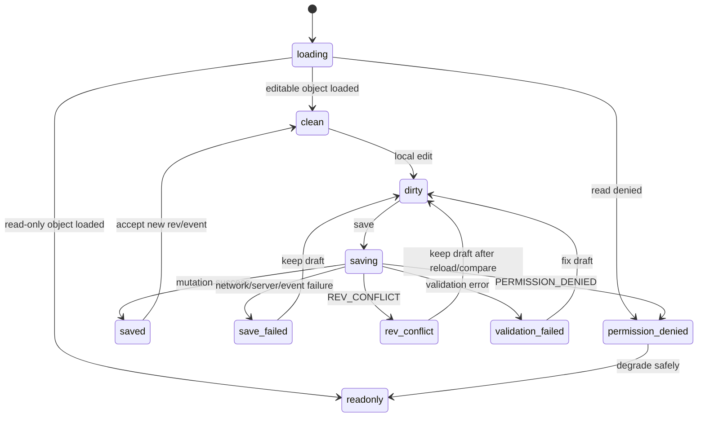
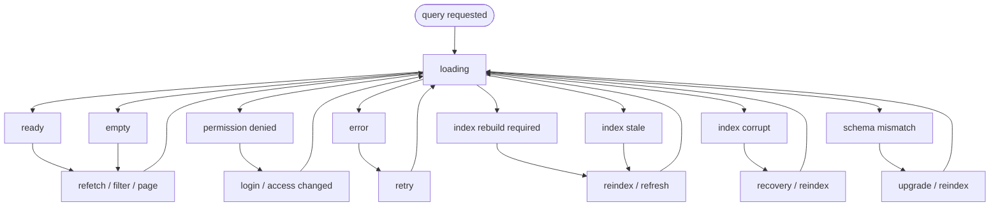
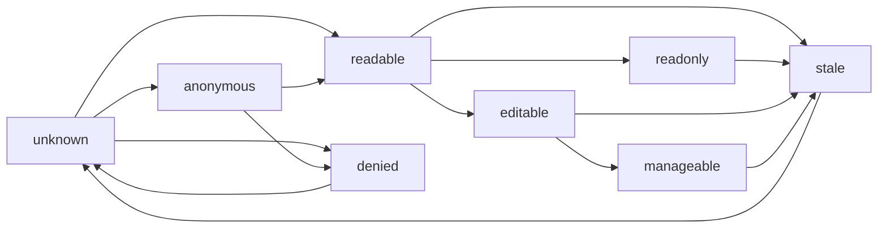
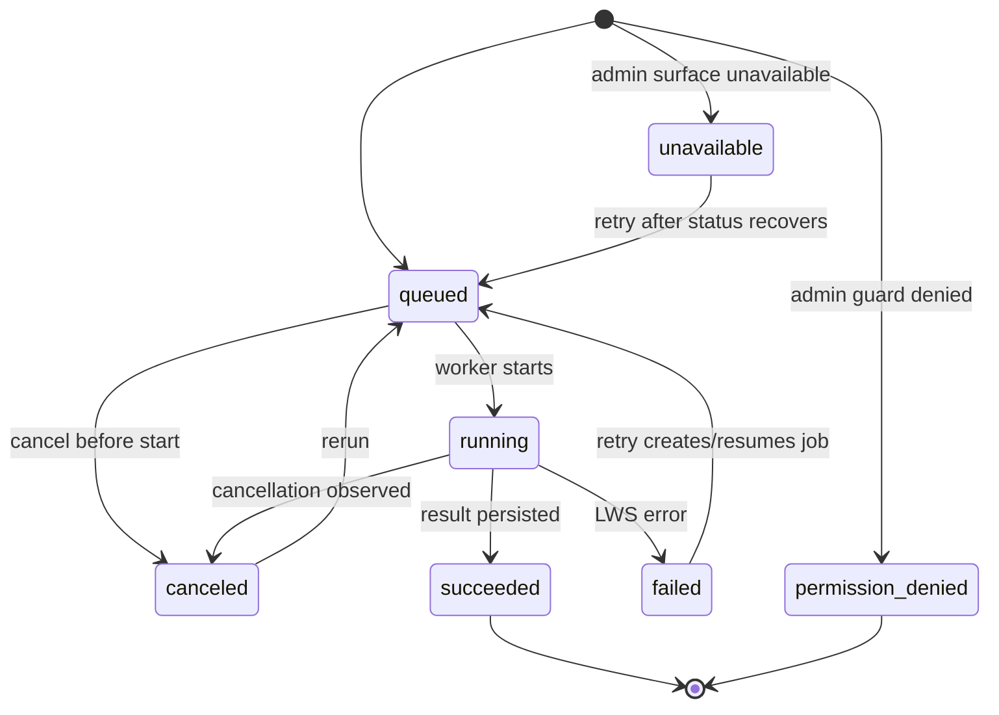
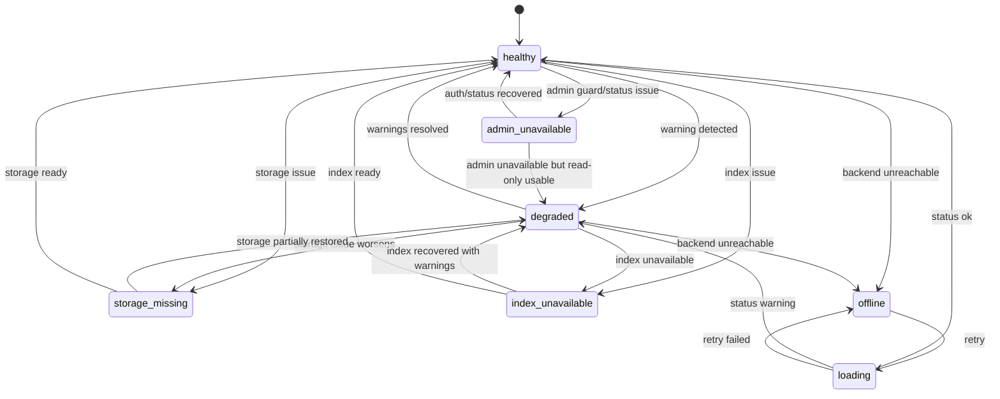

# L.W.S. Frontend Design

> Ontology status (2026-08-06): 현재 Timeline UI의 Scope/Collection filter는 legacy API
> surface다. Canonical `group` filter와 URL dual-read는
> [Group Ontology Migration Plan](./plans/LWS_GROUP_ONTOLOGY_MIGRATION_PLAN.md)의 후속 단계이며
> 이번 문서 정리에서 UI/API를 변경하지 않는다.

## Timeline Inspector and Coverage Drawer (2026-08-05)

Timeline has one right sidebar with `closed`, `selection`, and `coverage` modes. Node/Edge selection opens an inspector; Edge detail is fetched only when the Edge is selected. Coverage opens the same drawer and fetches its object list only when a non-zero state tab is opened. The initial Timeline response carries coverage counts only.

The client caches coverage pages by normalized Timeline query, state, and index revision. Filter, time basis, center, admin context, refresh, or revision changes invalidate the cache and selection. Search filters use a draft combobox: debounced search does not update the Timeline; selecting a candidate or pressing Apply performs the single URL/API update. Dates similarly remain drafts until valid ISO input is committed.

작성일: 2026-07-31

## 1. Purpose

L.W.S. frontend는 Listro Wiki System의 node/edge 기반 knowledge graph를 실제로 탐색하고 편집하기 위한 technical workbench다.

현재 backend는 M7 Backend V1 Completion Gate를 통과한 상태다. 따라서 frontend의 다음 목표는 mock demo가 아니라, backend v1 API를 얇게 연결해 단일 사용자 또는 소규모 trusted operator가 실제 node 기반 wiki 체계를 시험 운용할 수 있게 하는 것이다.

Frontend는 storage root, event log, SQLite file, backup path를 직접 읽거나 쓰지 않는다. 모든 작업은 `/api/lws/*` route를 통과해야 한다.

초기 frontend의 역할:

```text
browse objects
search nodes and edges
read object detail
create and edit node
create and edit edge
inspect relation graph
inspect timeline
inspect ontology
view history and diff
restore from history
run validation/reindex/backup/recovery jobs
observe permission and index status
```

초기 목표는 완성형 public wiki가 아니다. Backend v1의 source of truth, projection, permission, mutation, admin recovery contract가 실제 지식 작업에서 쓸 만한지 검증하는 alpha workbench다.

## 2. Product Posture

```text
Product:
  L.W.S. - Listro Wiki System

Primary user:
  single technical operator
  small trusted local team

Mode:
  alpha workbench
  backend-integrated wiki operator console
  graph-first structured knowledge editor

Mood:
  quiet
  dense
  durable
  inspectable
  professional

Not:
  marketing landing page
  public blog
  casual note app
  decorative graph toy
  production SaaS admin console
```

Frontend는 Notion보다 구조적이고, Obsidian graph보다 조작 가능한 객체 모델을 드러내며, 일반 admin dashboard보다 wiki editing에 가까워야 한다.

## 3. Current Backend Baseline

Frontend는 다음 backend v1 contract를 전제로 한다.

| Area | Frontend assumption |
| --- | --- |
| Source of truth | node/edge JSON과 event/patch/history가 canonical state다. |
| Read model | SQLite projection은 list/search/graph/timeline/history/permission query용 generated read model이다. |
| API boundary | Frontend는 `/api/lws/*` API만 호출한다. |
| Permission | anonymous는 public read만 가능하고, private/write/admin은 fail-closed다. |
| Mutation | create/update/restore는 base rev와 durable event/history 기록 이후 성공한다. |
| Recovery | validation, reindex, backup, recovery는 admin job envelope로 다룬다. |
| Error | API error는 `error.code`, `error.message`, optional `error.details` shape를 따른다. |

Frontend는 backend guard를 우회하지 않는다. `viewer_permissions`, `ui_capabilities`, `default_scope`는 UI affordance hint일 뿐, 실제 허용 여부는 service layer가 최종 판단한다.

## 4. Initial Operating Mode

초기 frontend는 다음 운영 모드를 기준으로 한다.

```text
environment:
  local development or trusted private deployment

auth:
  anonymous public read
  local-admin secret for mutation/admin actions in non-production

data:
  real backend API first
  mock data only for isolated component development

scope:
  backend v1 operation
  no production-grade auth UI
  no real-time collaboration
  no visual merge editor
```

Production-grade login/session/token verification은 frontend 초기 범위가 아니다. Production 환경에서는 local-admin shortcut이 막히므로, production 운영 UI는 별도 auth milestone 이후에 다룬다.

## 5. Route Structure

권장 App Router 구조:

```text
src/app/
  layout.tsx
  page.tsx
  objects/
    page.tsx
    [id]/page.tsx
  graph/
    page.tsx
  timeline/
    page.tsx
  ontology/
    page.tsx
  admin/
    page.tsx
    validation/page.tsx
    indexing/page.tsx
    jobs/page.tsx
    backup/page.tsx
```

초기에는 `/`를 landing page로 만들지 않는다. 첫 화면은 바로 workbench dashboard여야 한다.

`src/app/page.tsx`는 다음 역할을 한다.

```text
home dashboard
recent objects
search entry
system/index status
validation warnings
admin job summary
quick create node/edge
```

## 6. App Shell

모든 주요 화면은 같은 shell을 공유한다.

```text
Left navigation:
  Dashboard
  Objects
  Graph
  Timeline
  Ontology
  Admin

Top command bar:
  global search input
  create node button
  create edge button
  index status indicator
  validation status indicator
  session/admin mode indicator

Main work area:
  route-specific editor, table, graph, timeline, or admin panel

Right inspector:
  selected object summary
  backlinks/outgoing edges
  validation warnings
  viewer permission hints
  recent history
  quick actions
```

Desktop-first로 시작한다. 작은 화면에서는 left navigation과 right inspector를 collapsible panel로 전환한다.

UI는 마케팅 설명보다 실제 객체와 조작을 우선한다. “기능 설명 카드”를 많이 두기보다 object list, editor, status, warnings, actions가 바로 보여야 한다.

## 7. Visual System

기본 방향:

```text
theme:
  dark or neutral system theme first

layout:
  dense but readable
  three-pane workbench
  stable table and panel dimensions

surface:
  restrained borders
  low elevation
  no nested cards
  no decorative orbs or hero sections

accent:
  selected object
  active relation
  warnings/errors
  permission state

typography:
  compact panel headings
  readable table rows
  no hero-scale text inside tools
```

Status colors:

```text
public
private
draft
stub
active
archived
deleted
warning
error
index stale
permission denied
```

UI controls:

```text
icon buttons for common actions
segmented controls for mode
toggles for booleans
menus for type/relation/status choices
tabs for object detail sections
tables for object lists
drawers/modals for focused edits
tooltips for icon-only controls
```

Frontend UI implementation standard:

```text
foundation:
  Radix primitives + lucide-react + L.W.S.-owned CSS design system

use Radix primitives for:
  dialog
  tabs
  tooltip
  dropdown menu
  select
  switch
  popover
  other accessibility-sensitive interaction primitives when needed

use lucide-react for:
  navigation icons
  icon-only action buttons
  status/action affordances
  editor/admin toolbar controls

use L.W.S.-owned CSS for:
  workbench shell
  dense tables
  panels
  inspector
  status badges
  form layout
  graph/timeline/admin surfaces
  visual density, color, spacing, borders, and responsive behavior
```

The frontend should prefer headless accessibility primitives over a fully styled UI kit. L.W.S. must keep its own quiet, dense, inspectable operator-console visual language instead of inheriting a generic SaaS/admin theme.

Dependency posture:

```text
allowed initial UI dependencies:
  lucide-react
  focused @radix-ui/react-* primitive packages

defer by default:
  full styled UI kits
  broad component frameworks
  Tailwind/shadcn-style adoption unless a later frontend milestone explicitly chooses it
```

Radix usage should be introduced through small local wrapper components where repetition appears. Styling must remain local to the L.W.S. design system so future UX polish can evolve without replacing the interaction primitives.

## 8. Data Access Layer

Frontend는 API client layer를 둔다.

권장 위치:

```text
src/lib/lws-api/
  client.ts
  errors.ts
  objects.ts
  nodes.ts
  edges.ts
  graph.ts
  timeline.ts
  ontology.ts
  admin.ts
  types.ts
```

API client 책임:

```text
build request
parse success body
normalize LWS error response
expose typed methods
avoid direct storage access
avoid duplicated route parsing rules
```

API client는 `LwsErrorResponse`를 UI가 다루기 쉬운 형태로 변환한다.

```ts
type LwsApiError = {
  code: string
  message: string
  details?: Record<string, unknown>
  status: number
}
```

초기에는 SWR/React Query 같은 외부 cache library 없이 시작해도 된다. 다만 object list, object detail, graph, admin job polling은 나중에 query cache로 분리하기 쉽도록 API client를 먼저 둔다.

## 9. Core Screens

### 9.1 Dashboard

목적:

```text
현재 wiki와 backend 상태를 한 화면에서 파악한다.
```

필수 영역:

```text
recent nodes
recent edges
recent history
index status
validation issue summary
admin job summary
quick create node
quick create edge
```

초기 API:

```text
GET /api/lws/status
GET /api/lws/objects?limit=...
GET /api/lws/timeline?limit=...
GET /api/lws/admin/jobs
```

Admin API는 local-admin context가 없으면 permission denied가 날 수 있다. UI는 이를 정상 상태로 처리하고 public/read-only dashboard로 degrade한다.

### 9.2 Object Explorer

목적:

```text
node와 edge를 하나의 object list에서 검색하고 필터링한다.
```

필수 기능:

```text
combined object table
search input
kind filter
type filter
tag filter
visibility filter
status filter
include permission hints toggle
open selected object
quick create node/edge
```

주요 columns:

```text
kind
title
id
type
tags
visibility
status
rev
updated_at
viewer permissions
warnings
```

초기 API:

```text
GET /api/lws/objects
GET /api/lws/search
```

Anonymous context에서는 private object가 list/search 결과에 나타나면 안 된다. UI는 결과 개수 차이를 정상적인 permission filtering으로 취급한다.

### 9.3 Object Detail

목적:

```text
node/edge 공통 metadata, history, validation, permission hint를 검사한다.
```

공통 tabs:

```text
Overview
Edit
Relations
History
Validation
Permissions
Raw JSON
```

초기 API:

```text
GET /api/lws/objects/:id
GET /api/lws/objects/:id/backlinks
GET /api/lws/objects/:id/history
GET /api/lws/objects/:id/validation
GET /api/lws/objects/:id/permissions
```

Private object 접근이 거부되면 editor shell을 유지하되 `PERMISSION_DENIED` 상태를 명확히 보여준다. 존재 여부를 과도하게 추론하게 만드는 UI 문구는 피한다.

### 9.4 Node Editor

목적:

```text
node의 title, summary, content, tags, props, temporal field를 편집한다.
```

필수 fields:

```text
title
slug
type
detail_mode
visibility
status
summary
content
tags
props
temporal
```

저장 방식:

```text
load object rev
edit local draft
generate patch
submit PATCH with base_rev
handle success new rev
handle REV_CONFLICT
handle validation error
```

초기 API:

```text
POST /api/lws/nodes
PATCH /api/lws/nodes/:id
```

Autosave는 바로 켜지 않아도 된다. 초기에는 explicit save가 더 안전하다. Autosave는 patch generation과 conflict UI가 안정된 뒤 추가한다.

### 9.5 Edge Editor

목적:

```text
edge를 first-class relationship object로 편집한다.
```

필수 fields:

```text
source
type
target
title
detail_mode
visibility
status
summary/content
tags
props
temporal
```

필수 affordance:

```text
source object search
target object search
relation type selector
create stub target
public edge boundary warning
open source
open target
open relation type
```

초기 API:

```text
POST /api/lws/edges
PATCH /api/lws/edges/:id
```

Public edge는 source와 target이 모두 public일 때만 허용된다. UI는 저장 전에 warning을 보여줄 수 있지만, 최종 차단은 backend validation/permission boundary가 담당한다.

### 9.6 Graph Explorer

목적:

```text
node/edge 관계를 탐색하고 wiki 구조의 연결성을 확인한다.
```

초기 기능:

```text
graph canvas
selected node/edge inspector
center object selector
depth selector
relation type filter
visibility/status filter
open object
create relation from selection
```

초기 API:

```text
GET /api/lws/graph
GET /api/lws/objects/:id/backlinks
```

Graph canvas는 decorative demo가 아니라 object navigation surface여야 한다. Canvas 조작이 불편한 사용자를 위해 동일 데이터를 list 형태로도 제공한다.

### 9.7 Timeline Explorer

목적:

```text
edit timeline과 knowledge timeline을 구분해 본다.
```

Modes:

```text
Edit timeline:
  object created/updated/deleted events

Knowledge timeline:
  object temporal.occurred_at / valid_from / valid_to
```

초기 API:

```text
GET /api/lws/timeline
GET /api/lws/objects/:id/history
```

Timeline item은 클릭 시 object detail 또는 event detail로 이동한다.

### 9.8 Ontology Manager

목적:

```text
type, tag, relation type을 wiki object로 관리한다.
```

초기 sections:

```text
Node types
Relation types
Tags
Built-in virtual ontology
Usage counts
Objects using selected ontology id
```

초기 API:

```text
GET /api/lws/ontology
GET /api/lws/search
POST /api/lws/nodes
PATCH /api/lws/nodes/:id
```

Relation type은 단순 enum이 아니라 materializable node로 유지한다. UI도 relation type을 “문자열 설정”이 아니라 object-like concept으로 보여줘야 한다.

### 9.9 Admin Workbench

목적:

```text
backend v1 운영 표면을 실제로 확인하고 복구한다.
```

필수 panels:

```text
Status
Validation
Index/Reindex
Jobs
Backup
Recovery
Public Boundary
Permission Projection Status
```

초기 API:

```text
GET /api/lws/status
POST /api/lws/admin/validate
POST /api/lws/admin/reindex
POST /api/lws/admin/backup
GET /api/lws/admin/jobs
GET /api/lws/admin/jobs/:jobId
POST /api/lws/admin/jobs/:jobId/cancel
GET /api/lws/admin/recovery
POST /api/lws/admin/recovery/repair
POST /api/lws/admin/check-public-boundary
POST /api/lws/admin/materialize-core-ontology
```

Admin action은 job envelope를 반환한다. UI는 job status, progress, warnings, result, audit을 표시한다.

Admin route가 `PERMISSION_DENIED`를 반환하면 UI는 “admin mode unavailable”로 표시한다. Header spoofing을 UI 기능처럼 제공하지 않는다.

## 10. State Model

### 10.1 Editor State

```text
readonly
loading
clean
dirty
saving
saved
save failed
rev conflict
validation failed
permission denied
```

각 state의 의미는 다음과 같다.

| State | Meaning | Typical UI behavior |
| --- | --- | --- |
| `readonly` | object는 표시되지만 현재 화면에서 수정할 수 없다. 권한 부족, deleted/history/diff view, public viewer 상황에서 사용한다. | editor control을 비활성화하고 read-only badge와 가능한 다음 action을 표시한다. |
| `loading` | object, permission hint, validation, history 같은 필수 데이터를 불러오는 중이다. | skeleton 또는 progress indicator를 표시하고 editing action을 잠근다. |
| `clean` | local draft가 server object와 같은 상태다. 저장되지 않은 변경이 없다. | save button을 비활성화하거나 neutral 상태로 두고 current rev를 표시한다. |
| `dirty` | 사용자가 local draft를 변경했지만 아직 server에 저장하지 않았다. | save button을 활성화하고 navigation guard/autosave candidate 상태로 표시한다. |
| `saving` | mutation request가 진행 중이다. | 중복 저장을 막고 draft를 유지한 채 save progress를 표시한다. |
| `saved` | mutation이 성공했고 server가 새 object/rev/event id를 반환했다. | success feedback을 짧게 표시한 뒤 `clean`으로 전환한다. |
| `save failed` | network/server/durable mutation failure 등으로 저장이 실패했다. | local draft를 보존하고 retry/cancel/reload 선택지를 제공한다. |
| `rev conflict` | local `base_rev`와 server current rev가 달라 mutation이 거부되었다. | 최신 object reload, compare, local draft 보존, cancel 선택지를 제공한다. |
| `validation failed` | schema/semantic/public-boundary validation이 실패했다. | field-level issue와 object-level warning을 표시하고 draft를 보존한다. |
| `permission denied` | read/update/admin 권한이 없거나 projection state 때문에 fail-closed 되었다. | private detail을 추가로 노출하지 않고 login/request access/readonly fallback을 표시한다. |

권장 전환 흐름:

```text
loading -> clean
loading -> readonly
loading -> permission denied

clean -> dirty
dirty -> saving
saving -> saved -> clean

saving -> save failed
saving -> rev conflict
saving -> validation failed
saving -> permission denied
```



`dirty`, `save failed`, `rev conflict`, `validation failed` 상태에서는 local draft를 버리지 않는다. 사용자가 명시적으로 reload, discard, restore, close를 선택하기 전까지 draft를 보존한다.

`saved`는 영구 상태가 아니라 transient feedback state다. UI는 새 `rev`와 `event_id`를 받은 뒤 server object를 local baseline으로 교체하고 `clean`으로 돌아간다.

초기 저장은 explicit save를 기본으로 한다.

Autosave는 다음 조건이 갖춰진 뒤 켠다.

```text
stable patch generation
clear dirty state
rev conflict handling
draft preservation
error recovery
```

### 10.2 Query State

```text
loading
ready
empty
permission denied
index rebuild required
index stale
index corrupt
schema mismatch
error
```

각 state의 의미는 다음과 같다.

| State | Meaning | Typical UI behavior |
| --- | --- | --- |
| `loading` | list/search/graph/timeline/ontology query가 진행 중이다. | table/list/canvas skeleton을 표시하고 이전 결과가 있으면 stale overlay 없이 유지할지 화면별로 결정한다. |
| `ready` | query가 성공했고 표시할 result가 있다. | result count, filters, pagination cursor, permission-aware result를 표시한다. |
| `empty` | query는 성공했지만 표시할 result가 없다. | empty state를 표시하되 private object가 filtering 되었을 가능성을 과도하게 암시하지 않는다. |
| `permission denied` | query endpoint 또는 requested scope에 접근할 권한이 없다. | login/request access/read-only fallback을 표시하고 private result detail을 노출하지 않는다. |
| `index rebuild required` | SQLite projection이 없거나 아직 만들어지지 않았다. | admin capability가 있으면 reindex action을 보여주고, 없으면 read model unavailable 상태로 표시한다. |
| `index stale` | projection이 source of truth보다 뒤처졌을 수 있다. | stale warning, stale reason, refresh/reindex action을 표시한다. |
| `index corrupt` | SQLite projection을 열거나 읽을 수 없다. | recovery/reindex guidance를 표시하고 raw SQLite error를 노출하지 않는다. |
| `schema mismatch` | backend가 기대하는 index schema version과 현재 DB schema가 다르다. | manual upgrade/reindex guidance를 표시하고 일반 query result를 숨긴다. |
| `error` | 위 state로 분류되지 않는 query/network/server error다. | retry action과 technical detail disclosure를 제공한다. |

권장 전환 흐름:

```text
loading -> ready
loading -> empty
loading -> permission denied
loading -> index rebuild required
loading -> index stale
loading -> index corrupt
loading -> schema mismatch
loading -> error

index rebuild required -> loading
index stale -> loading
index corrupt -> loading
schema mismatch -> loading
```



`INDEX_REBUILD_REQUIRED`, `INDEX_STALE`, `INDEX_CORRUPT`, `INDEX_SCHEMA_MISMATCH`는 단순 toast가 아니라 user action으로 이어져야 한다.

예:

```text
INDEX_REBUILD_REQUIRED -> show Reindex action
INDEX_STALE -> show stale reason and Reindex action
INDEX_CORRUPT -> show Recovery/Reindex action
INDEX_SCHEMA_MISMATCH -> show manual upgrade/reindex guidance
```

### 10.3 Permission Hint State

`viewer_permissions`는 guard가 아니라 hint다.

Permission hint는 action affordance를 조정하기 위한 상태로만 사용한다. Backend authorization은 매 요청마다 service layer에서 다시 판단한다.

권장 permission hint state:

```text
unknown
anonymous
readable
readonly
editable
manageable
denied
stale
```

각 state의 의미는 다음과 같다.

| State | Meaning | Typical UI behavior |
| --- | --- | --- |
| `unknown` | session 또는 `viewer_permissions`를 아직 받지 못했다. | destructive/edit action을 잠그고 loading affordance를 표시한다. |
| `anonymous` | 로그인되지 않은 viewer다. | public read만 기대하고 login action을 표시한다. |
| `readable` | object를 볼 수 있다. update/manage 가능 여부는 아직 별도다. | detail, metadata, backlinks/history entry point를 표시한다. |
| `readonly` | read는 가능하지만 update/delete/restore는 불가능하다. | editor control을 비활성화하고 read-only badge를 표시한다. |
| `editable` | update/delete/restore 같은 write action을 시도할 수 있다. | editor controls와 save action을 활성화한다. |
| `manageable` | permission/admin-like access action을 시도할 수 있다. | permission panel, access management entry point를 표시한다. |
| `denied` | backend가 `PERMISSION_DENIED`를 반환했거나 hint상 read가 불가능하다. | object detail을 숨기고 denied state를 표시한다. |
| `stale` | permission projection 또는 session state가 불확실하다. | private action을 잠그고 refresh/reload/reindex guidance를 표시한다. |

Permission hint source:

```text
GET /api/lws/session
GET /api/lws/objects/:id
GET /api/lws/objects/:id/permissions
list/search include_permissions=true
```

Permission hint는 하나의 strict lifecycle이라기보다 session, object visibility, permission projection 결과에서 파생되는 UI capability graph다.



UI에서 허용:

```text
disable unavailable edit buttons
show read/update/manage/create hints
explain why an action may be unavailable
```

UI에서 금지:

```text
assuming hint is authorization
showing private object data after denied response
trusting frontend-supplied account/capability headers
```

### 10.4 Admin Job State

Admin APIs return job envelopes. UI는 job envelope의 lifecycle state를 그대로 표현한다.

```text
queued
running
succeeded
failed
canceled
permission denied
unavailable
```

각 state의 의미는 다음과 같다.

| State | Meaning | Typical UI behavior |
| --- | --- | --- |
| `queued` | job envelope가 생성되었지만 아직 work가 시작되지 않았다. | queued badge와 cancel action을 표시한다. |
| `running` | job work가 진행 중이다. | progress phase/current/total/message를 표시하고 가능한 경우 cancel action을 제공한다. |
| `succeeded` | job이 정상 완료되었고 result가 있다. | result summary, warnings, follow-up action을 표시한다. |
| `failed` | job이 실패했고 LWS error code/message가 있다. | error summary, retry action, technical detail disclosure를 표시한다. |
| `canceled` | user 또는 system이 job을 중단했다. | canceled badge와 재실행 action을 표시한다. |
| `permission denied` | admin route 또는 job 조회/cancel 권한이 없다. | admin mode unavailable 상태로 표시하고 spoofing control을 제공하지 않는다. |
| `unavailable` | admin backend, index, recovery surface가 준비되지 않았거나 network error가 있다. | retry와 status check action을 표시한다. |

권장 전환 흐름:

```text
queued -> running
queued -> canceled
running -> succeeded
running -> failed
running -> canceled
```



`client_job_id` idempotency 때문에 같은 action을 다시 눌렀을 때 새 job이 아니라 기존 job envelope가 돌아올 수 있다. UI는 이를 duplicate submit failure가 아니라 existing job resume으로 처리한다.

### 10.5 Global Status State

App shell과 dashboard는 backend 상태를 별도의 global status로 추적한다.

```text
healthy
degraded
storage missing
index unavailable
admin unavailable
offline
```

각 state의 의미는 다음과 같다.

| State | Meaning | Typical UI behavior |
| --- | --- | --- |
| `healthy` | health/status API가 성공했고 storage/index 상태가 정상이다. | normal navigation과 primary actions를 표시한다. |
| `degraded` | 일부 warning이 있지만 public/read-only 탐색은 가능하다. | banner를 표시하고 affected action만 제한한다. |
| `storage missing` | configured storage root 또는 required directory가 준비되지 않았다. | setup/admin guidance를 표시하고 mutation을 잠근다. |
| `index unavailable` | read model query가 불가능하다. | list/search/graph/timeline을 index state UI로 degrade한다. |
| `admin unavailable` | current context에서 admin jobs를 사용할 수 없다. | admin panels를 read-only 또는 hidden 상태로 둔다. |
| `offline` | frontend가 backend에 연결할 수 없다. | retry, last loaded data, offline warning을 표시한다. |

Global status는 object-level editor state를 대체하지 않는다. 예를 들어 app이 `degraded`여도 이미 로드된 public object detail은 `readonly` 또는 `clean`일 수 있다.



## 11. Mutation Flow

### 11.1 Create Node

```text
open create node dialog
enter title/type/visibility/detail_mode
optional summary/tags/props
submit POST /api/lws/nodes
on success open object detail
on validation error show field-level issues where possible
```

### 11.2 Create Edge

```text
select source
select relation type
select or create target stub
choose visibility/detail_mode
preview public boundary warning
submit POST /api/lws/edges
on success open edge detail
```

### 11.3 Update Object

```text
load object
keep base_rev
edit draft
generate JSON Patch
submit PATCH
on success replace local object and rev
on REV_CONFLICT show reload/compare/cancel options
```

### 11.4 Restore

```text
open history tab
select event
open diff
choose restore
submit source_event_id and base_rev
on success open restored rev
```

Restore must only use event ids returned by backend history APIs. UI must not allow arbitrary patch path input.

## 12. Error UX

Frontend should map common LWS error codes to stable UI states.

| Code | UI behavior |
| --- | --- |
| `SCHEMA_INVALID` | Show request/field validation error. |
| `PERMISSION_DENIED` | Show read-only or denied state without leaking private detail. |
| `REV_CONFLICT` | Show conflict resolution choices. |
| `PATCH_INVALID` | Show patch generation failure and keep local draft. |
| `EVENT_APPEND_FAILED` | Show mutation failed, advise validation/recovery check. |
| `INDEX_REBUILD_REQUIRED` | Show reindex action if admin mode is available. |
| `INDEX_STALE` | Show stale warning and reindex/recovery action. |
| `INDEX_CORRUPT` | Show recovery guidance. |
| `INDEX_SCHEMA_MISMATCH` | Show manual upgrade/reindex guidance. |

Raw stack traces must not appear in UI. `error.details` may be shown in an expandable technical detail panel.

## 13. Accessibility Requirements

Minimum requirements:

```text
semantic landmarks
keyboard navigable navigation
keyboard navigable object table
visible focus state
dialog focus trap
escape closes modal/drawer
aria labels for icon-only buttons
labels connected to form fields
errors connected to fields
status changes announced where appropriate
color is never the only state signal
```

Graph canvas does not need full keyboard graph editing in v1 frontend. It must provide an accessible object/edge list alternative and inspector controls.

## 14. Mock Data Policy

Mock data is allowed only for isolated UI development.

Allowed:

```text
small inline component examples
storybook-like local fixtures if introduced later
read-only sample objects for layout work
```

Not allowed:

```text
frontend writing live storage files
frontend importing backend storage modules
repo-internal private knowledge fixture as real content
mock auth treated as production security
```

Once API integration begins, primary screens should use real `/api/lws/*` responses.

## 15. Frontend Implementation Milestones

### F1 - Backend-Integrated Read Workbench

```text
AppShell
Dashboard
Object Explorer
Object Detail readonly
Search
Graph readonly
Timeline readonly
Status indicators
LWS API client
LWS error state mapping
```

Exit criteria:

```text
can browse real node/edge objects
can search public/visible objects
can inspect graph/timeline/ontology
private data is not leaked in anonymous mode
index missing/stale states render useful UI
```

### F2 - Node/Edge Editing

```text
Create node
Create edge
Patch node
Patch edge
Explicit save
Validation errors
Rev conflict state
Relation editor
Stub target creation
```

Exit criteria:

```text
can create and update real node/edge objects
can create relation edges between objects
can handle validation and permission errors
can preserve local draft on failed save
```

### F3 - History, Diff, Restore

```text
History tab
Event detail
Diff view
Restore action
Recovery hint on mutation failure
```

Exit criteria:

```text
can inspect object history
can view diff for a selected event
can restore from a backend-returned event id
```

### F4 - Admin Operations

```text
Admin dashboard
Validation job
Reindex job
Backup job
Recovery report
Job list/detail/cancel
Public boundary check
```

Exit criteria:

```text
can run guarded admin jobs in local-admin mode
can observe progress/result/audit
can recover missing/corrupt/stale index states through reindex path
```

### F5 - Workbench Hardening

```text
layout polish
keyboard coverage
error detail panels
loading/empty states
basic HTTP smoke tests
route-level frontend integration tests
```

Exit criteria:

```text
thin workbench is usable for real local alpha operation
major user flows survive refresh and failed requests
```

## 16. Frontend Non-Goals For Initial Workbench

```text
marketing landing page
public publishing UI
production login/session/token UI
OAuth/passkey/password auth
real-time collaboration
CRDT/OT merge
visual diff merge editor
drag-to-connect graph editing
advanced graph algorithms
advanced FTS/vector search UI
backup retention/encryption/remote copy UI
observability dashboard beyond admin job/status panels
permission administration UI beyond readonly hints
```

These items are not rejected. They are deferred so the first frontend can validate the backend v1 node-based wiki model without mixing in product-scale UX and production security work.

## 17. First Usable Slice

The first useful frontend slice should be deliberately small.

```text
0. UI foundation with Radix primitives, lucide-react, and L.W.S.-owned CSS
1. LWS API client
2. App shell
3. Object list/search
4. Object detail readonly
5. Node create/edit with explicit save
6. Edge create/edit with explicit save
7. Graph readonly view
8. Admin status/reindex/validate
```

If this slice feels useful with real data, L.W.S. is ready to move from backend v1 completion into frontend alpha operation.

## Timeline Time Basis Extension (2026-08-05)

`/timeline`은 Created를 기본값으로 사용하고 Last updated, Occurred, Valid interval, Custom props를 선택할 수 있다. Custom props는 `/props/...` JSON Pointer draft를 입력한 뒤 Apply할 때만 URL과 API query를 갱신한다.

Summary는 selected basis의 dated/undated와 Custom의 declared/missing/invalid coverage를 구분한다. Last updated는 현재 revision의 최신 시각이며 전체 mutation sequence가 아니라는 안내를 표시한다. Scene은 source field와 무관하게 Backend `position` contract만 렌더링한다.
