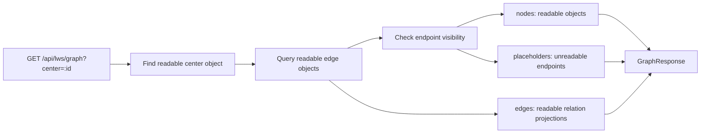

# L.W.S. Graph Read Policy 구현 보고서

작성일: 2026-08-02

## 1. 목표

`docs/LWS_GRAPH_READ_POLICY.md`의 graph read 정책을 backend와 frontend에 적용했다.

핵심 목표:

```text
center object가 readable이면 graph에 center를 포함한다.
readable edge는 endpoint 일부가 unreadable이어도 relation으로 포함한다.
unreadable endpoint detail은 노출하지 않고 placeholder로 표현한다.
```

## 2. Backend 변경

수정 파일:

```text
src/services/graph-service.ts
src/lib/lws-api/types.ts
```

구현 내용:

- `GraphResponse`에 `placeholders` field를 추가했다.
- `GraphService.getGraph()`가 center object를 먼저 visible/readable 기준으로 확인한다.
- center가 unreadable이면 `nodes=[]`, `edges=[]`, `placeholders=[]`를 반환한다.
- center가 readable이면 readable edge가 없어도 center object를 `nodes`에 포함한다.
- edge query는 edge object visibility를 기준으로 수행한다.
- endpoint visibility는 edge visibility와 분리해서 별도 판단한다.
- readable endpoint는 `nodes`에 포함한다.
- unreadable endpoint는 `placeholders`에 `{ id, kind: "unreadable_endpoint" }`로 포함한다.

Backend flow:



## 3. Frontend 변경

수정 파일:

```text
src/components/relationship-flow.tsx
src/app/page.tsx
src/app/graph/page.tsx
src/app/globals.css
```

구현 내용:

- React Flow graph가 `placeholders`를 endpoint node처럼 배치한다.
- placeholder node는 `Unreadable endpoint`로 표시하고 endpoint id만 보여준다.
- placeholder node double click은 object detail 이동을 수행하지 않는다.
- Relation Detail에서 unreadable endpoint는 disabled placeholder button으로 표시한다.
- 오른쪽 `Related Objects`에서도 unreadable endpoint는 클릭 불가 placeholder row로 표시한다.
- `/graph` route는 placeholder count를 요약하고 edge list에서도 placeholder endpoint를 구분한다.
- relation이 없어도 center node가 있으면 empty state로 빠지지 않고 단일 node graph를 표시한다.

Frontend rendering rule:

```text
nodes[] -> readable object node
placeholders[] -> unreadable endpoint placeholder
edges[] -> readable relation line
```

## 4. 검증

실행한 명령:

```powershell
npm.cmd run test:sprint-d
npm.cmd run test:milestone-m6
npm.cmd run test:frontend-foundation
npm.cmd run build
```

검증 결과:

- `test:sprint-d` 통과
- `test:milestone-m6` 통과
- `test:frontend-foundation` 통과
- `next build` 통과

추가한 주요 회귀:

```text
public center node + private edge only -> center node remains, edge omitted
readable edge + unreadable endpoint -> edge included, endpoint placeholder included
center edge readable + unreadable target -> edge object/readable endpoint included, unreadable endpoint placeholder included
private edge center in anonymous context -> private edge not exposed
```

Build note:

- 기존 Turbopack NFT trace warning은 계속 남아 있다.
- warning trace는 `next.config.ts -> storage-doctor.ts -> status-service.ts -> /api/lws/status/route.ts` 경로이며, 이번 graph policy 변경과 직접 관련 없다.

## 5. 남은 범위

- placeholder를 포함한 graph API contract를 backend design 문서의 read model API section에 반영할지 결정한다.
- large graph에서 placeholder가 많을 때 grouping/filtering이 필요한지 검토한다.
- placeholder 접근성 label과 keyboard navigation을 Playwright/browser smoke test로 검증한다.

