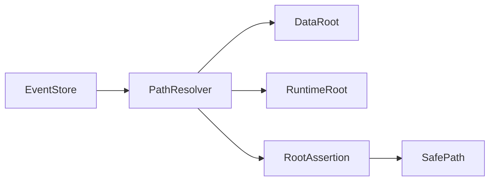
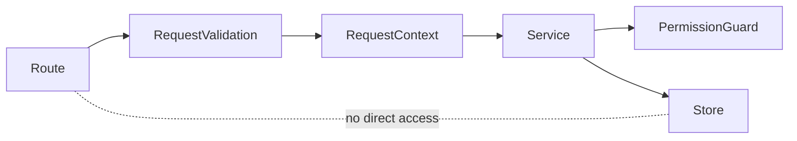

# L.W.S. M1 Safety Boundary Implementation Report

작성일: 2026-07-30

## 1. 목표

M1 Safety Boundary Closure는 path safety와 API read boundary의 high-risk 항목을 닫기 위한 안정화 작업이다.

이번 구현은 기존 guard를 유지하는 데서 멈추지 않고, EventStore 경로 처리를 `PathResolver`로 일원화하고 App Route가 raw store를 직접 볼 수 없는 route-safe backend surface를 분리했다.

## 2. 구현 요약

| ID | 구현 내용 | 완료 상태 |
| --- | --- | --- |
| BE-M1-01 | `event.*` id safe validator를 유지하고 slash, backslash, traversal, drive/UNC, invalid pattern 회귀 테스트를 추가했다. | Complete |
| BE-M1-02 | EventStore의 event log, object history, patch, head, journal, event_ref 경로 해석을 `PathResolver` helper로 이동했다. | Complete |
| BE-M1-03 | restore/history route는 shared route validation helper로 normalize하고 service/EventStore에서 event id를 재검증한다. | Complete |
| BE-M1-04 | validation route는 `ObjectService.validateObject()`를 통해 `assertCanRead` permission guard를 통과한다. | Complete |
| BE-M1-05 | `createLwsBackend()`를 route-safe surface로 제한해 route가 raw store를 직접 받을 수 없게 했다. | Complete |
| BE-M1-06 | query services는 `IndexStore.openReady()`를 통해 SQLite missing/corrupt/schema mismatch/stale 상태를 LWS error로 반환한다. | Complete |

## 3. Path Safety Flow



EventStore는 더 이상 data/runtime root relative path를 직접 최종 absolute path로 확정하지 않는다. `PathResolver`가 root kind, relative path, access mode를 포함한 `SafePath`를 만들고, root escape와 symlink escape를 기존 `assertInsideRoot` 정책으로 차단한다.

EventStore가 사용하는 주요 경로는 다음과 같다.

- global event log: `data/events/YYYY/MM/DD.jsonl`
- object history: `data/history/{nodes,edges}/{safe_object_id}/events.jsonl`
- patch record: `data/history/{nodes,edges}/{safe_object_id}/patches/{event_id}.json`
- history head: `data/history/{nodes,edges}/{safe_object_id}/head.json`
- mutation journal: `runtime/mutations/{pending,failed,committed}/{event_id}.json`

`eventId`는 `assertSafeEventId()`로 검증하고, event log date는 `occurred_at`의 `YYYY-MM-DD` prefix가 안전한 형식일 때만 사용한다.

## 4. Route Boundary Flow



`createLwsInternalBackend()`는 service 조립과 테스트를 위해 store를 포함한다. 반면 App Route가 사용하는 `createLwsBackend()`는 route-safe surface만 반환한다.

Route-safe surface에는 아래 항목이 노출되지 않는다.

- `objectStore`
- `eventStore`
- `indexStore`
- `jobService`
- `permissionService`
- `pathResolver`

따라서 route는 request parsing, request context 생성, service 호출, LWS error mapping만 수행하고, permission guard나 index status guard를 우회하는 raw persistence access를 직접 사용할 수 없다.

## 5. 검증 결과

아래 명령을 통과했다.

```powershell
npm.cmd run test:sprint-a
npm.cmd run test:sprint-b
npm.cmd run test:sprint-c
npm.cmd run test:sprint-d
npm.cmd run test:sprint-e
npm.cmd run test:sprint-f
npm.cmd run test:sprint-g
npm.cmd run test:milestone-m1
npm.cmd run test:milestone-m2
npm.cmd run test:milestone-m3
npm.cmd run test:milestone-m4
npm.cmd run test:milestone-m5
npm.cmd run test:milestone-m6
npm.cmd run build
```

`npm.cmd run build`는 성공했다. 기존과 동일하게 Turbopack NFT tracing warning 1건은 남아 있으며, M1 실패 조건은 아니다.

## 6. M2로 넘기는 범위

M1에서는 경로와 route boundary를 닫고, mutation commit/recovery 의미론은 바꾸지 않았다.

M2에서 이어서 다룰 항목은 다음과 같다.

- commit step idempotency의 추가 강화
- partial failure recovery의 빠진 단계만 복구하는 동작 검토
- object/event hash consistency validation 보강
- recovery report의 manual repair 분류 정교화
