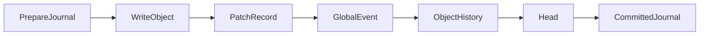
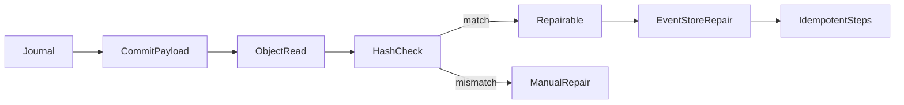

# L.W.S. M2 Durable Mutation And Idempotent Recovery Implementation Report

작성일: 2026-07-30

## 1. 목표

M2는 mutation 성공 응답의 의미를 "object JSON과 event/history durable record가 모두 기록된 상태"로 확정하고, partial failure 이후 recovery가 중복 없이 빠진 기록만 완성하도록 강화한다.

이번 구현은 기존 EventStore의 idempotent commit primitive를 유지하면서, `MutationRecoveryService`를 추가해 recovery preflight, repair/manual 분류, admin recovery report를 보강했다.

## 2. 구현 요약

| ID | 구현 내용 | 완료 상태 |
| --- | --- | --- |
| BE-M2-01 | journal step state를 recovery report의 completed/failed/missing step으로 노출한다. | Complete |
| BE-M2-02 | patch/global event/object history/head 기록은 `event_id` 기준으로 existing record를 감지하고 중복 append를 방지한다. | Complete |
| BE-M2-03 | `patch_write`, `global_event_append`, `history_append`, `head_write` failure injection과 repair 회귀를 모두 검증한다. | Complete |
| BE-M2-04 | `MutationRecoveryService`가 pending/failed journal을 repairable/manual로 분류하고 안전한 항목만 repair한다. | Complete |
| BE-M2-05 | JSON file write는 temp file fsync 후 rename, JSONL append는 append fsync 후 directory fsync를 시도한다. | Complete |
| BE-M2-06 | current object hash와 journal `after_hash`, history head hash/rev mismatch를 status/admin validation/recovery report에서 감지한다. | Complete |

## 3. Mutation Commit Flow



각 단계는 journal step state를 갱신한다. 중간 실패가 발생하면 mutation API는 `EVENT_APPEND_FAILED`를 반환하고, pending journal은 failed journal로 이동한다. 성공 응답은 `head.json`까지 durable record가 완료된 후에만 반환된다.

## 4. Recovery Classification Flow



`MutationRecoveryService`는 자동 repair 전에 source object를 읽고 current hash가 journal commit의 `after_hash`와 일치하는지 확인한다. object가 없거나 hash가 다르면 자동 repair를 수행하지 않고 manual repair로 분류한다.

manual repair reason은 다음 값을 사용한다.

- `COMMIT_PAYLOAD_MISSING`
- `OBJECT_MISSING`
- `OBJECT_HASH_MISMATCH`
- `COMMIT_STEP_CONFLICT`

## 5. Durable Write Policy

M2 기준 durable write baseline은 다음과 같다.

- JSON record write: 같은 directory 안 temp file write, file fsync, atomic rename, directory fsync 시도
- JSONL append: append write, file fsync, directory fsync 시도
- directory fsync는 플랫폼별 제약이 있으므로 실패해도 file fsync를 durable baseline으로 유지한다.
- recovery는 existing patch/event/history/head를 `event_id`로 감지하고, 동일 record면 skip, 다른 record면 conflict로 manual repair 처리한다.

## 6. 검증 결과

아래 명령을 통과했다.

```powershell
npm.cmd run test:sprint-a
npm.cmd run test:sprint-b
npm.cmd run test:sprint-c
npm.cmd run test:sprint-d
npm.cmd run test:sprint-e
npm.cmd run test:sprint-f
npm.cmd run test:sprint-g
npm.cmd run test:milestone-m1
npm.cmd run test:milestone-m2
npm.cmd run test:milestone-m3
npm.cmd run test:milestone-m4
npm.cmd run test:milestone-m5
npm.cmd run test:milestone-m6
npm.cmd run build
```

`npm.cmd run build`는 성공했다. 기존 Turbopack NFT tracing warning 1건은 남아 있으며, M2 실패 조건은 아니다.

## 7. 다음 범위

M2는 mutation durability와 idempotent recovery baseline을 닫는다. 다음 milestone에서는 SQLite projection completion을 중심으로 event/history projection consistency와 read model 재생성 범위를 다룬다.
