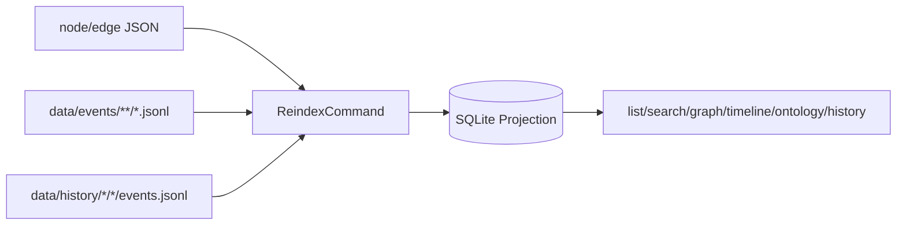
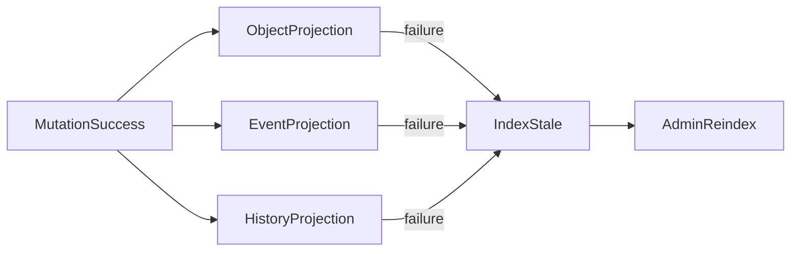

# L.W.S. M3 SQLite Projection Completion Implementation Report

작성일: 2026-07-30

## 1. 목표

M3는 SQLite projection이 source of truth가 아니라 generated read model임을 코드와 테스트로 고정한다. DB 파일이 삭제되어도 source JSON, global event log, object history record만 남아 있으면 list/search/graph/timeline/ontology/history lookup projection을 full reindex로 재생성할 수 있어야 한다.

이번 구현은 기존 event/history scanner와 incremental projection 흐름을 유지하면서, fallback search policy, index metadata, projection consistency validation을 보강했다.

## 2. 구현 요약

| ID | 구현 내용 | 완료 상태 |
| --- | --- | --- |
| BE-M3-01 | `data/events/**/*.jsonl` scanner를 유지하고 full reindex에서 `events` projection을 재생성한다. | Complete |
| BE-M3-02 | `data/history/{nodes,edges}/.../events.jsonl` scanner를 유지하고 `object_history` projection을 재생성한다. | Complete |
| BE-M3-03 | `event_ref`, `byte_offset`, `patch_path`, `object_history_path`, `head.json`, current object rev/hash mismatch를 validation issue로 남긴다. | Complete |
| BE-M3-04 | M3 검색 모드는 SQLite FTS5가 아니라 `objects.search_text LIKE ?` fallback으로 공식화하고 `index_meta.search_mode = fallback_like`를 기록한다. | Complete |
| BE-M3-05 | `include_permissions=true`는 visible result에 `viewer_permissions` hint만 추가하며 permission guard를 대체하지 않는다. | Complete |
| BE-M3-06 | mutation 후 object/tag/graph/timeline/event/history projection이 함께 갱신되는지 회귀 테스트로 고정하고, event/history projection 실패는 `INDEX_STALE`로 남긴다. | Complete |
| BE-M3-07 | reindex 성공 시 `index_meta`와 `index_builds`의 build id/status/warning/search metadata 일관성을 테스트한다. | Complete |

## 3. Full Reindex Flow



`ReindexCommand`는 object source files, global event log, object history JSONL을 모두 다시 스캔한다. object validation failure, event/history parse failure, consistency mismatch는 source record를 수정하지 않고 `validation_issues` warning으로 projection한다.

## 4. Incremental Projection Flow



mutation source write와 event/history durable commit이 성공하면 SQLite projection은 incremental update를 시도한다. projection update가 실패해도 source mutation은 rollback하지 않고 `INDEX_STALE` warning/status와 `index_stale_reason`을 남긴다. 운영자는 admin reindex로 generated read model을 복구한다.

## 5. Query Permission Flow


list/search는 `openReady()`를 통과한 SQLite projection에서 동작한다. anonymous query는 public predicate를 먼저 적용하므로 private object의 title, summary, content는 fallback search 결과에 포함되지 않는다. `include_permissions=true`는 이미 볼 수 있는 결과에 hint를 붙이는 옵션이며, read guard 자체가 아니다.

## 6. Projection Consistency Validation

M3 reindex consistency check는 다음 문제를 warning issue로 남긴다.

| Code | 의미 |
| --- | --- |
| `EVENT_LOG_INVALID` | global event JSONL row parse/shape failure |
| `OBJECT_HISTORY_INVALID` | object history JSONL row parse/shape failure |
| `EVENT_REF_INVALID` | unsafe or mismatched `event_ref` |
| `EVENT_BYTE_OFFSET_INVALID` | `byte_offset`이 global event row를 가리키지 않음 |
| `PATCH_PATH_INVALID` | unsafe patch path reference |
| `PATCH_PATH_MISSING` | referenced patch record missing |
| `PATCH_PATH_MISMATCH` | global event patch path와 object history patch path 불일치 |
| `OBJECT_HISTORY_PATH_MISMATCH` | global event의 object history path 불일치 |
| `MUTATION_HEAD_MISSING` / `MUTATION_HEAD_INVALID` | history directory의 head record 누락/손상 |
| `MUTATION_HEAD_EVENT_MISSING` | head의 latest event가 global event projection에 없음 |
| `MUTATION_REV_MISMATCH` | current object rev와 head rev 불일치 |
| `MUTATION_HASH_MISMATCH` | current object hash와 head hash 불일치 |

## 7. Search Policy

M3에서는 FTS5 table을 추가하지 않는다. 현재 search contract는 `objects.search_text LIKE ?` 기반 fallback search이며, reindex 성공 시 `index_meta.search_mode = fallback_like`로 남긴다.

FTS5 ranking, tokenizer, highlight/snippet, rebuild migration은 Phase 7 이후 advanced search tuning 범위로 분리한다.

## 8. 검증 결과

아래 명령을 통과했다.

```powershell
npm.cmd run test:sprint-a
npm.cmd run test:sprint-b
npm.cmd run test:sprint-c
npm.cmd run test:sprint-d
npm.cmd run test:sprint-e
npm.cmd run test:sprint-f
npm.cmd run test:sprint-g
npm.cmd run test:milestone-m1
npm.cmd run test:milestone-m2
npm.cmd run test:milestone-m3
npm.cmd run test:milestone-m4
npm.cmd run test:milestone-m5
npm.cmd run test:milestone-m6
npm.cmd run build
```

`npm.cmd run build`는 성공했다. 기존 Turbopack NFT tracing warning 1건은 남아 있으며, M3 실패 조건은 아니다.

## 9. 다음 범위

M3는 SQLite projection completion을 닫는다. 다음 milestone에서는 permission enforcement completion을 중심으로 private graph edge, owner/group/scope projection, admin validation signal을 더 엄격하게 점검한다.
