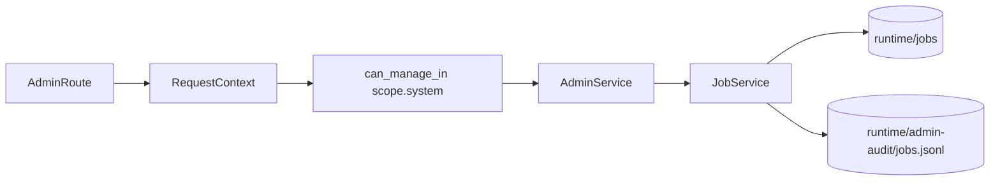
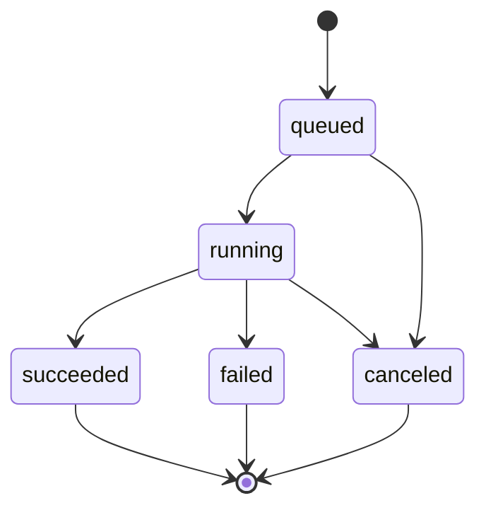
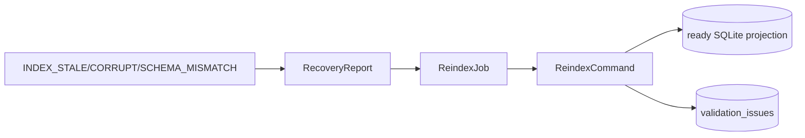

# L.W.S. M5 Admin Jobs And Operational Recovery Implementation Report

작성일: 2026-07-30

## 1. 목표

M5는 Phase 6 admin job contract를 운영 가능한 baseline으로 고정한다.

Admin action은 direct function call 결과가 아니라 permission-guarded job envelope를 반환한다. Job envelope는 lifecycle, progress, result/error, actor, audit trail을 포함하며, recovery와 backup은 configured runtime/backup root 안에서 동작한다.

## 2. 구현 요약

| ID | 구현 내용 | 완료 상태 |
| --- | --- | --- |
| BE-M5-01 | `JobService`/`JobStore`가 `queued`, `running`, `succeeded`, `failed`, `canceled` envelope를 runtime JSON으로 저장하고 list/detail API에서 조회한다. | Complete |
| BE-M5-02 | `client_job_id`는 job type과 함께 idempotency key로 사용되며, 같은 type/id 요청은 기존 job을 반환한다. | Complete |
| BE-M5-03 | `JobRunContext.checkCanceled()`와 `cancelJob()`으로 validation/reindex/backup runner가 cancellation request를 감지한다. | Complete |
| BE-M5-04 | job progress에 phase, current/total, scanned_count, warning_count, message를 저장한다. | Complete |
| BE-M5-05 | lifecycle transition과 progress update를 per-job audit 배열과 `runtime/admin-audit/jobs.jsonl`에 기록한다. | Complete |
| BE-M5-06 | validation job이 object validation, public boundary issue, mutation consistency issue, validation projection update를 하나의 result로 연결한다. | Complete |
| BE-M5-07 | backup id/path safety를 검증하고, manifest에는 source root absolute path를 `<redacted>`로 기록한다. | Complete |
| BE-M5-08 | recovery report가 mutation recovery와 index status를 함께 반환하고, corrupt index는 reindex로 ready state까지 복구한다. | Complete |

## 3. Admin Job Boundary



모든 admin route는 `RequestContext`를 만든 뒤 `AdminService`로 진입한다. `AdminService`는 `PermissionService.assertCanManageIn(context, "scope.system")`을 먼저 호출한다.

따라서 anonymous request와 untrusted session header spoof는 job 생성, list, detail, cancel, recovery API에 접근할 수 없다.

## 4. Job Lifecycle



현재 runner는 synchronous baseline이다. 그래도 job envelope는 long-running runner로 확장 가능한 모양을 유지한다.

- `queued`: job envelope가 생성됨
- `running`: work function 실행 중
- `succeeded`: result와 final progress가 저장됨
- `failed`: LWS error code/message가 저장됨
- `canceled`: cancel request가 확인되어 중단됨

`client_job_id`는 `(type, client_job_id)` 조합으로 적용된다. 같은 `client_job_id`라도 `reindex`와 `backup`은 서로 다른 작업이므로 별도 job이다.

## 5. Operational Recovery Flow



Index failure state는 query failure에서 끝나지 않고 admin recovery surface로 연결된다.

- `INDEX_STALE`: generated read model이 source of truth보다 뒤처짐
- `INDEX_CORRUPT`: SQLite file을 열거나 읽을 수 없음
- `INDEX_SCHEMA_MISMATCH`: schema version이 현재 backend와 맞지 않음

`ReindexCommand`는 source JSON/event/history에서 SQLite projection을 다시 만들며, corrupt SQLite file은 격리 후 fresh projection으로 복구한다.

## 6. Backup Policy

M5 backup baseline은 source object/event/index snapshot을 configured backup root 아래에 생성한다.

- backup id는 `backup.*` safe pattern만 허용한다.
- resolved backup path가 `LWS_BACKUP_ROOT` 밖으로 나가면 `PATH_OUTSIDE_ROOT`로 거부한다.
- manifest에는 knowledge/data absolute root를 기록하지 않고 `<redacted>`로 둔다.
- retention, encryption, remote copy는 M5 범위 밖이며 Phase 7 이후 운영 정책으로 남긴다.

## 7. 검증 결과

아래 시나리오를 `tests/milestone-m5.test.ts`에 고정했다.

- succeeded/canceled/failed job envelope와 audit event
- same type/client idempotency와 different type separation
- validation/reindex/backup progress persistence
- deterministic cancellation fixture
- anonymous/session spoof admin guard
- unsafe backup id traversal denial
- backup manifest source root redaction과 backup root containment
- validation job의 public boundary와 mutation inconsistency report
- `INDEX_CORRUPT` fixture의 reindex recovery

아래 명령을 통과했다.

```powershell
npm.cmd run test:sprint-a
npm.cmd run test:sprint-b
npm.cmd run test:sprint-c
npm.cmd run test:sprint-d
npm.cmd run test:sprint-e
npm.cmd run test:sprint-f
npm.cmd run test:sprint-g
npm.cmd run test:milestone-m1
npm.cmd run test:milestone-m2
npm.cmd run test:milestone-m3
npm.cmd run test:milestone-m4
npm.cmd run test:milestone-m5
npm.cmd run test:milestone-m6
npm.cmd run build
```

`npm.cmd run build`는 성공했다. 기존 Turbopack NFT tracing warning 1건은 남아 있으며, M5 실패 조건은 아니다.

## 8. 다음 범위

M5는 admin jobs and operational recovery baseline을 닫는다. 다음 milestone에서는 API contract와 integration hardening을 중심으로 route response shape, error mapping, request validation, route/service boundary를 최종 고정한다.
