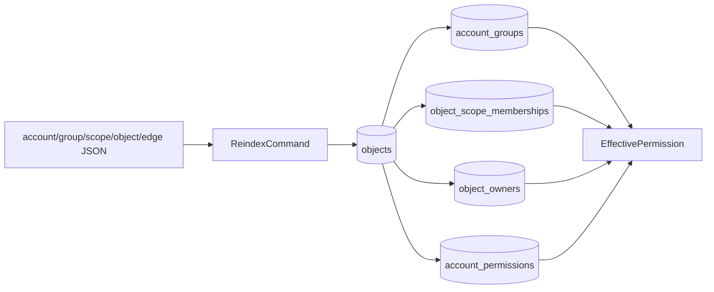
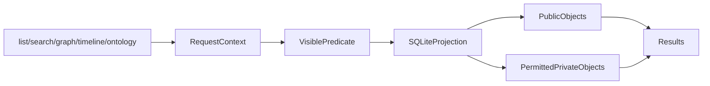
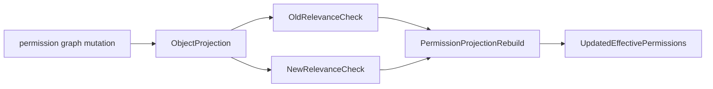

# L.W.S. M4 Permission Enforcement Completion Implementation Report

작성일: 2026-07-30

## 1. 목표

M4는 Phase 5의 projection-backed real permission enforcement를 완료한다.

핵심 계약은 모든 private read/write/query/admin 판단이 `RequestContext`만 신뢰하지 않고, source JSON/edge에서 재생성 가능한 SQLite permission projection을 통해 effective permission을 계산한다는 점이다.

용어 기준은 [LWS_GLOSSARY.md](../../reference/LWS_GLOSSARY.md)를 따른다.

## 2. 구현 요약

| ID | 구현 내용 | 완료 상태 |
| --- | --- | --- |
| BE-M4-01 | `IndexStore.updateObjectProjection()`이 old/new permission relevance를 모두 고려해 permission edge가 일반 edge로 바뀔 때 stale grant를 제거한다. | Complete |
| BE-M4-02 | `rel.contains`, collection/scope membership, direct/group ownership, direct/group `can_*` capability projection을 permission model로 고정한다. | Complete |
| BE-M4-03 | list/search/graph/timeline/ontology query가 `PermissionService.getVisibleObjectPredicate()`를 통해 context별 visible set만 반환한다. | Complete |
| BE-M4-04 | permission projection missing/stale/corrupt 상태에서 private read/write가 `PERMISSION_DENIED`로 fail-closed 된다. | Complete |
| BE-M4-05 | create/update/delete/restore/permission-graph mutation이 `can_create_in`, ownership, `can_update`, `can_update_in`, `can_manage_in` guard를 통과한다. | Complete |
| BE-M4-06 | session, object permission response, `viewer_permissions`, `ui_capabilities`, `default_scope`가 projection 기반 hint를 반환한다. | Complete |
| BE-M4-07 | account/group/scope/permission edge 변경 후 incremental object projection이 permission projection rebuild를 트리거한다. | Complete |

## 3. Permission Projection Model



Permission projection은 source of truth가 아니다. 원본은 account/group/scope/object node와 permission edge이며, SQLite table은 runtime permission query를 빠르게 하기 위한 generated read model이다.

M4 기준 projection 계약:

| Projection | Source relation/object | 의미 |
| --- | --- | --- |
| `accounts` | `account.*` object | active account 확인과 display name |
| `account_groups` | `rel.member_of` | account의 group membership |
| `object_scope_memberships` | `rel.contains` | `scope.*` 또는 `collection.*` 안에 포함된 object |
| `object_owners` | direct/group `rel.owns` | object owner permission |
| `account_permissions` | direct/group `rel.can_*` | read/create/update/manage capability |

`scope.wiki`는 일반 scoped permission의 global fallback으로 유지한다. 단, `scope.system`에 대한 manage 권한은 별도 시스템 경계이므로 `scope.wiki` global fallback을 허용하지 않는다.

## 4. Permission-Aware Query Boundary



Query service는 anonymous public filter만 사용하지 않는다. `PermissionService.getVisibleObjectPredicate()`가 public object, direct read, group-derived read, ownership, scope/collection permission을 반영한 SQL predicate를 만든다.

이 predicate는 search 조건과 함께 적용된다. 따라서 authenticated account도 자신에게 허용되지 않은 private title, summary, content를 list/search 결과로 얻을 수 없다.

`viewer_permissions`와 `ui_capabilities`는 UI hint다. Backend guard를 대체하지 않으며, read/write/admin service는 요청마다 PermissionService를 다시 통과한다.

## 5. Permission Graph Incremental Update



M4의 high-risk bug는 기존 permission edge가 일반 edge로 바뀔 때 old grant가 projection에 남는 문제였다.

현재 `IndexStore.updateObjectProjection()`은 mutation 전 projection row와 mutation 후 object를 모두 확인한다. old 또는 new object가 permission projection에 영향을 주면 permission projection을 rebuild한다. 따라서 `rel.can_read` edge가 `rel.references`로 바뀌면 기존 grant가 제거된다.

## 6. Fail-Closed Policy

Private read/write/admin 판단은 projection 상태가 ready일 때만 허용된다.

| 상태 | 의미 | M4 동작 |
| --- | --- | --- |
| `INDEX_REBUILD_REQUIRED` | SQLite projection missing | private read/write denied |
| `INDEX_STALE` | source와 projection 불일치 가능 | private read/write denied |
| `INDEX_CORRUPT` | SQLite file unreadable | private read/write denied |
| `INDEX_SCHEMA_MISMATCH` | schema version mismatch | private read/write denied |

Public object read는 object JSON의 `visibility: "public"`을 기준으로 허용될 수 있다. 그러나 private object는 effective permission을 확인할 수 없으면 fail-closed로 거부한다.

## 7. 검증 결과

아래 시나리오를 `tests/milestone-m4.test.ts`에 고정했다.

- Account A/B private object list/search isolation
- direct `rel.owns` 기반 private read/update
- group membership 추가/삭제 후 permission result 변경
- `rel.can_read` edge를 `rel.references`로 변경하면 grant 제거
- `rel.can_update_in` scope/collection write guard
- `rel.can_create_in` scope/collection create guard
- stale/corrupt/missing permission projection에서 private read/write denied
- graph/timeline/ontology query permission filtering
- frontend-supplied account/capability header spoofing 차단
- `viewer_permissions`, `ui_capabilities`, `default_scope` hint 유지

아래 명령을 통과했다.

```powershell
npm.cmd run test:sprint-a
npm.cmd run test:sprint-b
npm.cmd run test:sprint-c
npm.cmd run test:sprint-d
npm.cmd run test:sprint-e
npm.cmd run test:sprint-f
npm.cmd run test:sprint-g
npm.cmd run test:milestone-m1
npm.cmd run test:milestone-m2
npm.cmd run test:milestone-m3
npm.cmd run test:milestone-m4
npm.cmd run test:milestone-m5
npm.cmd run test:milestone-m6
npm.cmd run build
```

`npm.cmd run build`는 성공했다. 기존 Turbopack NFT tracing warning 1건은 남아 있으며, M4 실패 조건은 아니다.

## 8. 다음 범위

M4는 permission enforcement completion을 닫는다. 다음 milestone에서는 admin jobs and operational recovery를 중심으로 validation, reindex, backup, recovery workflow를 하나의 운영 표면으로 정리한다.
