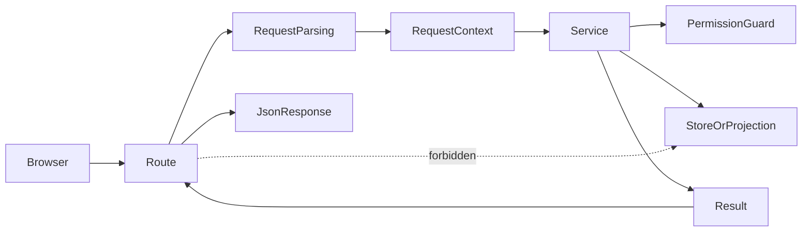
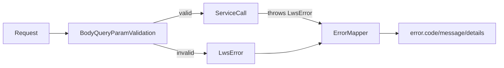
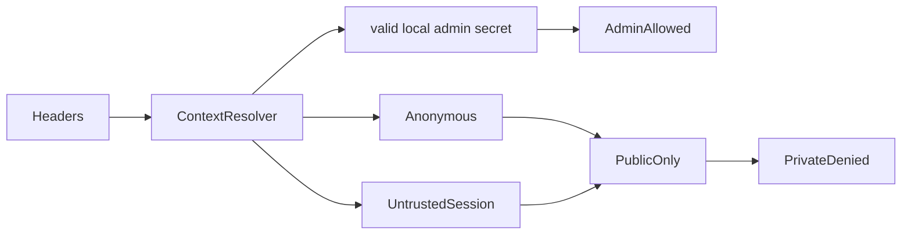

# L.W.S. M6 API Contract And Integration Hardening Implementation Report

작성일: 2026-07-30

## 1. 목표

M6는 모든 `/api/lws/*` route를 backend service adapter로 마감한다.

Route의 책임은 HTTP request parsing, `RequestContext` resolution, service call, success/error JSON response mapping이다. Route는 storage, event log, SQLite index, job internals를 직접 읽거나 쓰지 않는다.

Route inventory는 [LWS_API_ROUTE_INVENTORY.md](./LWS_API_ROUTE_INVENTORY.md)를 따른다.

## 2. 구현 요약

| ID | 구현 내용 | 완료 상태 |
| --- | --- | --- |
| BE-M6-01 | `/api/lws/**` route inventory에 service boundary, primary guard, direct persistence access 여부를 정리했다. | Complete |
| BE-M6-02 | body/query/route param parsing을 shared route validation helper로 통일하고 malformed request를 LWS error로 매핑한다. | Complete |
| BE-M6-03 | route static scan으로 raw store/index/job internals, `fs`, raw `request.json()`, ad hoc parsing 사용을 금지한다. | Complete |
| BE-M6-04 | anonymous, local-admin, untrusted-session, production local-admin-disabled behavior를 route-level test로 고정한다. | Complete |
| BE-M6-05 | error response가 `error.code`, `error.message`, optional `error.details`를 반환하고 stack을 노출하지 않음을 검증한다. | Complete |
| BE-M6-06 | object read/list/search/graph/timeline/ontology/history/admin route의 public/private boundary를 회귀 테스트로 고정한다. | Complete |

## 3. Route Adapter Boundary



M6 route rule:

- Route는 `createLwsBackend()` route-safe surface만 사용한다.
- Route는 `objectStore`, `eventStore`, `indexStore`, `jobService`, `permissionService`를 직접 호출하지 않는다.
- Route는 `fs`를 import하지 않는다.
- Route는 raw `request.json()`, direct `Number()`, direct `decodeURIComponent()` 대신 shared validation helper를 사용한다.
- Permission decision은 service layer에서 수행한다.

## 4. Validation And Error Contract



Malformed request와 service failure는 모두 `toErrorResponse()`를 통과한다.

성공 response는 `ok({ ... })` wrapper를 사용한다. Error response는 stack trace를 노출하지 않고 다음 shape를 유지한다.

```json
{
  "error": {
    "code": "PERMISSION_DENIED",
    "message": "Private read requires effective permission."
  }
}
```

M6 테스트는 invalid JSON, invalid patch shape, invalid restore event id, invalid query option, invalid route param encoding, invalid admin `client_job_id`, missing SQLite projection을 route-level response로 검증한다.

## 5. Auth Boundary



M6 auth baseline:

- Anonymous는 public read model만 볼 수 있다.
- Untrusted `session` header는 anonymous로 처리한다.
- Local admin은 development/local mode와 valid local secret에서만 mutation/admin action을 수행할 수 있다.
- Production에서는 local-admin shortcut도 disabled 처리한다.

Production-grade session/token verification은 M6 범위 밖이다.

## 6. 검증 결과

아래 시나리오를 `tests/milestone-m6.test.ts`에 고정했다.

- API route static scan
- malformed request body/query/route param validation
- stable LWS error response shape/status
- anonymous private object read/history/permissions/validation denied
- private search/list/graph/timeline/ontology/backlinks leak 방지
- edge id centered graph query에서 public edge는 반환되고 private edge는 anonymous 응답에서 노출되지 않음
- missing SQLite projection의 `INDEX_REBUILD_REQUIRED` mapping
- local-admin mutation/admin allowed with valid local secret in development
- local-admin denied with wrong secret or production environment
- untrusted session header treated as anonymous
- admin reindex/list/detail/cancel/validate/backup/recovery guard

아래 명령을 통과했다.

```powershell
npm.cmd run test:sprint-a
npm.cmd run test:sprint-b
npm.cmd run test:sprint-c
npm.cmd run test:sprint-d
npm.cmd run test:sprint-e
npm.cmd run test:sprint-f
npm.cmd run test:sprint-g
npm.cmd run test:milestone-m1
npm.cmd run test:milestone-m2
npm.cmd run test:milestone-m3
npm.cmd run test:milestone-m4
npm.cmd run test:milestone-m5
npm.cmd run test:milestone-m6
npm.cmd run build
```

`npm.cmd run build`는 성공했다. 기존 Turbopack NFT tracing warning 1건은 남아 있으며, M6 실패 조건은 아니다.

## 7. 다음 범위

M6는 API contract and integration hardening을 닫는다. 다음 milestone에서는 M7 Backend V1 Completion Gate로 넘어가 M1-M6 결과를 최종 gate/checklist 문서와 full regression 기준으로 정리한다.
