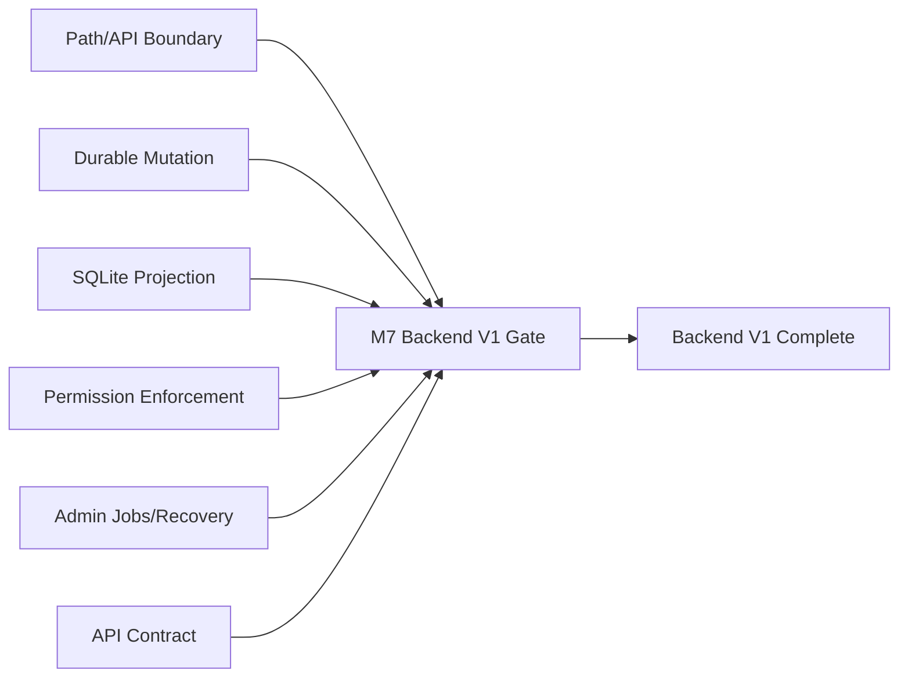
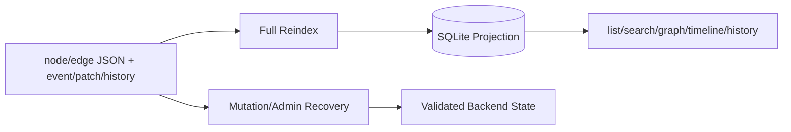
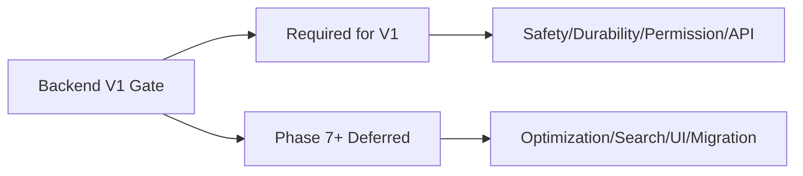

# L.W.S. M7 Backend V1 Completion Gate Report

작성일: 2026-07-30

## 1. 목표

M7은 M1-M6에서 닫은 backend 안정화 작업이 L.W.S. backend v1 complete 기준을 만족하는지 판정하는 release gate다.

이 문서는 새 기능 구현 보고서가 아니라 완료 판정 보고서다. Phase 7 이후 항목은 v1 gate를 막지 않는 후속 고도화 범위로 분리한다.

V1 gate result: Pass

판정 기준은 다음과 같다.

- M1-M6 구현 보고서가 존재하고 각 milestone의 필수 경계가 테스트로 고정되어 있다.
- source of truth, SQLite projection, route boundary, permission boundary, durable mutation, admin recovery가 서로의 책임을 침범하지 않는다.
- 최종 regression 명령이 통과한다.

## 2. Milestone Evidence



| Milestone | Evidence | Gate contribution |
| --- | --- | --- |
| M1 Safety Boundary Closure | [LWS_M1_SAFETY_BOUNDARY_IMPLEMENTATION_REPORT.md](./LWS_M1_SAFETY_BOUNDARY_IMPLEMENTATION_REPORT.md), `test:milestone-m1` | EventStore path safety, route-safe backend surface, private validation guard |
| M2 Durable Mutation And Idempotent Recovery | [LWS_M2_DURABLE_MUTATION_RECOVERY_IMPLEMENTATION_REPORT.md](./LWS_M2_DURABLE_MUTATION_RECOVERY_IMPLEMENTATION_REPORT.md), `test:milestone-m2` | Durable mutation response, commit step idempotency, recovery classification |
| M3 SQLite Projection Completion | [LWS_M3_SQLITE_PROJECTION_IMPLEMENTATION_REPORT.md](./LWS_M3_SQLITE_PROJECTION_IMPLEMENTATION_REPORT.md), `test:milestone-m3` | Full reindex from source of truth, event/history projection, index metadata and search policy |
| M4 Permission Enforcement Completion | [LWS_M4_PERMISSION_ENFORCEMENT_IMPLEMENTATION_REPORT.md](./LWS_M4_PERMISSION_ENFORCEMENT_IMPLEMENTATION_REPORT.md), `test:milestone-m4` | Projection-backed effective permission, query isolation, fail-closed private read/write |
| M5 Admin Jobs And Operational Recovery | [LWS_M5_ADMIN_JOBS_OPERATIONAL_RECOVERY_IMPLEMENTATION_REPORT.md](./LWS_M5_ADMIN_JOBS_OPERATIONAL_RECOVERY_IMPLEMENTATION_REPORT.md), `test:milestone-m5` | Guarded job envelope, idempotency, progress, audit, backup/recovery path |
| M6 API Contract And Integration Hardening | [LWS_M6_API_CONTRACT_INTEGRATION_HARDENING_IMPLEMENTATION_REPORT.md](./LWS_M6_API_CONTRACT_INTEGRATION_HARDENING_IMPLEMENTATION_REPORT.md), `test:milestone-m6` | Route adapter rule, request validation, LwsError response contract, auth/private regression |

## 3. Backend V1 Checklist

| Gate | Status | Evidence | Notes |
| --- | --- | --- | --- |
| Source of truth는 node/edge JSON과 event/patch/history이다. | Pass | M1, M2, M3 reports and tests | SQLite and validation projections are rebuildable read models, not canonical state. |
| SQLite는 삭제 후 source of truth에서 full rebuild 가능하다. | Pass | M3 report, `test:milestone-m3` | Full reindex rebuilds objects, graph, timeline, ontology, events, object history, permissions. |
| Object id, event id, history ref, backup/job id는 storage root 밖 접근에 사용될 수 없다. | Pass | M1, M5, M6 tests | PathResolver and validators reject traversal, absolute paths, drive/UNC injection, unsafe ids. |
| API route와 frontend는 storage를 직접 읽거나 쓰지 않는다. | Pass | M1/M6 route-safe surface and static scan | Route handlers remain service adapters and do not import `fs` or raw stores. |
| Node type, edge type, tag, relation type은 node id 또는 built-in virtual ontology id로 취급된다. | Pass | Sprint/schema/model tests | Type and relation identifiers remain ontology-backed ids. |
| Relation type도 materializable node로 유지된다. | Pass | Sprint ontology/materialization coverage | Full event-node materialization is separate from relation ontology materialization. |
| Edge는 first-class relationship object로 저장, 검증, mutation, history 처리된다. | Pass | Sprint B/C/F and M2 tests | Edges use the same object, mutation, patch, event, history flow as nodes. |
| Public edge는 source와 target이 모두 public일 때만 허용된다. | Pass | Public boundary validation and M5/M6 tests | Admin validation reports public-boundary violations. |
| Node/edge JSON에 `access` field를 넣지 않는다. | Pass | Schema validation tests | Permission remains edge/projection-backed, not embedded in object JSON. |
| Anonymous/private/write/admin permission boundary는 fail-closed이다. | Pass | M4/M6 tests | Non-ready permission projection denies private reads/writes. |
| Mutation success response는 object JSON과 event/history durable record 이후에만 반환된다. | Pass | M2 tests | Partial commit failures return `EVENT_APPEND_FAILED` and are recoverable. |
| Incomplete mutation state는 status/admin validation에서 탐지되고 recovery 가능하다. | Pass | M2/M5 tests | Recovery report classifies pending/failed/hash/head issues. |
| Permission graph 변경은 permission projection을 갱신한다. | Pass | M4 tests | Old/new permission relevance prevents stale grants after edge type changes. |
| Admin validate/reindex/backup/recovery jobs는 permission guarded이고 audit trail을 남긴다. | Pass | M5 tests | AdminService guards `scope.system` management and JobService persists audit. |
| Test suite가 M1-M6 필수 테스트를 모두 통과한다. | Pass | Final regression commands | M7 adds a thin release-gate test on top of M1-M6. |

## 4. Source, Projection, Recovery Flow



V1의 핵심 계약은 source of truth와 generated read model을 분리하는 것이다.

Node/edge JSON과 event/patch/history record가 canonical state다. SQLite는 list/search/graph/timeline/history/permission query를 빠르게 하기 위한 projection이며, 삭제되거나 손상되어도 full reindex로 다시 만들 수 있어야 한다.

Recovery는 SQLite를 canonical state로 만들지 않는다. Recovery는 source of truth와 mutation journal/event/history/head 상태를 검사하고, 빠진 durable record를 idempotent하게 보완하거나 manual repair 대상으로 분류한다.

## 5. Phase 7+ Deferred Scope



아래 항목은 backend v1 complete gate를 막지 않는다.

| Deferred item | Meaning | Why deferred |
| --- | --- | --- |
| event byte_offset lookup optimization hardening | JSONL event log에서 특정 event를 더 빠르게 찾기 위한 byte offset/index 최적화 | v1은 안전한 event lookup과 validation이 우선이다. 성능 병목이 실제 데이터 규모에서 확인된 뒤 강화해도 된다. |
| event hash chain decision | event record를 이전 event hash와 연결해 append-only 감사성을 강화하는 결정 | canonical event format과 recovery semantics를 바꿀 수 있어 v1 안정화 뒤 별도 설계가 필요하다. |
| history checkpoint/compaction | 긴 patch history replay를 줄이기 위한 중간 snapshot 또는 compacted history page | v1은 patch/inverse patch durability와 restore correctness를 먼저 닫는다. Replay 최적화는 이후 규모 대응이다. |
| event node full materialization | 모든 `event.*`를 node처럼 object graph에 materialize하는 기능 | v1 canonical history는 event log/object history/patch record다. Event graph UX는 별도 ontology와 중복 방지 정책이 필요하다. |
| advanced FTS tuning | FTS tokenizer, ranking, snippet, highlight, language tuning | v1은 permission-safe fallback search contract를 닫는다. 검색 품질 고도화는 compatibility를 유지하며 나중에 붙일 수 있다. |
| vector/semantic search | embedding과 vector index 기반 의미 검색 | 별도 index lifecycle, 비용, privacy filtering, rebuild policy가 필요하므로 v1 core safety 범위가 아니다. |
| schema migration runner and rollback | schema 변경 자동 적용, dry-run, rollback runner | v1은 schema mismatch detection과 reindex contract를 제공한다. 자동 migration은 운영 위험도가 높아 별도 gate가 필요하다. |
| advanced observability dashboard | job/index/recovery/status를 시각화하는 운영 dashboard | M5 admin job/status/report가 baseline이다. Dashboard는 운영 편의 기능이다. |
| advanced permission administration UI | account/group/scope permission을 편집하는 관리 UI | M4는 backend enforcement를 닫는다. UI workflow는 frontend/application layer 범위다. |
| visual diff merge editor | conflict와 patch diff를 시각적으로 병합하는 편집기 | v1은 diff/restore/rev conflict backend contract를 제공한다. Merge UX는 이후 editor feature다. |

## 6. Objective Review And Production Readiness Limits

M7의 `Pass` 판정은 "L.W.S. backend v1 core baseline이 구현되었다"는 의미다. 이것은 production 운영에 필요한 모든 보안, 동시성, 장애 복구, 관측성, 성능 요구가 완료되었다는 뜻은 아니다.

현재 코드와 regression 결과를 기준으로 확인된 구현 상태는 다음과 같다.

| Area | Current state | Evidence |
| --- | --- | --- |
| Path and route boundary | 구현됨. `PathResolver`가 object/event/history/journal 경로를 root 내부로 제한하고 route surface는 raw store를 노출하지 않는다. | `src/modules/storage/path-resolver.ts`, `src/server/lws-backend.ts`, `test:milestone-m1`, `test:milestone-m6` |
| Durable mutation baseline | 구현됨. pending journal, object write, patch/global event/object history/head commit step, idempotent repair classification이 있다. | `src/modules/events/event-store.ts`, `src/services/mutation-service.ts`, `src/services/mutation-recovery-service.ts`, `test:milestone-m2` |
| SQLite generated projection | 구현됨. source object, global event log, object history에서 objects/events/history/permission projection을 rebuild한다. | `src/modules/indexing/reindex-command.ts`, `src/modules/indexing/index-store.ts`, `test:milestone-m3` |
| Permission enforcement | 구현됨. anonymous public-only read, account/group/owner/scope permission projection, query visible predicate, stale/corrupt projection fail-closed가 있다. | `src/services/permission-service.ts`, `test:milestone-m4` |
| Admin job baseline | 구현됨. permission-guarded job envelope, progress, cancellation signal, `client_job_id` idempotency, audit JSONL이 있다. | `src/services/admin-service.ts`, `src/services/job-service.ts`, `src/modules/jobs/job-store.ts`, `test:milestone-m5` |
| API contract | 구현됨. route handler는 request parsing, context resolution, service call, response mapping 역할로 제한된다. | `src/app/api/lws/**/route.ts`, `test:milestone-m6`, `test:milestone-m7` |

운영 수준으로 올리기 위해 남아 있는 주요 한계는 다음과 같다.

| Gap | Why it matters | Required next work |
| --- | --- | --- |
| Production-grade authentication | 현재 production-grade session/token verification은 v1 범위 밖이다. `session` auth header는 untrusted로 취급되고, local-admin shortcut은 development/local mode에서만 허용된다. | login/session/token verification, secure cookie, session expiry/rotation, CSRF policy, account disable handling을 별도 milestone으로 구현한다. |
| Per-object concurrency control | 현재 rev conflict check는 있지만, 같은 object에 대한 고동시성 mutation에서 read-check-write 구간을 원자적으로 보호하는 per-object lock/CAS 보장은 명시적으로 닫혀 있지 않다. | object id별 mutex, filesystem lock, SQLite-backed CAS, 또는 mutation queue 중 하나를 선택해 같은 object의 concurrent write를 serialize하거나 deterministic `REV_CONFLICT`로 만든다. |
| Crash and filesystem durability hardening | atomic rename과 file fsync baseline은 있으나, OS/filesystem별 directory fsync 제약, process crash, partial temp file cleanup, disk full 같은 운영 장애는 더 넓은 검증이 필요하다. | crash-injection test, temp/journal cleanup, disk-full/error-path fixture, Windows filesystem behavior audit, backup 중 mutation 충돌 정책을 추가한다. |
| True asynchronous job execution | M5 runner는 synchronous baseline이다. envelope shape는 있지만 별도 worker, queue, retry, lease, crashed worker recovery는 없다. | persistent job queue, worker process, retry/timeout policy, job lease, canceled/running recovery, progress streaming 또는 polling contract를 구현한다. |
| Backup and restore operations | backup snapshot은 baseline이다. retention, encryption, remote/offsite copy, restore drill, backup consistency guarantee는 후속 운영 정책이다. | retention/encryption/remote copy, backup integrity manifest, restore command, scheduled backup, restore rehearsal test를 추가한다. |
| Observability and alerting | job/status/report는 baseline이지만 production incident를 감지하고 추적하기 위한 metrics/log/alert 체계는 부족하다. | structured request log, mutation/admin audit query, metrics, slow query/job duration tracking, alert rules, recovery dashboard를 추가한다. |
| Security hardening | path/id guard는 구현됐지만 public internet 운영에는 rate limit, body size limit, CORS/CSRF, secret management, detailed error exposure policy가 필요하다. | request size/rate limits, CORS/CSRF policy, secret loading hardening, fuzzing, dependency/security scan, admin endpoint network/access policy를 추가한다. |
| Schema migration | v1은 schema mismatch detection과 reindex contract를 제공하지만 automatic migration/rollback runner는 없다. | dry-run migration report, migration apply/rollback, compatibility test, data backup preflight를 구현한다. |
| Search and query performance | v1 search policy는 `fallback_like`다. 작은 데이터에는 충분하지만 규모가 커지면 FTS5 또는 다른 index 전략이 필요하다. | FTS5/tokenizer/ranking/highlight, permission-aware query plan review, pagination/load tests, reindex time budget을 검증한다. |
| Load and fault testing | 현재 tests는 기능 회귀 중심이다. 운영 신뢰성은 동시 요청, large dataset, corrupt JSONL, interrupted mutation, SQLite corruption fixture가 더 필요하다. | concurrency/load test, fault-injection suite, large fixture benchmark, recovery repeated-run idempotency test를 CI에 추가한다. |

따라서 다음 단계의 우선순위는 기능 확장보다 production readiness hardening이어야 한다.

1. per-object mutation lock/CAS로 source of truth write race를 먼저 닫는다.
2. production authentication/session milestone을 분리해 실제 사용자 경계를 닫는다.
3. crash/fault-injection test와 restore drill을 추가해 durable mutation/recovery를 운영 장애 조건에서 검증한다.
4. synchronous admin job baseline을 persistent async worker/queue 구조로 확장한다.
5. observability, backup retention/encryption, migration runner, search performance를 Phase 7+ workstream으로 순차 진행한다.

## 7. Gate Test

M7은 `tests/milestone-m7.test.ts`를 추가한다.

이 테스트는 full regression을 내부에서 다시 실행하지 않는다. 대신 다음 release-gate 산출물이 사라지지 않도록 얇게 고정한다.

- M1-M7 implementation reports 존재
- API route inventory 존재
- glossary와 warning/error code reference 존재
- M7 보고서가 checklist, evidence, Phase 7 deferred scope, production readiness limits, Mermaid diagram을 포함
- `/api/lws/**/route.ts`가 raw store, raw job internals, `fs`, raw `request.json()`, ad hoc `Number()`, direct `decodeURIComponent()`를 사용하지 않음
- `package.json`에 `test:milestone-m7` 존재

## 8. Verification

M7 단독 검증:

```powershell
npm.cmd run test:milestone-m7
```

Result: Passed.

최종 regression 기준:

```powershell
npm.cmd run test:sprint-a
npm.cmd run test:sprint-b
npm.cmd run test:sprint-c
npm.cmd run test:sprint-d
npm.cmd run test:sprint-e
npm.cmd run test:sprint-f
npm.cmd run test:sprint-g
npm.cmd run test:milestone-m1
npm.cmd run test:milestone-m2
npm.cmd run test:milestone-m3
npm.cmd run test:milestone-m4
npm.cmd run test:milestone-m5
npm.cmd run test:milestone-m6
npm.cmd run test:milestone-m7
npm.cmd run build
```

Result: Passed.

`npm.cmd run build`는 성공했으며 기존 Turbopack NFT tracing warning 1건을 출력했다. 이 warning은 현재 build failure가 아니며 M7 gate failure 조건으로 보지 않는다.

## 9. Conclusion

M7은 backend v1 core를 complete로 판정한다.

이 판정은 Phase 7 이후 확장 항목이 불필요하다는 뜻이 아니다. 의미는 더 좁다. L.W.S. backend는 현재 source of truth, generated read model, permission boundary, durable mutation, operational recovery, API adapter contract를 v1 baseline으로 제공한다.

Production readiness는 별도 gate로 보아야 한다. 이후 작업은 이 baseline을 깨지 않는 방향으로 authentication, per-object concurrency control, crash recovery, async jobs, backup/restore policy, observability, security hardening, migration, search performance를 단계적으로 닫아야 한다.
