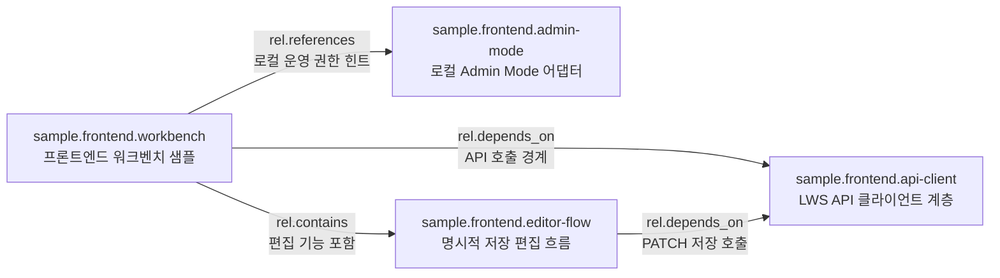
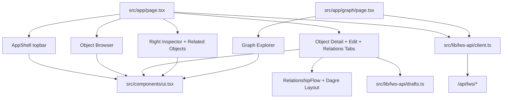
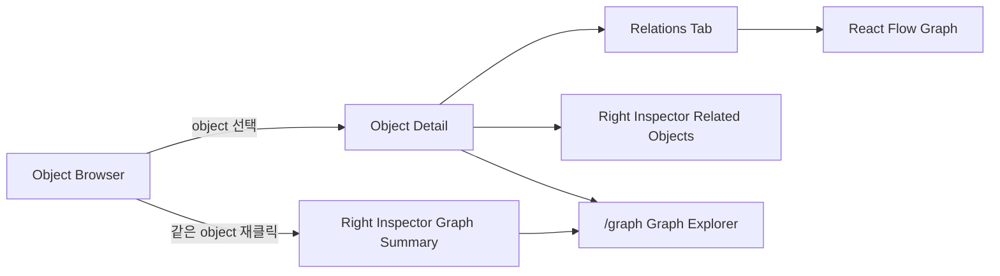
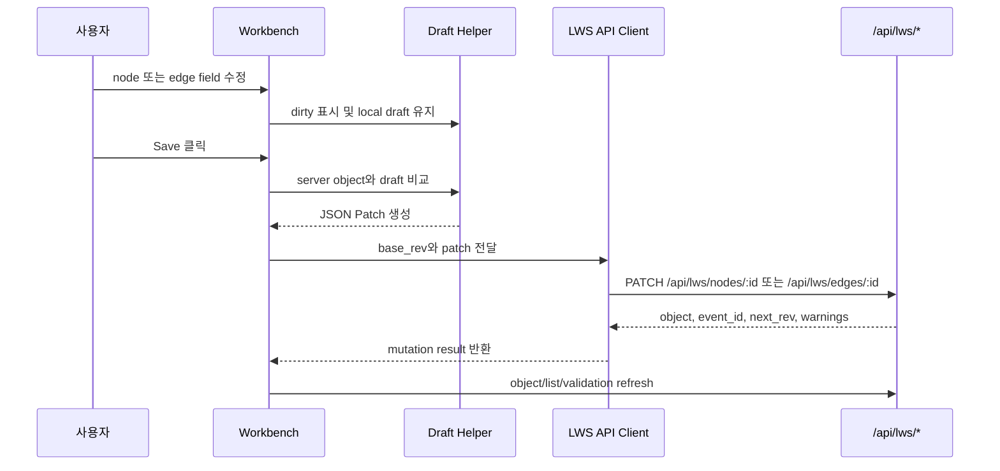
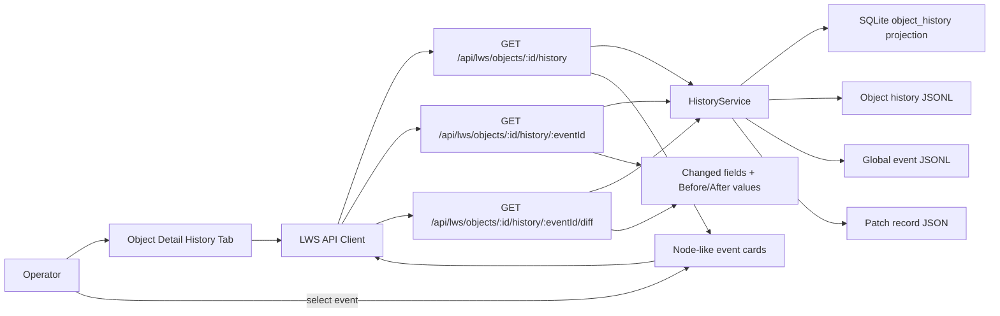
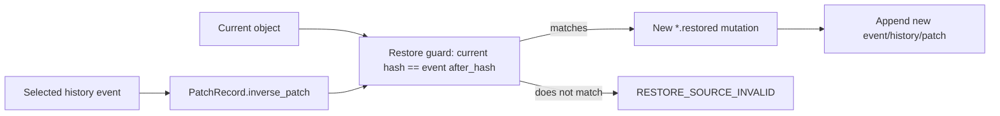
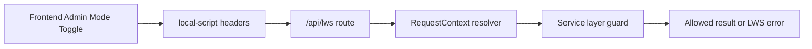

# L.W.S. Frontend Foundation Slice 구현 보고서 및 검토 계획서

작성일: 2026-08-01

## 1. 요약

이 문서는 L.W.S. 프론트엔드의 첫 사용 가능 구현 단위인 Foundation Slice 결과를 정리한다.

이번 구현 범위:

```text
F0 UI Foundation
+ F1 Backend-Integrated Read Workbench
+ 최소 F2 Editing Core
```

이번 slice의 핵심 목표는 실제 `/api/lws/*` 백엔드 응답을 사용해 다음 운영 루프를 검증하는 것이다.

```text
browse -> inspect -> edit -> validate -> reindex enough to continue working
```

첫 화면은 계속 `/`이다. 이 화면은 landing page가 아니라 실제 operator workbench로 동작한다. 이번에는 object 탐색, 상세 확인, 생성, 편집, 검증, reindex 흐름을 먼저 안정화하는 데 집중했다. 추가로 관계 이해를 돕기 위해 `/graph`에는 얇은 Graph Explorer route를 먼저 열어두었다. `/timeline`, `/ontology`, `/admin` 같은 독립 라우트는 후속 slice에서 확장한다.

## 2. 구현 결과

UI foundation:

- `lucide-react`를 추가해 주요 action/icon button에 사용했다.
- Radix primitive 패키지를 추가했다: dialog, tabs, tooltip, select, dropdown menu, switch.
- 관계 그래프 시각화를 위해 `@xyflow/react`와 `@dagrejs/dagre`를 추가했다.
- `src/app/globals.css`에 L.W.S. 소유 CSS design system을 추가했다.
- `src/components/ui.tsx`에 Button, IconButton, Badge, Panel, Tabs, Dialog, Tooltip, Select, Switch, Dropdown wrapper를 추가했다.
- 시각 스타일은 외부 UI kit이 아니라 L.W.S. CSS가 소유한다.

API/client layer:

- `src/lib/lws-api/client.ts`에 `/api/lws/*` 전용 typed client를 추가했다.
- 성공 응답과 LWS error 응답을 정규화한다.
- `LwsApiError`는 UI에서 쓰기 쉽도록 `code`, `message`, `details`, `status`를 가진다.
- local Admin mode가 켜진 경우에만 기존 백엔드 계약에 맞춰 local-admin 헤더를 붙인다.
- frontend는 storage, event store, SQLite, job internals를 직접 import하지 않는다.

History client layer:

- `src/lib/lws-api/types.ts`에 backend history contract를 반영한 frontend 타입을 추가했다: `ObjectHistoryLink`, `ObjectHistoryResponse`, `GlobalMutationEvent`, `PatchRecord`.
- `src/lib/lws-api/client.ts`에 기존 backend history route를 호출하는 method를 추가했다: `listObjectHistory`, `getHistoryEvent`, `getHistoryDiff`.
- 이 layer는 source storage, event store, SQLite projection, patch file을 직접 import하지 않는다. 모든 history 조회는 `/api/lws/objects/:id/history*` route를 통해 수행한다.

Draft/Patch layer:

- `src/lib/lws-api/types.ts`에 frontend client 타입을 추가했다.
- `src/lib/lws-api/drafts.ts`에 node/edge draft 생성, object-to-draft 변환, draft-to-object 변환, JSON Patch 생성 helper를 추가했다.
- PATCH 생성 시 backend-managed field는 제외한다.

제외되는 protected fields:

```text
schema_version
object_kind
id
rev
audit
```

Workbench 화면:

- 기존 단일 `src/app/page.tsx` 시제품을 3-pane workbench로 재구성했다.
- 상단에는 status/session/admin mode/create/refresh control을 둔다.
- 상단에는 `/graph`로 이동하는 Graph entry도 둔다.
- 왼쪽에는 object browser와 search/kind filter를 둔다.
- 가운데에는 object detail, edit tab, validation, raw JSON을 둔다.
- 오른쪽에는 storage/index 상태, admin action, capability, graph/timeline/ontology 요약, API boundary 설명을 둔다.

관계 탐색:

- object detail에 `Relations` tab을 추가했다.
- `Relations` tab은 선택 object 중심의 1-hop 관계를 React Flow 기반 동적 관계 그래프로 먼저 보여준다.
- Dagre layout을 사용해 source -> relation -> target 흐름을 좌우 방향으로 자동 배치한다.
- canvas drag, wheel zoom, node drag, fit controls를 사용해 관계를 직접 탐색할 수 있다.
- node를 손으로 끌어 배치하면 현재 화면 안에서 위치가 유지된다.
- `Auto layout`은 Dagre 자동 배치로 되돌리고, `Fit`은 현재 그래프를 화면에 맞춘다.
- mouse wheel은 위아래 pan이 아니라 확대/축소에만 사용한다.
- single click은 그래프 안에서 local focus만 바꾸고, double click은 해당 object detail로 이동한다.
- 현재 선택된 자기 자신을 그래프에서 double click해도 선택이 해제되지 않는다.
- 선택 해제는 왼쪽 object browser에서 같은 object row를 다시 클릭할 때만 수행한다.
- 선, 화살표, relation label을 사용해 source -> target 흐름을 시각적으로 읽을 수 있게 했다.
- 관계 목록은 보조 detail 영역으로 낮춰 클릭 이동과 원문 확인 용도로 둔다.
- 오른쪽 inspector는 object가 선택된 동안 `Related Objects` 목록을 보여준다.
- object가 선택되지 않은 상태에서는 오른쪽 inspector가 전체 Graph 요약을 보여준다.
- 왼쪽 object row를 다시 클릭하면 선택이 해제된다.
- `/graph` route를 추가해 같은 React Flow 그래프를 더 넓은 화면에서 볼 수 있게 했다.

읽기 흐름:

- status/session indicator 표시
- object list/search/filter
- object detail readonly 확인
- 왼쪽 object browser에서 선택된 object를 다시 클릭해 선택 해제
- validation report 확인
- raw JSON 확인
- Relations tab에서 선택 object의 1-hop 관계 확인
- React Flow graph로 관계 방향과 relation label 시각화
- node drag를 통한 수동 배치
- mouse wheel zoom
- Auto layout/Fit 조작
- 오른쪽 inspector에서 선택 object의 related object list 확인
- object가 선택되지 않았을 때만 오른쪽 inspector의 전체 graph 요약 표시
- `/graph` route에서 visible graph 또는 center object graph 확인
- timeline/ontology 요약 확인
- index/storage issue 표시

최소 편집 흐름:

- node 생성
- edge 생성
- node 수정
- edge 수정
- explicit Save
- dirty/saving/saved/failure 상태 표시
- mutation result의 `event_id`, `next_rev`, `warnings` 표시
- 저장 실패 시 local draft 보존
- validation, permission, rev conflict error 표시

History tab:

- object detail에 `History` tab을 추가했다.
- `History` tab은 기존 backend canonical history API를 읽는다. event/log record를 실제 node JSON으로 새로 materialize하지 않는다.
- history list는 `GET /api/lws/objects/:id/history` 응답을 사용하고, frontend에서 최신 event가 먼저 보이도록 정렬한다.
- 각 event는 node-like event card로 표시한다: `event_id`, `event_type`, `base_rev -> next_rev`, `occurred_at`, `summary`.
- event card를 클릭하면 `GET /api/lws/objects/:id/history/:eventId`와 `GET /api/lws/objects/:id/history/:eventId/diff`를 lazy load한다.
- detail panel은 actor, occurred time, rev transition, before/after hash, changed fields, changed values, inverse patch, technical JSON을 표시한다.
- changed values는 patch와 inverse patch를 짝지어 `Before` / `After` 값을 보여준다.
- `Inverse Patch`는 restore에 사용되는 반대 방향 patch이지만, 이번 frontend slice에서는 restore 실행 UI를 추가하지 않았다.
- 현재 backend restore는 임의 과거 revision으로 replay rollback하는 기능이 아니다. 선택 event의 `after_hash`가 현재 object hash와 같을 때 해당 event의 `inverse_patch`를 현재 object에 적용해 새 `*.restored` mutation을 만든다.
- 따라서 향후 restore UI는 latest-event undo 성격, `base_rev`, `RESTORE_SOURCE_INVALID` 가능성, restore가 새 event를 append한다는 점을 명확히 보여줘야 한다.

Local Admin mode:

- production auth UI는 구현하지 않았다.
- 대신 기존 backend local development HTTP contract를 사용한다.
- Admin mode가 켜지고 local secret이 입력된 경우 다음 헤더를 붙인다.

```text
x-lws-auth-source: local-script
x-lws-local-admin-secret: <local secret>
```

- 현재 `.env.local` 기준 local secret은 다음 값이다.

```text
change-me
```

- 이 UI는 권한 판단을 대체하지 않는다. 실제 read/write/admin 허용 여부는 항상 backend service layer가 판단한다.

## 3. 로컬 테스트 데이터

검토를 쉽게 하기 위해 임시 public sample object를 실제 mutation API로 생성했다. 생성 후 reindex를 수행했다.

공통 속성:

```text
visibility: public
status: active
tags: tag.frontend, tag.sample
```

현재 샘플 데이터 규모:

```text
nodes: 4
edges: 4
total objects: 8
```

### 3.1 샘플 노드

| ID | 표시 제목 | Type | 확인 목적 | 요약 |
| --- | --- | --- | --- | --- |
| `sample.frontend.workbench` | 프론트엔드 워크벤치 샘플 | `type.note` | 메인 검토 시작점 | L.W.S. 프론트엔드 Foundation Slice를 확인하기 위한 공개 샘플 노드 |
| `sample.frontend.api-client` | LWS API 클라이언트 계층 | `type.service` | API client/read-write boundary 확인 | typed `/api/lws/*` client와 error/admin header normalization 확인 |
| `sample.frontend.admin-mode` | 로컬 Admin Mode 어댑터 | `type.concept` | local-admin UX와 permission boundary 확인 | Admin mode가 백엔드 권한 검사를 대체하지 않는지 확인 |
| `sample.frontend.editor-flow` | 명시적 저장 편집 흐름 | `type.concept` | create/edit/save/draft 보존 확인 | JSON Patch 생성과 실패 시 draft 보존 확인 |

### 3.2 샘플 엣지

| ID | 표시 제목 | Source | Relation | Target | 관계 의미 |
| --- | --- | --- | --- | --- | --- |
| `sample.edge.frontend-workbench-api-client` | 워크벤치가 API 클라이언트를 사용함 | `sample.frontend.workbench` | `rel.depends_on` | `sample.frontend.api-client` | 워크벤치는 storage에 직접 접근하지 않고 API client에 의존한다. |
| `sample.edge.frontend-workbench-admin-mode` | 워크벤치가 Admin mode를 노출함 | `sample.frontend.workbench` | `rel.references` | `sample.frontend.admin-mode` | 워크벤치는 local development mutation을 위해 Admin mode adapter를 참조한다. |
| `sample.edge.frontend-workbench-editor-flow` | 워크벤치가 편집 흐름을 포함함 | `sample.frontend.workbench` | `rel.contains` | `sample.frontend.editor-flow` | 워크벤치 안에 명시적 저장 편집 흐름이 포함된다. |
| `sample.edge.editor-flow-api-client` | 편집 흐름이 API 클라이언트를 호출함 | `sample.frontend.editor-flow` | `rel.depends_on` | `sample.frontend.api-client` | 편집 저장은 base_rev와 JSON Patch를 API client로 전송한다. |

### 3.3 샘플 관계도



### 3.4 샘플 그래프 확인 방법

- object browser에서 `프론트엔드` 또는 `frontend`를 검색한다.
- 먼저 `sample.frontend.workbench`를 선택한다.
- object list에 node와 edge가 함께 보이는지 확인한다.
- edge object를 열었을 때 source, relation type, target이 edge line에 표시되는지 확인한다.
- `Relations` tab에서 `sample.frontend.workbench`의 1-hop 관계 3개가 보이는지 확인한다.
- React Flow 그래프에서 `sample.frontend.workbench`와 API client, Admin mode, editor flow가 좌우 방향 relation edge로 연결되는지 확인한다.
- 그래프 영역을 드래그해 pan이 되는지 확인한다.
- mouse wheel이 위아래 pan이 아니라 zoom으로 동작하는지 확인한다.
- control로 zoom/fit이 되는지 확인한다.
- node를 직접 끌어 위치가 바뀌고 유지되는지 확인한다.
- `Auto layout`을 누르면 Dagre 자동 배치로 돌아오는지 확인한다.
- 오른쪽 inspector가 기존 Graph 요약 대신 `Related Objects` 목록을 보여주는지 확인한다.
- 같은 object row를 다시 클릭해 선택 해제한 뒤 오른쪽 inspector에 Graph 요약이 다시 나타나는지 확인한다.
- 상단 `Graph` 버튼 또는 오른쪽 Graph panel의 `Open` 버튼으로 `/graph` route에 진입한다.
- `/graph`에서 center object id에 `sample.frontend.workbench`를 입력하면 샘플 node/edge 관계가 표시되는지 확인한다.
- Admin mode를 켠 뒤 refresh하면 backend permission hint에 따라 sample object 편집 가능 상태가 보이는지 확인한다.

이 샘플 그래프는 일부러 작게 만들었다. 큰 데이터셋으로 UI 상태 버그가 가려지는 것을 피하고, list/search/detail/edit/graph 흐름을 빠르게 검토하기 위한 목적이다.

## 4. 프론트엔드 구조

현재 UI 구성:



관계 탐색 흐름:



Mutation flow:



History read flow:



Restore relationship:



Permission boundary:



중요한 점:

- frontend는 권한을 최종 판단하지 않는다.
- frontend는 local development admin 요청 헤더를 붙일 뿐이다.
- backend service layer가 매 요청마다 permission guard를 다시 수행한다.
- wrong secret, anonymous, production local-admin disabled 상태는 backend error로 표현되어야 한다.

## 5. 수동 검토 계획

브라우저에서 다음 주소를 연다.

```text
http://127.0.0.1:3000
```

코드나 env가 바뀐 뒤에는 `Ctrl + F5`로 강력 새로고침한다.

### 5.1 Anonymous Read 확인

확인할 것:

- 상단 status bar에 `Storage: Ready`, `Env: development`, viewer/auth 상태가 표시되는지 확인한다.
- `프론트엔드` 또는 `frontend`를 검색한다.
- 샘플 object 8개가 보이는지 확인한다.
- `sample.frontend.workbench`를 선택한다.
- Overview, Edit, Relations, Validation, Raw JSON tab이 동작하는지 확인한다.
- Admin mode를 켜기 전에는 Edit tab이 readonly인지 확인한다.
- 선택된 object가 있을 때 오른쪽 panel에 Related Objects, Timeline, Ontology, Validation, API Boundary가 보이는지 확인한다.
- 선택된 object row를 한 번 더 클릭하면 선택이 해제되고 오른쪽 panel에 Graph 요약이 다시 보이는지 확인한다.

기대 결과:

```text
anonymous 사용자는 public sample object를 읽을 수 있지만 수정할 수 없다.
```

### 5.2 Admin Mode 확인

확인할 것:

- `Admin mode`를 켠다.
- local secret을 입력한다.

```text
change-me
```

- refresh 버튼을 누른다.
- `sample.frontend.workbench`를 다시 선택한다.
- backend permission hint에 따라 edit control이 활성화되는지 확인한다.
- 잘못된 secret을 입력했을 때 저장/admin action이 `PERMISSION_DENIED`로 실패하는지 확인한다.

기대 결과:

```text
Admin mode는 local development request adapter로만 동작한다.
권한 실패는 조용히 무시되지 않고 LWS error로 표시된다.
```

### 5.3 Node 생성 확인

확인할 것:

- `Node` 버튼을 클릭한다.
- 예시 ID로 public node를 만든다.

```text
sample.frontend.manual-note
```

- 권장 입력:

```text
type: type.note
detail_mode: note
visibility: public
status: active
```

- 생성 후 해당 object detail이 열리는지 확인한다.
- 검색으로 새 node가 보이는지 확인한다.
- Raw JSON에 source object field가 정상 표시되는지 확인한다.

기대 결과:

```text
POST /api/lws/nodes를 통해 생성되고 workbench가 refresh된다.
```

### 5.4 Edge 생성 확인

확인할 것:

- `Edge` 버튼을 클릭한다.
- source는 `sample.frontend.workbench`를 사용한다.
- target은 `sample.frontend.manual-note` 또는 다른 public sample node를 사용한다.
- relation은 `rel.references`를 사용한다.
- visibility는 `public`으로 둔다.
- 생성 후 edge가 object search에 나타나는지 확인한다.

기대 결과:

```text
POST /api/lws/edges를 통해 생성된다.
public edge의 source/target이 public이 아니면 저장 전 warning이 표시된다.
최종 차단은 backend validation이 수행한다.
```

### 5.5 Edit 확인

확인할 것:

- sample node를 선택한다.
- summary 또는 content를 수정한다.
- 상태가 `dirty`로 바뀌는지 확인한다.
- Save를 누른다.
- mutation result에 event id와 next rev가 표시되는지 확인한다.
- generated patch에 protected field가 포함되지 않는지 확인한다.

기대 결과:

```text
PATCH 요청은 base_rev와 generated JSON Patch를 사용한다.
저장 실패 시 draft가 유지된다.
```

### 5.6 Recovery/Reindex 확인

확인할 것:

- Admin mode가 켜진 상태에서 오른쪽 inspector의 reindex icon을 누른다.
- job result가 표시되는지 확인한다.
- refresh 후 storage/index 상태가 ready인지 확인한다.

기대 결과:

```text
reindex는 local operator recovery action으로 사용할 수 있다.
```

### 5.7 관계 탐색 확인

확인할 것:

- `sample.frontend.workbench`를 선택한다.
- `Relations` tab을 연다.
- React Flow 그래프에서 relation edge label과 화살표 방향이 보이는지 확인한다.
- 그래프를 드래그해 pan하고, wheel/control로 확대/축소되는지 확인한다.
- wheel이 위아래 이동으로 동작하지 않는지 확인한다.
- node를 직접 끌어 배치하고, 그 배치가 즉시 되돌아가지 않는지 확인한다.
- single click은 그래프 내부 선택 강조만 바꾸고, double click은 object detail로 이동하는지 확인한다.
- 현재 선택된 자기 자신을 그래프에서 double click해도 선택이 해제되지 않는지 확인한다.
- 선택 해제는 왼쪽 object browser에서 같은 object row를 다시 클릭할 때만 가능한지 확인한다.
- `Auto layout`과 `Fit` 버튼이 동작하는지 확인한다.
- 관계 chip 또는 관련 node button을 눌렀을 때 해당 object로 selection이 이동하는지 확인한다.
- 오른쪽 `Related Objects` 목록에서 관련 object를 클릭했을 때 detail panel이 갱신되는지 확인한다.
- 같은 object row를 다시 클릭해 선택을 해제한다.
- 선택 해제 상태에서 오른쪽 Graph panel만 노출되고 `Related Objects` panel은 사라지는지 확인한다.
- 상단 `Graph` 버튼으로 `/graph` route를 연다.
- `Center object id`에 `sample.frontend.workbench`를 입력하고 Center를 누른다.

기대 결과:

```text
Workbench에서는 선택 object의 국소 관계를 먼저 보여준다.
선택이 없을 때만 전체 graph 요약을 보여준다.
/graph route에서는 같은 /api/lws/graph 응답을 더 넓은 탐색 화면으로 확인할 수 있다.
```

### 5.8 수동 검토 결과

위 5번 수동 검토 계획은 모두 통과한 것으로 기록한다.

통과 범위:

```text
5.1 Anonymous Read 확인
5.2 Admin Mode 확인
5.3 Node 생성 확인
5.4 Edge 생성 확인
5.5 Edit 확인
5.6 Recovery/Reindex 확인
5.7 관계 탐색 확인
```

## 6. 시각 검토 자료 계획

다음 검토에서는 아래 화면을 캡처해 비교하는 것이 좋다.

| 시각 자료 | 목적 | 필요한 화면 상태 |
| --- | --- | --- |
| 전체 workbench screenshot | shell 밀도, 3-pane layout, status strip, right inspector 확인 | 검색어 `프론트엔드` 또는 `frontend` |
| Object detail screenshot | 선택 object의 metadata, summary, validation, permission 표시 확인 | `sample.frontend.workbench` 선택 |
| Relations tab screenshot | 선택 object의 1-hop 관계와 React Flow graph 확인 | `sample.frontend.workbench` 선택 후 Relations tab |
| Related objects inspector screenshot | 선택 object 상태에서 오른쪽 inspector가 국소 관계 목록으로 바뀌는지 확인 | `sample.frontend.workbench` 선택 |
| Edit tab screenshot | draft field, state badge, save action, generated patch 영역 확인 | Admin mode enabled |
| Create node dialog screenshot | Radix dialog layout과 field fit 확인 | Node dialog open |
| Edge detail screenshot | source/relation/target edge line 표시 확인 | sample edge 선택 |
| Graph summary screenshot | 선택 해제 상태에서 전체 graph 요약과 `/graph` 진입점 확인 | object 선택 없음 |
| Graph explorer screenshot | `/graph` route의 visible graph와 centered graph 탐색 확인 | `/graph`, center id `sample.frontend.workbench` |
| Error state screenshot | LWS error banner와 detail disclosure 확인 | wrong admin secret 또는 validation error |

시각 검토 기준:

- 버튼, 탭, field, panel 안의 텍스트가 넘치지 않는다.
- desktop width에서 3-pane layout이 읽기 쉽다.
- 좁은 화면에서는 panel이 겹치지 않고 stack된다.
- icon-only button에는 accessible label과 tooltip이 있다.
- error banner가 object browser나 edit form을 가리지 않는다.
- generated patch 영역은 scroll 가능하고 전체 workbench를 과도하게 밀어내지 않는다.
- Relations tab의 React Flow graph는 긴 object id와 한국어 제목이 겹치지 않는다.
- `/graph` route는 desktop과 좁은 화면 모두에서 graph canvas와 edge list가 서로 겹치지 않는다.

## 7. 검증 결과

구현 중 통과한 명령:

```powershell
npm.cmd run test:frontend-foundation
npm.cmd run build
npm.cmd run test:milestone-m7
```

샘플 데이터 생성 후 수행한 runtime check:

```text
GET /api/lws/status
POST /api/lws/admin/reindex
GET /api/lws/objects?q=frontend&include_permissions=true&limit=20
GET /api/lws/objects?q=프론트엔드&include_permissions=true&limit=20
GET /api/lws/graph?center=sample.frontend.workbench&depth=1
GET /graph
```

관찰 결과:

- storage status는 `ok`이다.
- SQLite index state는 `ready`이다.
- reindex는 `object_count: 8`, `edge_count: 4`로 성공했다.
- public object search에서 sample frontend node/edge가 반환된다.
- 한국어 검색어 `프론트엔드`로 한국어 제목과 요약이 반환된다.
- `sample.frontend.workbench` 중심 graph query가 관련 node와 edge를 반환한다.
- workbench 선택 상태에서는 Relations tab과 Related Objects inspector가 같은 centered graph 응답을 사용한다.
- object 선택 해제 시 오른쪽 inspector는 Related Objects 대신 Graph 요약을 표시한다.
- `/graph` route가 빌드 결과에 포함된다.
- local-admin context에서 `sample.frontend.workbench`는 `can_update: true`로 조회된다.

## 8. 한계 및 논의 필요 사항

Graph 관련 기능에는 현재 중복된 표면이 있다.

중복되는 영역:

```text
Object Detail > Relations tab
Right Inspector > Related Objects
/graph route
```

현재 `/graph` route는 Relations tab에서 이미 확인할 수 있는 centered graph 기능을 더 넓은 화면으로 노출하는 얇은 explorer이다. 따라서 독립 route로 유지할지, Relations tab 중심으로 통합할지, 혹은 `/graph`를 고급 graph explorer로 확장할지는 별도 논의가 필요하다.

향후 논의할 기능:

- Relations tab과 `/graph` route의 책임 분리
- full graph 탐색, filtering, depth 조절의 위치
- accessible graph list alternative 제공 방식
- placeholder endpoint, edge-centered graph, definition/instance 같은 확장 정책을 어느 화면에서 주로 다룰지
- `/graph` entry가 단순 중복이 아니라 독립 가치가 있으려면 필요한 고급 기능 범위

현재 결론:

```text
Foundation Slice에서는 graph 기능을 검증하기 위해 중복 표면을 허용했다.
다음 slice에서는 Graph 기능의 제품상 위치와 정보 구조를 다시 정리해야 한다.
```

## 9. 알려진 후속 작업

- object detail 상태가 안정화되면 `/objects/[id]` 전용 route를 추가한다.
- `/graph` route는 이번 slice에서 얇게 열어두었고, F3에서는 layout, filtering, 깊이 조절, accessible graph list alternative를 확장한다.
- F4에서 history/diff/restore UX를 추가한다.
- F5에서 admin job list/detail/cancel 화면을 확장한다.
- UI 동작이 안정화되면 Playwright 또는 route-level browser smoke test를 추가한다.
- `next`, `postcss`, `sharp` 관련 `npm audit` finding은 별도 framework upgrade 계획으로 처리한다.
- 기존 Turbopack NFT tracing warning은 이번 frontend slice 이전부터 있던 경고이며 별도 작업으로 정리한다.

## 10. History Tab Addendum

이번 frontend pass에서 object detail의 `History` tab을 추가했다.

구현 요약:

- backend는 수정하지 않았다.
- frontend는 기존 backend history API만 호출한다.
- `src/lib/lws-api/types.ts`에 `ObjectHistoryLink`, `ObjectHistoryResponse`, `GlobalMutationEvent`, `PatchRecord` 타입을 추가했다.
- `src/lib/lws-api/client.ts`에 `listObjectHistory`, `getHistoryEvent`, `getHistoryDiff` method를 추가했다.
- `src/app/page.tsx`의 object detail tabs에 `History` tab을 추가했다.
- history list는 `GET /api/lws/objects/:id/history` 응답을 최신순으로 정렬해 보여준다.
- event card는 `event_id`, `event_type`, `base_rev -> next_rev`, `occurred_at`, `summary`를 표시한다.
- event card 선택 시 `GET /api/lws/objects/:id/history/:eventId`와 `GET /api/lws/objects/:id/history/:eventId/diff`를 lazy load한다.
- detail panel은 actor, occurred time, revision, before/after hash, changed fields, changed values, inverse patch, technical JSON을 표시한다.
- changed values는 patch와 inverse patch를 짝지어 path별 `Before` / `After` 값을 보여준다.

History read flow:


Restore relationship:


Restore note:

- `Inverse Patch`는 restore에 사용되는 반대 방향 patch다.
- 현재 frontend는 restore 실행 UI를 제공하지 않는다.
- 현재 backend restore는 임의 과거 revision으로 replay rollback하는 기능이 아니다.
- backend restore는 선택 event의 `after_hash`가 현재 object hash와 같을 때 해당 event의 `inverse_patch`를 현재 object에 적용하고, 새 `*.restored` mutation을 append한다.
- 따라서 향후 restore UI는 latest-event undo 성격, `base_rev`, `RESTORE_SOURCE_INVALID` 가능성, restore가 새 event를 append한다는 점을 명확히 표시해야 한다.

Manual check:

- `sample.frontend.workbench`를 선택한다.
- `History` tab을 연다.
- event list가 최신순으로 표시되는지 확인한다.
- event card가 `event_type`, `base_rev -> next_rev`, `occurred_at`, `summary`, `event_id`를 보여주는지 확인한다.
- event card를 클릭한다.
- detail panel에 actor, occurred time, revision, before/after hash, changed fields가 표시되는지 확인한다.
- `Changed Values`에서 patch path별 `Before` / `After` 값이 표시되는지 확인한다.
- `Inverse Patch`는 표시되지만 restore 실행 버튼은 제공하지 않는지 확인한다.
- `Technical JSON` disclosure를 열면 event와 patch record 원본을 확인할 수 있는지 확인한다.
