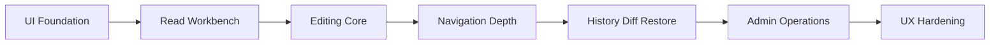

# L.W.S. Frontend Implementation Milestones

Created: 2026-07-31

## 1. Purpose

This document turns the frontend design direction into an implementation sequence. The frontend should grow as an operator-quality wiki workbench, not as a broad but shallow set of pages.

The first goal is to prove the core operating loop with real `/api/lws/*` responses:

```text
browse -> inspect -> edit -> validate -> reindex/recover enough to continue working
```

The frontend implementation uses:

```text
Radix primitives + lucide-react + L.W.S.-owned CSS design system
```

Radix should provide accessibility-sensitive interaction primitives. L.W.S. CSS should own the visual language, density, layout, color, tables, panels, and workbench-specific surfaces.

## 2. Milestone Strategy

The milestones are ordered by UX dependency, not only by feature category.



Do not treat later milestones as rejected scope. They are deferred so the early workbench can be used with real data before deeper operational workflows are locked in.

## 3. Implementation Slices

Milestones define the main concern for each stage. They should not be implemented as isolated rooms. L.W.S. frontend screens share object selection, permission hints, index state, editor state, graph context, and admin recovery affordances, so each implementation pass should be a vertical slice through the user workflow.

Core rule:

```text
vertical slice first
then deepen by milestone
```

Recommended slices:

```text
Foundation Slice:
  F0 + F1 + minimum F2
  prove browse -> inspect -> edit -> validate -> reindex/recover

Structure Slice:
  F3 centered, with F2 relation editing improvements
  deepen backlinks, graph navigation, timeline context, and ontology usage

Trust Slice:
  F4 centered, with F2 conflict/error improvements
  deepen history, diff, restore, rev conflict, and mutation recovery UX

Operations Slice:
  F5 centered, with F1 status/index state improvements
  deepen admin jobs, recovery, backup, public boundary, job audit, and unavailable states

Hardening Slice:
  F6 centered
  polish keyboard access, focus behavior, responsive panels, error disclosure, smoke tests, and refresh/failure survival
```

Cross-slice dependency policy:

```text
when implementing F1:
  reserve stable locations for edit actions, permission hints, validation warnings, and admin recovery prompts

when implementing F2:
  expose save result rev/event/warning information in a place that F4 history can later expand

when implementing F3:
  keep graph, timeline, ontology, backlinks, and object detail connected through the same selected-object model

when implementing F4:
  reuse editor state, LWS error mapping, and backend-returned event ids; do not introduce arbitrary patch input

when implementing F5:
  reuse global status, index state, permission denied, and job envelope display patterns from earlier slices
```

This approach prevents wide-but-shallow pages while still allowing later features to leave small hooks in earlier screens.

## 4. Milestones

### F0 - UI Foundation

Goal:

```text
Create the reusable UI foundation that all workbench screens use.
```

Implementation scope:

```text
install lucide-react
install focused @radix-ui/react-* primitive packages
create L.W.S. CSS design system
create app shell layout primitives
create local wrappers for button, icon button, badge, panel, tabs, dialog, tooltip, select, switch, and dropdown menu as repetition appears
define loading, empty, error, permission, and index-state display patterns
```

Exit criteria:

```text
new frontend screens do not need to re-decide core UI patterns
icon-only controls have accessible labels and tooltips
dialog/tab/menu/select/switch interactions use Radix primitives when they are introduced
visual style remains owned by L.W.S. rather than inherited from a generic UI kit
```

### F1 - Backend-Integrated Read Workbench

Goal:

```text
Browse and inspect real backend v1 data safely.
```

Implementation scope:

```text
LWS API client
AppShell
Dashboard
Object Explorer
search and basic filters
Object Detail readonly
Graph readonly view with list alternative
thin Timeline and Ontology readonly entry points
status/session/permission/index indicators
LWS error state mapping
```

Exit criteria:

```text
can browse real node and edge objects
can search public/visible objects
can open readonly object detail without direct storage access
can inspect basic graph, timeline, and ontology information
private data is not leaked in anonymous mode
index missing/stale/corrupt/schema mismatch states render useful action hints
```

### F2 - Editing Core

Goal:

```text
Support the primary wiki operation loop: create and update node/edge objects with explicit save.
```

Implementation scope:

```text
create node
create edge
patch node
patch edge
explicit save
draft/clean/dirty/saving/saved/save failed states
validation error display
rev conflict state
relation selector
source and target object search for edge editing
public edge boundary warning
local draft preservation after failed save
```

Exit criteria:

```text
can create and update real node and edge objects
can create relation edges between objects
can submit PATCH with base_rev and generated JSON Patch
can handle validation, permission, and rev conflict errors
can preserve local drafts on failed save
```

### F3 - Navigation Depth

Goal:

```text
Make objects feel like part of a graph/wiki structure rather than isolated JSON records.
```

Implementation scope:

```text
Object Detail tab expansion
backlinks and outgoing relations
selected object inspector improvements
richer Graph Explorer
Timeline Explorer baseline modes
Ontology Manager readonly usage view
object-like display for type, tag, and relation type concepts
향후 ontology system 개선은 별도 계획으로 진행한다
```

Exit criteria:

```text
can move naturally from an object to related objects, relation edges, ontology concepts, and timeline items
graph view works as an object navigation surface rather than a decorative demo
timeline and ontology views provide enough context to guide editing decisions
```

### F4 - History, Diff, Restore

Goal:

```text
Make object history and recovery understandable and safe.
```

Implementation scope:

```text
History tab
event detail
diff view
restore action
restore confirmation
mutation failure recovery hint
technical detail disclosure for safe error details
```

Exit criteria:

```text
can inspect object history
can view diff for a selected backend-returned event id
can restore from a backend-returned event id only
restore UX does not expose arbitrary patch path input
users can understand the new rev/event result after restore
```

### F5 - Admin Operations

Goal:

```text
Let a trusted local operator inspect, repair, and maintain backend v1 runtime health.
```

Implementation scope:

```text
Admin dashboard
validation job
reindex job
backup job
recovery report and repair action
public boundary check
materialize core ontology
job list/detail/cancel
job progress/result/warnings/audit display
permission denied and admin unavailable states
```

Exit criteria:

```text
can run guarded admin jobs in local-admin mode
can observe progress, result, warning, error, and audit information
can recover missing/stale/corrupt index states through the reindex path
admin route permission denial safely degrades without spoofing controls
```

### F6 - UX Hardening

Goal:

```text
Turn the alpha workbench into a UI that can be used for sustained wiki operation.
```

Implementation scope:

```text
layout polish
responsive collapsible panels
keyboard navigable navigation and object table
visible focus state audit
dialog/drawer focus behavior audit
status announcements where appropriate
error detail panels
loading and empty state coverage
route-level frontend integration tests
basic HTTP smoke tests
failed request and refresh survival checks
```

Exit criteria:

```text
major user flows survive refresh and failed requests
keyboard and focus behavior are usable across primary workbench flows
graph canvas has an accessible list alternative
the workbench is ready for real local alpha operation
```

## 5. First Implementation Target

The first implementation target should be the Foundation Slice: `F0 + F1 + the minimum F2 slice`.

Minimum F2 slice:

```text
create node
edit node
create edge
edit edge
explicit save
validation and permission error display
draft preservation after failed save
```

This is intentionally smaller than F1-F6. It proves the core operating loop before history, restore, full admin operations, and deeper ontology/timeline UX are locked in.

## 6. Deferred Until Later Milestones

These items should not block the first usable frontend:

```text
full history/diff/restore
full timeline explorer
full ontology manager
backup/recovery/public-boundary/materialize-core-ontology admin UX
production auth UI
visual merge/diff editor
drag-to-connect graph editing
full accessibility hardening pass
advanced graph algorithms
advanced search UI
permission administration UI beyond readonly hints
```

## 7. Verification Baseline

Every frontend milestone should keep the existing backend regression green unless a migration explicitly updates the contract.

Baseline commands:

```powershell
npm.cmd run build
npm.cmd run test:milestone-m7
```

Frontend-specific smoke tests should be added once the first integrated workbench routes and user flows are implemented.
