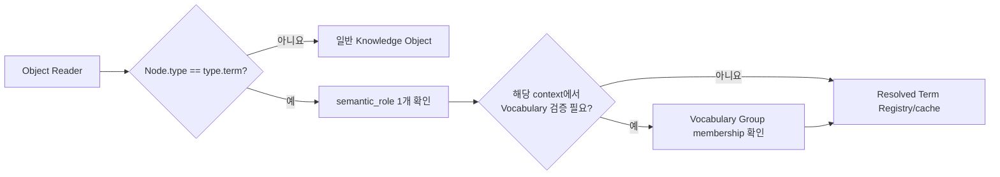
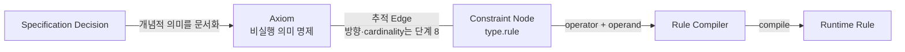
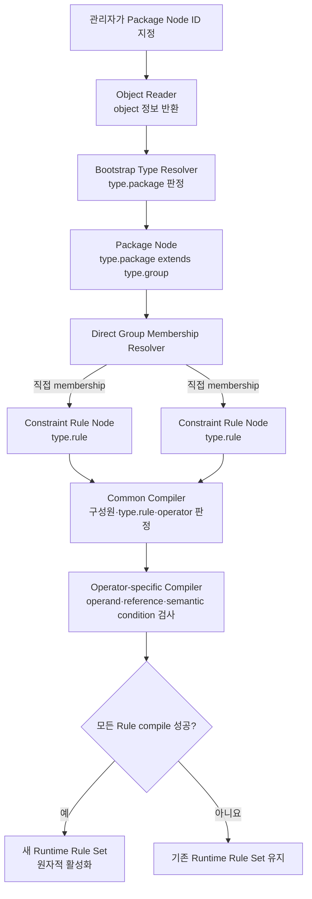
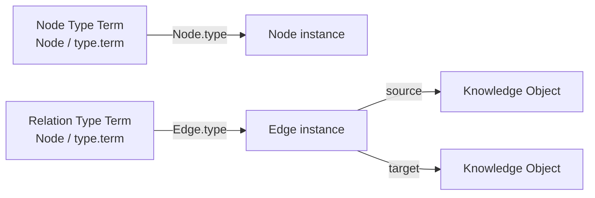
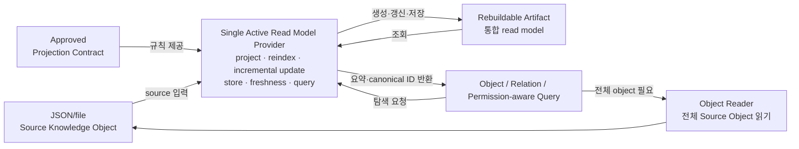
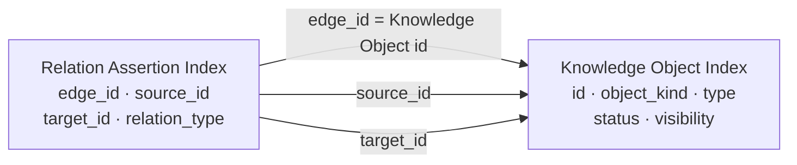
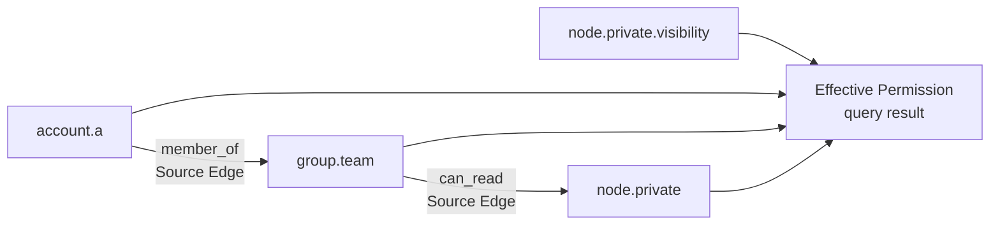

# L.W.S. Ontology Specification

상태: Draft — 단계별 ontology 규범 확립 중

이 문서는 L.W.S. ontology 체계를 단계적으로 논의하고 최종 확립하기 위한 단일 기준 문서다.
앞으로 각 단계를 순서대로 논의하여 내용을 추가한다. 단계별 규칙은 0.6에서 정의한
`Specification Authority`의 명시적 승인과 문서화 요청을 거쳐 기록하며, 논의 중 동의나
잠정 합의만으로 문서를 수정하지 않는다.

## 기존 ontology 문서의 폐기 및 과거 자료 이관

본 문서가 검토를 마치고 **Canonical** 상태로 승인되면 아래 문서는 현행 규범에서 폐기한다.
내용이 본 문서에 반영되었는지 확인한 뒤 `docs/archive/ontology/`로 이동하여 과거 자료로
보존하거나, 보존 가치가 없는 중복본은 제거한다. 이 작업은 Canonical 승인 이후의 별도
변경으로 수행하며, 지금은 기존 문서를 참고 자료로 유지한다.

| 처리 대상 | Canonical 승인 후 처리 | 이유 |
| --- | --- | --- |
| `docs/LWS_ONTOLOGY_MODEL.md` | 과거 자료 이관 또는 제거 | 현재 구현 인벤토리와 Group ontology 초안 |
| `docs/plans/LWS_ONTOLOGY_SYSTEM_DISCUSSION_AND_PLAN.md` | 과거 자료 이관 | node-first ontology 설계 경위와 초기 논의 |
| `docs/plans/LWS_GROUP_ONTOLOGY_MIGRATION_PLAN.md` | 과거 자료 이관 | 확정 specification 이전의 Group migration proposal |
| `docs/plans/LWS_EDGE_DEFINITION_INSTANCE_PLAN.md` | 과거 자료 이관 | Definition/Relation model 확정 전의 edge definition proposal |

`LWS_NODE_MODEL.md`, `LWS_EDGE_MODEL.md`, `LWS_PROPS_CONVENTION.md`,
`LWS_BACKEND_DESIGN.md`는 ontology 전용 문서가 아니라 현행 저장·구현 계약이므로 이 폐기
목록에 포함하지 않는다. 다만 본 specification과 충돌하는 내용은 Canonical 승인 뒤 별도
compatibility/migration 기록으로 정리한다.

## 목차

### [단계 0 — 문서 권위와 의사결정 규범](#stage-0)

1. 문서의 목적과 적용 범위
2. Canonical specification의 권위와 관련 문서의 우선순위
3. `Current`, `Target`, `Compatibility`, `Deprecated`, `Unresolved`의 의미
4. `MUST`, `MUST NOT`, `SHOULD`, `MAY` 규범어
5. 논의, 승인, 변경, 폐기 절차
6. 단계별 기록 형식과 Exit Criteria
7. Ontology 전체 확립의 완료 조건

### [단계 1 — Ontology의 정의와 시스템 경계](#stage-1)

1. L.W.S.에서 Ontology의 정의
2. Ontology, Knowledge Graph, Schema, Validation, Projection의 구분
3. Ontology graph, domain ontology, instance graph의 층위
4. Ontology가 책임지는 것과 책임지지 않는 것
5. 초기 목표와 non-goal
6. Open-world와 closed-world 해석 정책

### [단계 2 — 저장 철학과 Ontology bootstrap](#stage-2)

1. “의미 있는 모든 것은 Node이다”의 정확한 범위
2. First-class Node/Edge와 literal/property의 판정 기준
3. Source Knowledge Object와 event/history의 source-of-truth 지위
4. Index·projection과 rebuildable artifact의 지위
5. 최소 bootstrap kernel
6. In-code registry와 materialized ontology의 관계
7. Meta-circular Type과 self-description 규칙
8. Built-in term 충돌 시 우선순위와 drift 처리

### [단계 3 — Core meta-model과 semantic role](#stage-3)

1. Ontology Term의 공통 contract
2. Node Type
3. Relation Type
4. Tag
5. Property
6. Definition
7. Axiom/Constraint
8. Group과 Group Role
9. Ontology Profile 또는 Vocabulary Set
10. Term role 판정과 role mismatch
11. Core term과 domain term의 구분

### [단계 4 — 식별자, namespace, version, lifecycle](#stage-4)

1. Canonical ID와 namespace 규칙
2. Stable identity와 rename 금지 원칙
3. Slug, label, alias와 ID의 구분
4. Object revision과 semantic version의 구분
5. Definition version과 authoritative version 선택
6. Term lifecycle: draft, active, deprecated, retired
7. Object status와 ontology lifecycle의 관계
8. Deprecation, replacement, successor, compatibility alias
9. Term 삭제와 기존 usage 보존 정책

### [단계 5 — Type과 classification 규칙](#stage-5)

1. Instance의 primary Type
2. Single Type와 multiple Type 정책
3. Type hierarchy와 `subclass_of`
4. Type inheritance의 적용 범위
5. Tag의 classification 의미
6. Type와 Tag의 경계
7. Type/Tag 사용 가능 상태와 visibility
8. Unknown, virtual, unresolved term 처리
9. Type 변경의 semantic impact

### [단계 6 — Relation과 statement 규칙](#stage-6)

1. Relation Type과 Edge Instance의 구분
2. Relation Definition, Relation Profile, Edge Template의 구분
3. Directed, symmetric, inverse relation
4. Structural endpoint object-kind policy
5. Semantic domain/range policy
6. Relation별 source/target role policy
7. Edge를 endpoint로 사용하는 관계
8. Qualified statement와 reification 기준
9. Evidence, provenance, confidence, temporal qualifier
10. Relation identity, 중복, uniqueness, cardinality
11. Inactive 또는 deprecated Relation의 기존 Edge 처리

### [단계 7 — Property와 value model](#stage-7)

1. `props`와 ontology Property의 관계
2. Property ID와 JSON path
3. Datatype과 value shape
4. Required, optional, default value
5. Cardinality와 collection value
6. Enum, reference, embedded object
7. Inline temporal wrapper와 temporal property
8. Unit, locale, normalization
9. Unknown/custom Property 확장 정책
10. JSON Schema와 ontology property rule의 우선순위
11. Property 변경과 instance compatibility

### [단계 8 — Definition, Axiom과 Constraint model](#stage-8)

1. Definition의 목적과 소유 대상
2. Definition의 revision, version, citation
3. 단순 assertion Edge와 Axiom Node의 선택 기준
4. Axiom의 canonical shape
5. Rule kind와 operator vocabulary
6. Domain/range, property, cardinality, lifecycle Axiom
7. Severity, rationale, evidence, exception
8. Validity period와 effective version
9. Axiom 사이의 의미 관계와 conflict
10. Constraint evaluation과 explainability
11. Enforcement policy와 Axiom 자체 의미의 분리

### [단계 9 — Validation과 semantic issue](#stage-9)

1. Shape, reference, role, semantic validation의 단계
2. Advisory, warning, blocking validation
3. Validation code와 governing Term/Axiom/Constraint
4. Deterministic evaluation과 validation ordering
5. Legacy-invalid source 처리
6. False positive, exception, waiver
7. Issue provenance와 lifecycle
8. Curator disposition과 remediation
9. Strict validation 승격 기준
10. Mutation validation과 reindex validation의 일관성

### [단계 10 — Group, containment, scope ontology](#stage-10)

1. Group의 canonical identity
2. Container Group과 Principal Group
3. Declared Group Role과 relation-derived role
4. Content membership와 account membership
5. Canonical membership direction
6. Direct membership와 transitive closure
7. Group hierarchy, cycle, depth, provenance
8. Navigation Group과 policy-bearing Group
9. Scope/Collection legacy compatibility
10. Workspace/root/global query context
11. Group migration 이후의 canonical contract

### [단계 11 — Permission과 ontology governance](#stage-11)

1. Ontology vocabulary의 소유권과 governance boundary
2. Core ontology와 domain ontology
3. Curator, author, operator의 역할
4. Term 생성, 수정, 승인, 폐기 권한
5. Term visibility와 instance validity의 관계
6. Private term과 private usage 보호
7. Direct capability와 Group capability
8. Membership과 permission effect의 분리
9. Multi-Group permission conflict
10. Workspace-wide capability
11. `can_manage_in`과 ontology 관리 권한
12. Self-escalation과 last-manager safety

### [단계 12 — Materialization contract](#stage-12)

1. Materialization의 정의와 범위
2. Core ontology materialization
3. Virtual/reference term materialization
4. Domain ontology materialization
5. Projection, migration과 materialization의 구분
6. Dependency ordering과 bootstrap sequence
7. Dry-run inventory와 impact report
8. Create, skip-equivalent, conflict-preserved, repair-proposed
9. Idempotency와 deterministic output
10. Event/history와 mutation contract
11. Atomicity, failure recovery, resume
12. Reindex와 post-materialization validation
13. Rollback과 source preservation

### [단계 13 — Projection, query, explanation](#stage-13)

1. Ontology term projection
2. Term usage와 reverse usage
3. Assertion과 constraint projection
4. Type/Group hierarchy projection
5. Source/projection과 backing source 구분
6. Validation issue projection
7. Effective permission explanation
8. Permission-aware usage count와 metadata 보호
9. Projection freshness와 fail-closed 정책
10. Source-only rebuild와 parity 검증

### [단계 14 — Compatibility와 source migration](#stage-14)

1. Current implementation inventory
2. Legacy term과 virtual ID inventory
3. Compatibility resolver
4. Advisory-only migration 준비
5. Compatibility-only, retype-in-place, successor 전략
6. Reference와 backlink 보존
7. Permission/query 결과 diff
8. Batch migration과 Curator 승인
9. Rollback과 restore rehearsal
10. Legacy API와 projection retirement
11. 기존 ontology 문서의 폐기 또는 과거 자료 이관

### [단계 15 — Canonical core ontology vocabulary](#stage-15)

1. Core Type 목록과 Definition
2. Core Relation 목록과 Definition
3. Core Property 목록과 Definition
4. Core Tag와 classification policy
5. Core Axiom, 이를 operationalize하는 Constraint와 validation code
6. Group/permission vocabulary
7. Definition/replacement vocabulary
8. Materialization manifest와 ontology version
9. Reserved term과 extension point

### [단계 16 — API, editor, explorer](#stage-16)

1. Ontology read API
2. Term detail, usage, constraint API
3. Validation explanation API
4. Curator mutation API
5. Type/Tag/Relation/Property 선택 UX
6. Advisory editing guidance
7. Readonly ontology explorer
8. Impact review와 deprecation workflow
9. Accessibility와 permission-aware UI
10. API versioning과 compatibility alias

### [단계 17 — Conformance와 reference domain](#stage-17)

1. Conformance level과 지원 범위
2. 최소 reference domain ontology
3. Valid/invalid instance fixture
4. Type, Relation, Property, Axiom–Constraint 추적과 Constraint validation test
5. Group hierarchy와 permission fixture
6. Materialization idempotency test
7. Full reindex/incremental parity
8. Permission과 private metadata security test
9. Migration/restore rehearsal
10. Specification acceptance criteria

### [단계 18 — 구현과 release 전환](#stage-18)

1. 구현 dependency와 phase ordering
2. Advisory-only 최초 release
3. Core materialization release gate
4. Domain ontology opt-in
5. Strict validation activation gate
6. Group migration gate
7. API/UI cutover
8. Legacy retirement gate
9. Monitoring, audit, operational recovery
10. Canonical specification 승인

### [단계 19 — 확장 과제와 부록](#stage-19)

1. Deferred reasoning
2. Inverse/subclass inference
3. External ontology import/export
4. RDF/OWL/SHACL 호환성 검토
5. Ontology package와 federation
6. 용어집
7. Canonical ID registry
8. Validation code registry
9. Decision log
10. Superseded design history
11. 관련 문서와 migration map

---

<a id="stage-0"></a>
## 단계 0 — 문서 권위와 의사결정 규범

단계 상태: **Completed**

승인일: 2026-08-10

승인 주체: 초기 `Specification Authority`

### 0.1 문서의 목적과 적용 범위

**Decision**

`L.W.S. Ontology Specification`은 기존 설계와 구현을 초안 및 근거 자료로 재검토하여
L.W.S. ontology의 개념, 표현, 해석, validation, materialization, governance와
compatibility를 구현 가능한 수준으로 재정립하는 유일한 규범 문서다.

기존 설계 문서, 현재 구현과 기존 데이터는 자동으로 Target ontology의 규범이 되지 않는다.
기존 규칙은 이 specification에서 명시적으로 재승인된 경우에만 Target ontology의 규범이
된다.

이 specification은 다음 세 수준을 연결해야 한다(MUST).

1. **개념 규칙**: Type, Relation, Property, Definition, Axiom 등 ontology 요소의 의미
2. **표현 규칙**: 그 의미를 Node, Edge, ID, field와 `props`로 기록하는 방식
3. **실행 규칙**: validator, materializer, projection과 query가 그 표현을 해석하는 방식

중요한 Decision은 해당되는 경우 다음 대상으로 이어지는 추적 정보를 제공해야 한다(SHOULD).

```text
Decision
├─ source shape 또는 schema
├─ validation rule
├─ materialization rule
├─ projection/query rule
├─ compatibility/migration
└─ conformance test
```

모든 Decision이 위 대상을 전부 가져야 하는 것은 아니다. 해당되지 않는 연결은 생략할 수
있다(MAY).

이 specification의 Decision은 ontology 의미와 구현 목표를 확정하지만, 그 자체로 source
mutation, migration 실행, materialization 실행 또는 permission 완화를 승인하지 않는다.
실제 변경은 0.6의 별도 실행 승인 절차를 따라야 한다(MUST).

**Rationale**

초기 설계의 유효한 기반을 보존하면서도 불명확하거나 우연히 구현된 동작을 영구 규범으로
고정하지 않기 위함이다. 추상적인 개념 설명에 그치지 않고 source 표현과 실행 결과까지
연결해야 구현과 conformance를 객관적으로 판정할 수 있다.

### 0.2 문서 권위, 우선순위와 충돌 처리

**Decision**

문서 권위는 하나의 단순한 우선순위로 판단하지 않는다. 다음 세 축을 분리해야 한다(MUST).

1. 무엇이 올바른 ontology 의미인가: **의미 규범의 권위**
2. 현재 무엇이 실제로 실행되는가: **현재 동작 판정의 권위**
3. 지금 무엇을 변경할 수 있는가: **변경 권한과 실행 순서**

#### 0.2.1 의미 규범의 권위

Target ontology의 의미를 판정할 때는 다음 규범 우선순위를 적용해야 한다(MUST).

```text
1. 이 specification에 기록된 Decision
2. 이 specification에 기록된 Compatibility
```

`Decision`은 최종 목표 규칙이다. `Compatibility`는 Decision으로 이행하는 동안에만 효력이
있는 임시 규칙이며, Decision의 의미를 영구적으로 변경할 수 없다(MUST NOT).

다음 자료는 규범이 아니라 논의와 사실 확인을 위한 근거다.

```text
1. Proposal
2. 검증된 Current evidence
3. 과거 설계 문서와 구현 보고서
4. 문서에 기록되지 않은 추정
```

Proposal이나 현재 구현은 Specification Decision을 대신할 수 없다(MUST NOT). 적용되는
Decision이 없으면 임의로 Target 규칙을 추론하지 않고 `Unresolved`로 남겨야 한다(MUST).

#### 0.2.2 현재 동작 판정의 권위

Current evidence가 서로 충돌할 때는 다음 우선순위로 현재 동작을 판정해야 한다(MUST).

```text
1. 실행 코드와 schema
2. 해당 동작을 검증하는 test
3. 실제 source와 projection을 이용한 재현 결과
4. 구현 보고서
5. 설계 문서의 Current 설명
```

상위 근거와 하위 근거가 충돌하면 상위 근거를 우선하되, 코드와 test가 서로 충돌하거나
재현 결과가 다르면 확인된 사실로 단정하지 않고 조사 대상 `Current`로 기록해야 한다(MUST).
현재 동작을 설명할 때 코드가 우선한다는 사실은 그 동작을 Target 규칙으로 승인한다는 뜻이
아니다.

#### 0.2.3 변경 권한과 실행 순서

Specification Decision을 실제 코드나 source에 적용할 때는 다음 순서를 따라야 한다(MUST).

```text
1. 승인되고 기록된 Decision을 확인한다.
2. Current와 Decision의 차이를 확인한다.
3. data, API, permission, security와 recovery 영향을 조사한다.
4. Compatibility와 migration 필요 여부를 결정한다.
5. 구현 또는 migration 실행안을 작성한다.
6. `Execution Authority`가 실행안을 검토하고 실행을 승인한다.
7. 승인된 범위에서 변경을 실행한다.
8. test, inventory와 rebuild로 conformance를 검증한다.
9. 임시 Compatibility를 제거하거나 유지 조건과 기한을 기록한다.
```

Decision이 있다는 이유만으로 기존 source를 자동 rewrite하거나 security boundary를 완화해서는
안 된다(MUST NOT).

#### 0.2.4 충돌 처리

Specification과 현재 구현의 차이가 확인되면 적용 가능한 다음 절차를 순서대로 수행해야
한다(MUST).

```text
1. 적용되는 Decision을 식별한다.
2. 코드, schema와 source의 Current 동작을 검증한다.
3. 둘을 비교한다.
4. 일치하면 Conformant candidate로 검증한다.
5. 다르면 Implementation Gap으로 분류한다.
6. Gap을 구현 결함, Compatibility, source migration, security review,
   specification 재논의 중 하나 이상으로 분류한다.
7. 처리 전략과 구체적인 변경 절차를 실행안으로 작성한다.
8. `Execution Authority`가 실행안을 검토하고 실행을 승인한다.
9. 구현 또는 migration을 수행한다.
10. conformance를 검증한다.
11. Compatibility를 종료하거나 잔여 조건을 기록한다.
```

각 Implementation Gap에는 다음 표에서 해당하는 처리 방향을 모두 적용해야 한다(MUST).

| 상황 | 처리 방향 |
| --- | --- |
| 안전하게 즉시 수정할 수 있는 구현 차이 | 구현 결함으로 수정 |
| 기존 데이터가 영향을 받는 차이 | Compatibility와 migration 선행 |
| permission 결과가 달라지는 차이 | security diff와 별도 실행 승인 필요 |
| source rewrite가 필요한 차이 | dry-run, backup과 restore 검증 후 진행 |
| Specification의 맹점이 발견된 경우 | 구현을 중단하고 Decision을 재논의 |
| 현재 동작이 더 엄격한 security boundary인 경우 | 명시적 security 승인 전까지 더 엄격한 동작 유지 |

### 0.3 문서와 구현의 상태 체계

**Decision**

Specification 상태와 implementation 상태를 서로 독립된 축으로 관리해야 한다(MUST).

#### Specification status

| 상태 | 의미 |
| --- | --- |
| `Outline` | 목차와 논의 순서만 정립된 상태 |
| `Draft` | 단계별 Proposal과 Decision 작성이 진행 중인 상태 |
| `Candidate` | 필수 규칙이 작성되어 최종 검토 중인 상태 |
| `Canonical` | L.W.S. ontology의 유일한 현행 규범으로 승인된 상태 |
| `Superseded` | 후속 specification으로 대체된 상태 |

#### Implementation status

| 상태 | 의미 |
| --- | --- |
| `Not Implemented` | 해당 Decision을 구현하지 않은 상태 |
| `Partially Implemented` | 일부 구현 또는 Compatibility/migration 진행 상태 |
| `Conformant` | 코드, source 처리, projection과 test가 적용 Decision을 만족하는 상태 |

Specification이 `Canonical`이라는 사실만으로 구현이 `Conformant`가 되지 않는다. 두 상태를
결합하면 다음과 같이 해석한다.

| Specification | Implementation | 의미 |
| --- | --- | --- |
| `Draft` | Current only | 목표 규칙을 논의 중이며 확정된 전체 목표가 없음 |
| `Canonical` | `Not Implemented` | 목표는 확정됐지만 구현하지 않음 |
| `Canonical` | `Partially Implemented` | Compatibility 또는 migration을 거치는 중 |
| `Canonical` | `Conformant` | 구현과 검증 결과가 규범을 만족함 |
| `Superseded` | 기존 `Conformant` | 후속 specification으로 전환 계획이 필요함 |

Canonical과 Conformant의 분리는 불일치를 허용된 최종 상태로 방치하기 위한 것이 아니다.
Canonical Decision과 다른 현재 구현은 명시적으로 관리하고 해소해야 하는
`Implementation Gap`이다(MUST).

### 0.4 본문 기록 상태와 사용 방식

**Decision**

각 주제는 필요한 상태만 사용하되, 사실·논의안·규범·과도기 규칙을 혼합해서는 안 된다
(MUST NOT).

| 기록 상태 | 의미와 효력 |
| --- | --- |
| `Current` | 검증된 현재 동작 또는 데이터 상태. Target 규범이 아님 |
| `Proposal` | 논의 중인 안. 구현 또는 migration 근거로 사용할 수 없음 |
| `Decision` | 승인되고 문서에 기록된 Target 규범 |
| `Rationale` | Decision을 채택한 이유. Decision의 규범 문구를 변경하지 않음 |
| `Compatibility` | Decision으로 이행하기 위한 임시 허용 규칙 |
| `Deprecated` | 아직 지원하지만 제거 대상으로 지정된 규칙 또는 surface |
| `Unresolved` | 아직 결정되지 않은 문제. 0.7에 따라 `Blocking`, `Deferred`, `Execution-scoped`로 분류해야 함 |
| `Rejected` | 검토했지만 채택하지 않은 안과 그 이유 |
| `Exit Criteria` | 단계 논의 또는 구현 전환의 완료 조건 |

대화 중 합의는 자동으로 문서에 기록되지 않으며 자동으로 Decision 효력을 갖지 않는다.
`Specification Authority`의 명시적 문서화 요청, 문서 반영과 검토를 거쳐야 한다(MUST).

다음은 기록 형식의 **비규범 예시(설명용 예시)**다. 이 예시는 `Node.type`의 실제 규칙을 확정하지 않는다.

```text
주제: Node.type의 semantic role

Current:
  built-in Type ID이거나 존재하는 Node ID이면 허용한다.

Proposal:
  Node.type은 active Node Type term을 참조해야 한다.

Rationale:
  임의 Node를 Type으로 사용하면 validation 경계가 불명확해진다.

Compatibility:
  기존 arbitrary Node reference를 migration 동안 warning으로 허용한다.

Unresolved:
  deprecated Type의 기존 사용을 계속 허용할지 결정하지 않았다.

Rejected:
  prefix만으로 Type 역할을 판정하는 안.

Decision:
  승인된 규범 문장을 기록한다.

Exit Criteria:
  resolver, inventory, validation과 conformance fixture가 준비되어야 한다.
```

### 0.5 규범어와 사용 방식

**Decision**

대문자로 쓴 `MUST`, `MUST NOT`, `SHOULD`, `SHOULD NOT`, `MAY`만 이 문서의 규범어로
사용한다. 일반 서술의 “필수”, “권장” 또는 “가능”은 문맥 설명이며 규범어를 대신하지 않는다.

| 규범어 | 의미 |
| --- | --- |
| `MUST` | Conformance를 위해 반드시 만족해야 하는 요구사항 |
| `MUST NOT` | Conformance를 위해 반드시 금지되는 동작 |
| `SHOULD` | 원칙적으로 따라야 하며 예외에는 명시적 이유가 필요한 요구사항 |
| `SHOULD NOT` | 원칙적으로 금지되며 예외에는 명시적 이유가 필요한 동작 |
| `MAY` | 구현 또는 domain이 선택할 수 있는 기능이나 동작 |

규범 문장은 가능한 한 다음 형식을 따라야 한다(SHOULD).

```text
[주체]는 [조건]에서 [행동]해야 한다(MUST/SHOULD/MAY).
위반 여부는 [관찰 가능한 결과]로 판정한다.
```

다음은 규범어의 문법과 강도를 보여 주는 **비규범 예시(설명용 예시)**이며, 이후 단계의 substantive
Decision을 선결하지 않는다.

```text
MUST:
  Materializer는 변경되지 않은 동일 source에 대한 반복 실행에서 동일한
  결과를 생성해야 한다.

MUST NOT:
  Role resolver는 ID prefix만으로 사용자 정의 Node의 semantic role을
  확정해서는 안 된다.

SHOULD:
  Curator는 active Term을 deprecated로 전환할 때 replacement를 제공해야 한다.

SHOULD NOT:
  Materializer는 사람이 작성한 Definition을 자동으로 덮어쓰지 않아야 한다.

MAY:
  Domain ontology는 Property의 권장 표시 단위를 선언할 수 있다.
```

`SHOULD` 또는 `SHOULD NOT`의 예외는 이유와 영향을 기록해야 한다(MUST). `MAY` 기능을
사용하지 않는 구현은 그 이유만으로 비준수로 판정하지 않으며, consumer는 `MAY` 기능이 항상
존재한다고 가정해서는 안 된다(MUST NOT).

“적절하게”, “안전하게”, “필요에 따라”처럼 위반 여부를 객관적으로 판정할 수 없는 표현을
단독 규범으로 사용해서는 안 된다(MUST NOT). `MUST`가 기록되었다는 사실은 구현 완료를
뜻하지 않으며 implementation status로 별도 판정해야 한다(MUST).

### 0.6 의사결정, 문서화와 실행 승인 절차

**Decision**

#### 0.6.1 권한 주체

이 specification에서 별도 한정 없이 의사결정 주체로 지칭한 `사용자`는 L.W.S. 프로젝트
소유자를 뜻한다. L.W.S. 프로젝트 소유자는 초기 `Specification Authority`이자 초기
`Execution Authority`다.

`Specification Authority`는 이 specification의 Proposal을 Decision으로 승인하고, 기록·변경·
폐기 및 문서화를 요청할 수 있는 권한 주체다. `Execution Authority`는 승인된 Decision을
적용하기 위한 implementation, materialization, migration, source rewrite 또는 permission
변경의 실행을 승인할 수 있는 권한 주체다.

별도 위임이 없으면 `Specification Authority`가 `Execution Authority`를 겸한다. 두 Authority는
권한의 전부 또는 일부를 위임할 수 있다(MAY). 권한 위임에는 위임자, 수임자, 권한 범위,
허용 행위, 유효 시점, 종료 또는 철회 조건을 명시적으로 기록해야 한다(MUST).

일반 L.W.S. 사용자, Curator, 구현 담당자, 자동화 도구 또는 Codex를 명시적인 위임 없이
`Specification Authority`나 `Execution Authority`로 간주해서는 안 된다(MUST NOT).

#### 0.6.2 승인 종류

승인 종류는 `Specification 승인`과 `실행 승인` 두 가지로 구분해야 한다(MUST). 실행안의
작성과 검토는 실행 승인에 포함되는 절차이며 별도의 세 번째 승인 종류가 아니다.

```text
Specification 승인:
  ontology 의미, canonical 표현, 요구 동작, Compatibility, Conformance와
  구현이 지켜야 할 contract를 구체화하고 승인한다.

실행 승인:
  실제 구현 방식, migration 절차, 영향, recovery, test와 실행 시점을 담은
  실행안을 검토하고 실제 변경을 승인한다.
```

#### 0.6.3 Specification 의사결정 및 문서화

Specification Decision은 다음 절차를 따라야 한다(MUST).

```text
1. Issue를 제기한다.
2. Current evidence를 확인한다.
3. 목표와 제약을 확인한다.
4. 가능한 대안을 작성한다.
5. 의미, 구현, migration과 security 영향을 비교한다.
6. 잠정 합의를 도출한다.
7. 남은 Unresolved를 확인한다.
8. `Specification Authority`가 규칙을 명시적으로 승인한다.
9. `Specification Authority`가 문서화를 명시적으로 요청한다.
10. Decision, Rationale와 필요한 Compatibility를 문서에 반영한다.
11. `Specification Authority`가 반영 결과를 검토한다.
12. 기록된 Decision이 규범 효력을 갖는다.
```

논의 중의 동의, 잠정 합의, `Specification Authority`의 규칙 승인과 문서화 요청은 동일한
행위로 간주하지 않는다(MUST NOT). `Specification Authority`의 명시적 문서화 요청이 없으면
파일을 수정해서는 안 된다(MUST NOT).

#### 0.6.4 실행 승인

기록된 Decision을 실제 시스템에 적용하려면 다음 실행 승인 절차를 따라야 한다(MUST).

```text
1. 적용할 Decision과 Current의 차이를 확인한다.
2. 변경 범위와 구현 또는 migration 방법을 실행안으로 작성한다.
3. data, API, permission, security와 recovery 영향을 기록한다.
4. dry-run, backup, rollback과 conformance test 방법을 기록한다.
5. `Execution Authority`가 실행안 전체를 검토한다.
6. `Execution Authority`가 실행을 명시적으로 승인한다.
7. 승인된 범위와 절차에 따라서만 변경한다.
8. 실행 결과와 conformance를 검증한다.
```

Specification 승인은 ontology 규칙과 구현이 만족해야 할 contract를 구체화하는 승인이다.
이는 materialization, migration, source rewrite 또는 permission 변경의 실행 승인이 아니다.
실제 구현 방식, migration 절차, 영향, recovery와 실행 시점은 실행안으로 제시하며, 실행
승인에서 함께 검토하고 승인해야 한다(MUST).

이미 기록된 Decision을 변경하거나 폐기할 때도 같은 Specification 의사결정 및 문서화 절차를
적용해야 한다(MUST). 승인된 실행안의 범위나 절차를 변경하려면 변경된 실행안을 다시 검토하고
실행 승인을 받아야 한다(MUST).

### 0.7 단계별 기록 형식과 Ontology 확립 완료 조건

**Decision**

각 단계는 가능한 경우 다음 구조로 작성해야 한다(SHOULD).

```text
단계 목적
Current
Proposal
Decision
Rationale
Compatibility
Deprecated
Unresolved
Rejected
Exit Criteria
```

해당 상태가 없는 항목은 생략할 수 있다(MAY). `Decision`과 `Compatibility`는 구분해야 하며
Compatibility에는 종료 조건 또는 재검토 조건이 있어야 한다(MUST).

모든 `Unresolved`는 다음 세 종류 중 하나로 분류해야 한다(MUST).

| 분류 | 의미 | 승인에 미치는 영향 |
| --- | --- | --- |
| `Blocking` | 필수 의미, 표현, 동작, Compatibility, safety 또는 Conformance를 불명확하게 하는 문제 | Canonical 승인 차단 |
| `Deferred` | 현재 필수 범위 밖의 선택적 또는 후속 기능 | 아래 이관 조건을 만족하면 Canonical 승인 허용 |
| `Execution-scoped` | 구체적인 구현 또는 migration 실행안에 속하는 문제 | Canonical 승인은 허용하지만 관련 실행 승인 차단 |

다음 중 하나 이상에 해당하는 `Unresolved`는 `Blocking`으로 분류해야 한다(MUST).

1. ontology 의미를 불명확하게 한다.
2. canonical source 표현을 불명확하게 한다.
3. 필수 동작이나 금지 동작을 불명확하게 한다.
4. mandatory Compatibility의 적용 또는 종료 조건을 불명확하게 한다.
5. security 또는 source 보존 경계를 불명확하게 한다.
6. Conformance 판정을 불명확하게 한다.
7. 동일한 canonical source와 동일한 조건에 대해 상반된 semantic 해석이나 관찰 가능한 결과를 허용한다.

내부 구현 방식이 다르더라도 동일한 canonical source에 대해 같은 semantic 해석과 관찰 가능한
결과를 생성한다면 그 차이만으로 `Blocking`으로 분류하지 않는다. Specification이 `MAY`로
복수의 동작을 의도적으로 허용한 경우에도 허용 범위와 이를 이용하는 구현체의 처리 방식이
명확하면 그 선택 가능성만으로 `Blocking`으로 분류하지 않는다.

`Unresolved`를 `Deferred`로 이관하려면 다음 조건을 모두 충족해야 한다(MUST).

1. 현재 필수 범위 밖임을 명시한다.
2. 해당 기능이 없을 때의 현재 동작을 정의한다.
3. 기존 Decision의 의미를 변경하지 않는다.
4. 현재 Conformance 판정을 변경하지 않는다.
5. 영향 범위와 다시 논의할 조건을 기록한다.

구체적인 module, migration batch 크기, 배포 시점 또는 backup 경로 같은 문제는
`Execution-scoped`로 분류할 수 있다(MAY). 그러나 복구 가능한 backup의 필요 여부처럼
security나 source 보존의 규범적 경계를 결정하는 문제는 `Execution-scoped`로 낮춰서는 안
되며 `Blocking`으로 분류해야 한다(MUST).

Specification은 다음 조건을 모두 충족한 뒤에만 `Canonical`로 승인할 수 있다(MUST).

1. 단계 0부터 단계 18까지의 필수 규칙이 작성되고 검토되었다.
2. `Blocking Unresolved`가 없다.
3. 모든 `Deferred Unresolved`가 이관 조건을 충족한다.
4. canonical vocabulary, identity와 lifecycle 규칙이 확정되었다.
5. validation, materialization, conflict와 recovery 규칙이 확정되었다.
6. reference domain으로 규칙의 표현 가능성을 검증했다.
7. conformance test와 acceptance criteria가 정의되었다.
8. 기존 ontology 문서의 반영, 폐기 또는 과거 자료 이관 여부가 결정되었다.
9. implementation 및 legacy transition이 따라야 할 규범적 요구사항과 실행 승인 gate가 정의되었다.

`Execution-scoped Unresolved`는 Specification의 Canonical 승인을 차단하지 않지만, 해당 문제가
해결되고 실행안에 반영되기 전까지 관련 작업의 실행 승인을 차단해야 한다(MUST).

단계 19의 deferred reasoning, 외부 ontology 호환과 federation은 명시적으로 필수 범위로
승격되지 않는 한 Canonical 승인을 막지 않는다.

**Exit Criteria**

단계 0은 다음 조건을 충족하면 완료된다.

1. 문서의 목적과 적용 범위가 승인되었다.
2. 의미 규범, Current 판정과 변경 권한의 관계가 승인되었다.
3. 문서 및 구현 상태와 본문 기록 상태가 승인되었다.
4. 규범어와 비규범 예시(설명용 예시)의 사용 방식이 승인되었다.
5. 의사결정, 문서화와 실행 승인의 분리가 승인되었다.
6. Specification의 Canonical 완료 조건이 승인되었다.

위 조건은 2026-08-10 초기 `Specification Authority`의 검토와 승인으로 충족되었다.

[목차로 돌아가기](#목차)

<a id="stage-1"></a>
## 단계 1 — Ontology의 정의와 시스템 경계

단계 상태: **In Discussion**

이 절은 지금까지의 논의를 보존하고 남은 쟁점을 단계별로 나누기 위한 중간 기록이다.
아직 단계 1의 `Decision`이 아니며 규범 효력이나 구현 권한을 갖지 않는다. 논의가 진행되는
동안 내용, 용어, 층위와 후속 단계 배정은 언제든 수정될 수 있다. 단계 1의 규범은 남은
`Unresolved`를 논의한 뒤 `Specification Authority`가 명시적으로 승인하고 문서화를 요청하여
`Decision`으로 기록했을 때 확정된다.

### 단계 1 논의 목차

1. [단계 목적과 논의 범위](#stage-1-purpose)
2. [기존 논의 목적의 포함 여부](#stage-1-agenda-audit)
3. [확인된 Current source shape](#stage-1-current-shape)
4. [L.W.S. Ontology의 정의](#stage-1-ontology-definition)
5. [Knowledge Object와 Node/Edge](#stage-1-knowledge-object)
6. [Ontology, Knowledge Graph, Schema, Validation과 Projection](#stage-1-concept-boundaries)
7. [의미 규칙, JSON Schema와 Semantic Validator](#stage-1-schema-validation)
8. [Ontology graph, domain ontology와 instance graph의 층위](#stage-1-layers)
9. [Source Knowledge Object와 rebuildable artifact](#stage-1-source-derived)
10. [책임 범위와 구현 경계](#stage-1-boundary)
11. [초기 목표와 non-goal](#stage-1-goals)
13. [Open-world와 closed-world 해석 정책](#stage-1-world-assumption)
14. [추가 시스템 경계 질문](#stage-1-cross-cutting)
15. [논의해야 할 사항](#stage-1-unresolved)
16. [Exit Criteria](#stage-1-exit-criteria)

<a id="stage-1-purpose"></a>
### 1.1 단계 목적과 논의 범위

**Decision**

단계 1의 목적은 L.W.S. Ontology가 무엇을 규정하는지, 어떤 대상과 층위를 다루는지, 그리고
어디부터 애플리케이션 구현의 책임인지를 정하는 것이다. 이 단계에서는 Type, Relation, Tag,
Property 또는 Axiom의 개별 vocabulary를 열거하거나 `type.service` 같은 세부 term의 규칙을
확정하지 않는다. 대신 이후 단계에서 세부 term과 object profile을 일관되게 정의할 수 있는
전반적인 틀과 논의 단위를 정한다.

단계 1에서 정한 경계는 이후 단계의 세부 논의를 제한하거나 중복시키기 위한 별도 추상 계층이
아니다. 의미, canonical JSON 표현, validation, materialization과 conformance를 같은 규칙에서
추적할 수 있게 하는 공통 기준이다.

단계 1에서 승인된 Ontology의 정의와 시스템 경계는 이후 단계가 따라야 하는 규범적 큰 틀이다.
후속 단계는 이 큰 틀 안에서 개념, canonical 표현과 실행 contract를 세분화할 수 있지만, 단계
1의 의미 경계를 재정의하거나 그와 충돌하는 규칙을 재승인 없이 도입할 수 없다. 후속 논의에서
큰 틀 자체의 변경이 필요하다고 확인되면 0.6의 Specification 의사결정 및 문서화 절차에 따라
단계 1 Decision을 다시 검토하고 승인해야 한다.

<a id="stage-1-agenda-audit"></a>
### 1.2 기존 논의 목적의 포함 여부

**Current**

단계 1의 기존 목차에 제시된 일곱 논의 목적을 이번 보강 전의 초안과 대조한 결과는 다음과
같다. 여기서 `포함`은 승인 또는 완료를 뜻하지 않고, 상세 논의를 시작할 수 있는 내용이
기록되어 있었다는 뜻이다.

| 기존 논의 목적 | 보강 전 포함 상태 | 확인 결과와 남은 핵심 |
| --- | --- | --- |
| L.W.S.에서 Ontology의 정의 | 상당 부분 포함 | semantic grammar와 canonical object grammar라는 정의 후보가 있다. Knowledge Object의 최소 성질과 ontology가 L.W.S. 로직 전체 중 어디까지를 지배하는지는 미확정이다. |
| Ontology, Knowledge Graph, Schema, Validation, Projection의 구분 | 부분 포함 | JSON Schema, Semantic Validator와 rebuildable artifact는 구분했다. Knowledge Graph 자체의 정의와 다섯 개념 사이 권위·입출력 관계는 아직 명시하지 않았다. |
| Ontology graph, domain ontology, instance graph의 층위 | 상당 부분 포함 | Meta, Core, Domain, Instance, Rebuildable 후보가 있다. `Ontology graph`가 이 층위들을 포괄하는 graph인지 별도 층위인지와 한 object의 층위 소속 규칙은 미확정이다. |
| Ontology가 책임지는 것과 책임지지 않는 것 | 상당 부분 포함 | 의미에 영향을 주는 JSON shape와 내부 구현을 구분했다. query, permission, lifecycle, provenance 중 무엇이 ontology 의미이고 무엇이 애플리케이션 정책인지는 더 나눠야 한다. |
| 초기 목표와 non-goal | 부분 포함 | non-goal 후보는 있으나 긍정적 목표, 우선순위와 성공 판정 기준이 충분히 정리되지 않았다. |
| 명시적 선언과 자동 추론의 경계 | 단계 19로 이관 | 최초 Canonical은 derived assertion을 생성하지 않는다. 자동 inference, 결과의 권위·충돌·provenance와 Source Edge 생성 보조 기능은 확장 reasoning 기능으로 함께 정의한다. |
| Open-world와 closed-world 해석 정책 | 미포함에 가까움 | `Unknown`, `Absent`, `Invalid` 쟁점만 등록되어 있다. 적용 단위, negative assertion, permission과 temporal context까지 논의해야 한다. |

따라서 기존 일곱 목적은 목차상 모두 추적되고 있었지만, 보강 전 상태만으로 완료된 항목은
없었다. 특히 마지막 세 항목과 Knowledge Graph의 정의가 부족하여 1.6과 1.11부터 1.14까지에
정의 후보와 상세 논의 질문을 추가했다. 추가된 내용 역시 승인된 답이 아니라 논의 의제다.

이 절은 단계 1 논의 의제의 누락 여부를 확인하기 위한 임시 감사 기록이다. 단계 1의 각 의제가
Decision 또는 적절한 후속 단계의 `Unresolved`로 정리되고 그 추적이 확인되면, Candidate 정리
과정에서 이 절을 삭제한다. 이 기록 자체를 단계 1의 영구 규범이나 Canonical 완료 조건으로
유지하지 않는다.

<a id="stage-1-current-shape"></a>
### 1.3 확인된 Current source shape

**Current**

현재 L.W.S.는 Node와 Edge를 각각 JSON object로 저장하며, `object_kind`를 discriminator로
사용한다. 현재 `schemas/node.schema.json`과 `schemas/edge.schema.json`을 기준으로 확인한
필수 field의 공통 부분과 차이는 다음과 같다.

| 구분 | Current 필수 field |
| --- | --- |
| Node와 Edge 공통 | `schema_version`, `object_kind`, `id`, `rev`, `type`, `title`, `detail_mode`, `visibility`, `status`, `tags`, `props`, `temporal`, `audit` |
| Node에만 존재 | `slug` |
| Edge에만 존재 | `source`, `target` |

현재 Node schema는 `slug`를 필수로 요구하고 Edge schema는 `slug`를 정의하지 않는다. 이 차이는
검증된 `Current`이며, Node만 slug를 가져야 한다는 Target 규칙은 아니다. 모든 Knowledge
Object에 slug가 필요한지, 선택적인지, `title`에서 생성할 수 있는지, 고유성과 변경 시 alias를
어떻게 다룰지는 단계 4에서 결정해야 한다.

현재 shape에서 `id`는 canonical identity와 reference에 사용되고, `title`은 사람이 읽는 표시
이름이다. 다만 현재 mutation의 중복 검사는 Node와 Edge의 각 object kind 안에서만 수행한다.
따라서 같은 문자열 ID의 Node와 Edge가 동시에 존재할 가능성을 전역적으로 차단하지 않으며,
일반 object 조회는 같은 ID의 Node를 Edge보다 먼저 선택하고 SQLite `objects` projection은
`id` 하나를 primary key로 사용한다. 현재 `id`가 identity와 reference에 사용된다는 사실만으로
Node와 Edge 전체에 걸친 전역 uniqueness와 모호하지 않은 resolution이 보장된다고 볼 수 없다.

`title`은 필수인 사람이 읽는 표시 이름이지만 변경과 중복이 가능하다. `slug`는 현재 Node에만
필수인 URL-safe 문자열이며 Node projection과 편집 surface에 존재한다. 현재 구현은 slug의
uniqueness, ID를 대체하는 lookup, URL routing 또는 alias 의미를 보장하지 않는다. `aliases`는
별도의 선택 field이므로 현재 `slug`를 자동으로 address나 alias로 해석하지 않는다.

위 표는 JSON Schema에 선언된 **top-level 필수 field inventory**이며 전체 Current source
grammar를 뜻하지 않는다. 두 JSON Schema는 `additionalProperties: true`를 사용하면서 top-level
`access` field는 금지한다. Runtime shape validator는 schema의 필수 field 외에도 safe object
ID, Node slug pattern, temporal 값과 `audit.created_by`/`audit.updated_by`의 `account.*` 형식 등을
추가로 검사한다. 따라서 JSON Schema와 runtime validator가 표현하는 Current shape의 범위와
강도는 완전히 같지 않다.

위 field 목록과 현재 schema는 Target 설계의 근거이지만 자동으로 최종 canonical shape가 되지
않는다. 이 절은 이후 문법 논의가 참조할 Current baseline만 기록한다. 공통 Knowledge Object
shape와 kind별 semantic profile은 단계 2와 단계 3에서 세분화하고, canonical ID, namespace,
stable identity, slug·label·alias, schema/profile version과 lifecycle은 단계 4에서 확정한다.
JSON Schema와 Semantic Validator의 책임 및 conformance 관계는 1.7에서 경계를 정한 뒤 단계
7과 단계 9에서 구체화한다. 이 과정에서 확인된 Current 한계는 Target 규칙으로 자동 승격하지
않고, 승인된 규칙과 다르면 `Implementation Gap` 또는 Compatibility 대상으로 기록한다.

<a id="stage-1-ontology-definition"></a>
### 1.4 L.W.S. Ontology의 정의

**Decision**

L.W.S. Ontology는 L.W.S. 지식 체계의 **normative semantic grammar**다. Knowledge Object의
의미, semantic role, 관계, constraint와 canonical 표현을 규정하여, conforming consumer가
동일한 canonical source에 동일한 승인된 ontology 규칙 집합을 적용할 때 일관된 의미로
해석하게 한다.

L.W.S. Ontology는 모든 application behavior를 규정하지 않는다. Knowledge Object의 의미,
semantic role, 관계, constraint와 canonical 표현을 규정하고, 동일한 canonical source의 해석
또는 validity에 영향을 주는 규칙을 그 범위에 포함한다. UI 배치, API의 비규범적 정렬 방식,
물리 파일 layout, database table, cache, module 경계와 내부 알고리즘처럼 의미와 validity를
바꾸지 않는 선택은 애플리케이션 구현의 책임으로 남는다. 반대로 application code에 구현된
규칙이라도 reference, semantic role, relation 방향 또는 validity를 바꾸면 ontology나 그에
연결된 canonical contract의 대상이다.

#### Semantic grammar의 최소 개념 구조

단계 1에서는 다음 개념 구조를 이후 세부 문법을 논의하기 위한 큰 틀로 둔다. 이 구조는 모든
항목을 별도의 object kind나 materialized object로 확정하지 않는다.

```text
저장과 표현
├─ Knowledge Object
│  ├─ Node
│  └─ Edge
└─ Value/Literal

Core Ontology vocabulary
└─ Ontology Term
   └─ Semantic Role Term
      ├─ Type
      ├─ Tag
      ├─ Relation Type
      └─ Property

Semantic Statement
├─ Assertion
├─ Definition
├─ Axiom
└─ Executable Semantic Rule
   └─ Constraint
      ├─ Object-scoped Constraint
      └─ Global Constraint
```

`Knowledge Object`, `Node`와 `Edge`는 L.W.S.가 지식을 저장하고 참조하는 기본 형식이다.
`Value/Literal`은 Knowledge Object 안에서 독립적인 canonical identity 없이 기록하는 값의 개념
후보다. 어떤 값에 독립 identity가 필요하여 Knowledge Object가 되는지는 단계 2에서 정한다.

`Ontology Term`은 L.W.S. Ontology의 vocabulary 자체를 구성하기 위해 만든 Node Knowledge
Object다. 기본적인 machine-readable Term 판정은 `Node.type == type.term`으로 수행한다. 모든
Knowledge Object가 Term인 것은 아니며, ID prefix, 자연어 Definition 또는 Vocabulary Group
소속만으로 Ontology Term이라고 판정하지 않는다.

Term도 하나의 지식을 다루는 Knowledge Object이므로 하나의 Term에는 정확히 하나의 semantic
role만 부여한다. `type.term` profile은 `props` 아래의 ontology 전용 영역에 canonical
`semantic_role` reference를 요구하는 방향으로 둔다. 해당 reference는 승인된 Semantic Role
Term 하나를 가리켜야 하며, Type, Tag, Relation Type 또는 Property 역할을 동시에 둘 이상
가질 수 없다. 같은 개념을 서로 다른 role로 사용할 필요가 있으면 role마다 독립 identity를
가진 별도의 Term을 만들고 필요한 개념 관계로 연결한다. `props`의 정확한 path, role ID와
role별 canonical contract는 단계 3에서 확정한다.

```text
Ontology Term Node
├─ Node.type: type.term
└─ props의 ontology 전용 영역
   └─ semantic_role: 정확히 하나의 Semantic Role Term reference
      ├─ Type
      ├─ Tag
      ├─ Relation Type
      └─ Property
```

`type.term`은 Term 여부를 빠르게 식별하고 `semantic_role`은 그 Term이 맡는 구체 role을
판정한다. Vocabulary Group membership은 Term의 성립 조건이 아니라 특정 Core, Domain 또는
profile vocabulary에서 승인하여 사용할 수 있는지를 판정하는 별도 governance 정보다.
따라서 `type.term`이지만 대상 Vocabulary Group에 속하지 않은 Node도 Ontology Term이기는 하나,
그 vocabulary가 요구되는 context에서 승인된 Term으로 사용할 수는 없다.

Vocabulary Group membership와 전체 role contract는 일반 object 조회마다 반복 검사하지 않는다.
Term 생성·수정, Vocabulary membership 변경, ontology/profile 활성화, cache miss와 전체
conformance validation에서 검사하고, 성공한 해석을 Resolved Term Registry 또는 동등한 cache에
보관하여 Runtime consumer가 재사용하는 방향으로 둔다.



Term role 변경은 기존 instance와 reference의 의미를 바꿀 수 있으므로 일반 metadata 수정으로
취급하지 않는다. in-place 변경 허용 여부, 새 Term 또는 version 생성, 기존 사용처 migration과
Registry invalidation을 일으키는 semantic change의 기준은 단계 4에서 결정한다. Term의
provenance와 더 상세한 공통 meta-model contract는 단계 3에서 논의한다.

`Assertion`은 Knowledge Object 또는 Value 사이에 어떤 사실이나 관계가 성립한다고 표현한
semantic statement다. Assertion은 Ontology Term의 사용을 성립 조건으로 요구하지 않는다.
Relation Type 역할이 적용된 정식 관계 vocabulary로 확립되지 않은 특정 관계도 Edge로 기록된
Assertion일 수 있으며, 그 관계에 어떤 공유 의미와 validation을 적용할 수 있는지는 별도로
판정한다.

`Definition`은 Knowledge Object, Term, Axiom 또는 Constraint의 의미를 사람이 이해할 수
있도록 설명하는 statement다. 실행 가능한 Constraint의 자연어 설명은 operator와 operand가
나타내는 의미를 풀어 쓰는 보조 표현이며, 자연어만으로 실행 의미를 추가하거나 변경하지
않는다. operator·operand와 설명이 충돌하면 실행 판정은 machine-readable 표현을 따르고,
해당 충돌은 Definition 또는 문서의 drift로 검토한다.

`Axiom`은 ontology가 의미 체계의 기본 관계, proposition 또는 추론 기반으로 채택한
개념적 의미 명제이다. Axiom 자체는 Runtime Rule Set에서 실행하지 않는다. 개별
Axiom은 승인된 Specification Decision을 바탕으로 이후 단계에서 작성하며,
materialized Axiom이 Specification Decision을 대신하는 상위 권위가 되지 않는다.

`Constraint`는 Knowledge Object나 grammar에 적용되는 허용·필수·금지 조건을 기계가 검사할
수 있게 구현한 executable Semantic Rule이다. 실행 가능한 Constraint Node의 canonical
`Node.type`은 `type.rule`로 둔다. Constraint는 특정 Knowledge Object에 연결되는
`Object-scoped Constraint`와 전체 grammar 또는 대상 집합에 적용되는 `Global
Constraint`로 구분한다. `type.rule`의 전체 contract와 Rule의 canonical shape는
단계 8에서 구체화한다.

Axiom의 검사 가능한 부분은 하나 이상의 Constraint로 operationalize할 수 있다. Axiom과
Constraint 사이의 의미 추적 관계는 Edge로 표현하는 방향으로 둔다. 해당 Edge는
Constraint가 어떤 Axiom을 구현하는지 설명하는 관계이며, Compiler가 Axiom을 실행하거나
Axiom에서 Constraint를 자동 생성하게 하는 Rule dependency가 아니다. 구체 Relation Type,
방향과 cardinality는 단계 8에서 결정한다.



이 도식에서 Axiom과 Constraint 사이의 선은 의미 추적 관계만 나타낸다. Axiom에서 Constraint로
실행 제어가 흐르거나 Compiler가 Axiom을 실행 입력으로 읽는다는 뜻이 아니다.

별도의 `Semantic Context`를 최소 grammar 구성 요소나 Knowledge Object로 두지 않는다. 의미
판정에 필요한 적용 조건은 Axiom 또는 Constraint를 비롯한 적용 규칙 안에 명시할 수 있다.
현재의 의미 동일성 기준은 동일한 canonical source와 동일한 승인 규칙 집합을 전제로 하며,
숨겨진 runtime 상태가 같은 입력의 의미를 임의로 바꾸는 것은 허용하지 않는 방향으로 둔다.

#### 의미, 표현과 집행의 경계

Semantic grammar는 무엇을 의미하는지, canonical object grammar는 그 의미를 어떻게 기록하는지
정한다. JSON Schema와 Semantic Validator는 canonical object grammar 가운데 각각 구조적으로
검사할 수 있는 규칙과 여러 object의 의미를 함께 해석해야 하는 규칙을 집행한다. 이 관계의
그래프는 1.11에 기록한다.

Ontology 규칙은 기계가 결정적으로 식별하고 적용할 수 있어야 한다. 다만 모든 규칙을
처음부터 Knowledge Object로 self-description하거나 materialize하지 않고, 최소 Bootstrap
Kernel과 declarative Core Package를 두는 구조를 기준안으로 둔다.

#### Bootstrap Kernel과 declarative Core Package의 경계

Bootstrap Kernel은 Core Package를 읽고 컴파일하기 전에 이미 동작할 수 있어야 하는 최소
실행 기반이다. 따라서 Package 자체의 Constraint로 표현하면 순환 dependency가 생기는 문법,
식별, 해석과 활성화 기능만 Kernel에 둔다. 이 기준으로 지금까지 논의한 전체 구조는 다음과
같다.

```text
Bootstrap Kernel
├─ Object Reader
│  ├─ ID로 object 정보 읽기
│  ├─ membership 조회에 필요한 Edge 정보 읽기
│  └─ 읽은 canonical field를 의미 판정 없이 반환
├─ Bootstrap Vocabulary Provider
│  ├─ type.term의 canonical identity
│  ├─ type.group과 type.package의 canonical identity
│  ├─ type.rule의 canonical identity
│  ├─ 지원 operator의 identity
│  └─ 표준 Group membership relation의 canonical identity
├─ Bootstrap Type Resolver
│  ├─ object_kind 정보에 따른 Node/Edge 판정
│  ├─ Node.type의 exact canonical identity 판정
│  └─ type.package가 type.group을 확장한다는 최소 bootstrap 관계
├─ Direct Group Membership Resolver
│  ├─ Type Resolver로 group-capable Node 확인
│  ├─ Object Reader로 표준 membership Edge 읽기
│  └─ 중첩 전개 없이 직접 구성원 반환
├─ Package Resolver
│  ├─ 관리자가 지정한 Node ID 읽기
│  ├─ type.package 판정
│  ├─ Direct Group Membership Resolver로 Rule 후보 수집
│  └─ 하나의 활성 Core Package 선택
├─ Rule Compiler
│  ├─ Common Compiler
│  │  ├─ Package 구성 무결성 검사
│  │  ├─ type.rule 판정
│  │  └─ operator 식별과 dispatch
│  └─ Operator-specific Compiler
│     ├─ operand 구조 검사
│     ├─ reference와 semantic condition 검사
│     └─ Runtime Rule 생성
├─ Operator Runtime
│  ├─ 대상·분류 검사
│  ├─ 값 검사
│  ├─ 참조·관계 검사
│  └─ 논리 결합
├─ Activation Controller
│  ├─ 관리자 활성화 명령
│  ├─ Package 전체 성공 판정
│  ├─ Runtime Rule Set 원자적 교체
│  └─ 실패 시 기존 Rule Set 유지
└─ Runtime Rule Set
   ├─ 컴파일된 Rule cache
   ├─ mutation·validation에서 재사용
   └─ 실행 중 원본 Rule Node 반복 조회 금지

Declarative Core Package
└─ Package Node: type.package (type.group을 확장한 group-capable Node)
   └─ 직접 membership Edge
      └─ Constraint Rule Node: type.rule
         ├─ operator
         └─ operator-specific operand
```

Object Reader는 object 정보를 가져오는 retrieval component이며, 읽은 object가 Node, Edge,
Group, Package 또는 Rule인지 의미상 판정하지 않는다. 저장 형식을 decode할 수 없거나 판정에
필요한 field 자체를 읽을 수 없는 상태만 read/decode 실패로 반환한다. Bootstrap Type Resolver,
Direct Group Membership Resolver, Package Resolver와 Rule Compiler는 Object Reader를 호출하여
가져온 동일한 정보를 각자의 책임에 따라 판정한다.

`type.package`는 `type.group`을 확장한 built-in Type으로 둔다. 따라서 모든 `type.package` Node는
Group membership의 group 위치에 사용할 수 있지만, 모든 `type.group` Node가 Package인 것은
아니다. 일반 Type 계층을 아직 컴파일하지 않은 bootstrap 시점에는 Type Resolver가 이 최소
관계를 내재적으로 알고 있어야 한다. 향후 일반 Type 계층과 다른 group-capable Type의 확장
방식은 단계 10에서 구체화한다.

Direct Group Membership Resolver는 Core Package의 Rule을 읽기 위해 반드시 선행되어야 하므로
Bootstrap Kernel에 포함한다. 다만 직접 구성원 조회만 제공하며, 중첩 Group 전개, transitive
membership, permission effect와 일반 Group별 동작은 수행하지 않는다. 이러한 일반 Group
기능은 bootstrap 이후의 Core 규칙과 단계 10에서 다룬다.

Bootstrap Kernel은 ontology의 모든 Core 규칙을 code로 내재화하는 계층이 아니다. Core Package를
읽고 검증하고 컴파일하고 활성화하는 데 선행되어야 하는 invariant와 operator 구현만 code에
둔다. 그 기반 위에서 표현할 수 있는 L.W.S. Core 의미 규칙은 `type.rule` Constraint로 Core
Package에 선언하고, 활성화할 때 한 번 컴파일하여 Runtime Rule Set으로 cache한다.

Kernel code가 사용하는 `type.term`, `type.group`, `type.package`, `type.rule`, operator와 그 밖의
bootstrap identity는 사람이 조회할 수 있는 read-only Node Knowledge Object로 materialize한다.
Kernel code와 materialized bootstrap Node를 각각 별도의 definition이나 Knowledge Object로 두지
않는다. Kernel code는 bootstrap 동작의 구현이고, materialized bootstrap Node가 해당 identity의
유일한 Knowledge Object이자 자연어 Definition이다. Node는 일반 사용자가 수정하지 않으며 승인된
system materializer 또는 복구 절차가 생성·복구한다. Node의 설명과 실제 Kernel 동작이 충돌해도
Runtime은 현재 Kernel code를 계속 사용하고 관리자가 documentation/materialization drift를
확인하여 개선한다. 정확한 Node shape, materialization과 drift 검사는 단계 2와 단계 12에서
구체화한다.

Bootstrap Type을 나타내는 Term object와 그 Type을 사용하는 instance는 구별한다. 예를 들어
`id == type.rule`인 bootstrap Term Node 자체는 `Node.type == type.term`이고 Type semantic role을
가진다. 실제 Constraint Rule Node는 `Node.type == type.rule`을 사용한다. `type.package`와 다른
built-in Type도 같은 meta-circular 구조를 따르며, 최초 순환은 Bootstrap Vocabulary Provider가
끊는다. self-description의 bootstrap 원칙은 단계 2에서 확정하고 materialized object shape는
단계 12에서 구체화한다.

#### Ontology 작성과 활성화의 권한 경계

Ontology Term, executable Constraint와 Core Package는 일반 Knowledge Object 편집과 분리된
ontology governance 권한을 요구한다. 최소한 다음 행위는 서로 구별하여 권한을 부여할 수
있어야 한다.

1. `type.term` Node의 생성과 수정
2. `type.rule` Constraint Node의 생성과 수정
3. `type.package` Node와 그 직접 membership의 구성
4. Package의 컴파일 및 Runtime Rule Set 활성화
5. bootstrap Term의 materialization과 복구

Rule을 작성할 수 있다는 사실만으로 Package를 활성화할 수 있는 것은 아니다. Package 활성화는
Runtime 의미를 실제로 변경하므로 관리자 또는 동등한 별도 권한을 요구한다. `type.term`,
`type.group`, `type.package`, `type.rule`과 operator identity 같은 built-in bootstrap Term은 일반
사용자가 생성·수정·삭제할 수 없는 read-only 대상으로 두고, 승인된 system materializer 또는
bootstrap 복구 절차만 materialize하거나 복구할 수 있게 한다.

권한 판정과 semantic validity는 분리한다. 권한 있는 사용자가 작성했다는 사실만으로 Term이나
Rule이 valid해지지 않으며, valid한 source라도 권한 없는 mutation은 거부한다. 정확한 capability,
Group 기반 권한 부여, 승인 workflow와 lifecycle별 수정·폐기 권한은 단계 11에서 결정한다.

#### Machine-readable Rule의 작성과 실행

Core Package는 `type.group`을 확장한 `type.package` Node와, L.W.S. 기존 Group 시스템의 표준
membership Edge로 연결된 `type.rule` Constraint Node로 구성한다.
최초 Canonical에서는 하나의 활성 Core Package와 그 Package의 직접 구성원만 허용한다.
중첩 Package(group이 group을 member로 가지는 것), 부분 활성화, Package import와 Rule 간 호출·의존성은 후속 범위로 이관한다.
서로 의존하는 조건은 하나의 Rule 안에서 표현해야 하며, Rule 순서, dependency graph,
고정점 계산과 cycle 처리를 요구하는 구조는 최초 범위에 포함하지 않는다.

Rule Compiler는 공통 Compiler와 operator별 Compiler를 하나의 체계로 둔다. Package Resolver는
활성화 대상으로 지정된 `type.package` Node의 직접 구성원을 수집한다. 공통 Compiler는 전달된
모든 직접 구성원을 `type.rule`이라는 정확한 canonical Type ID로 판정하고 operator별 Compiler로
dispatch한다. operator별 Compiler는 해당 operator가 요구하는
operand 구조, reference와 semantic condition을 검사하고 Runtime Rule로 컴파일한다.
`type.rule`은 실행 후보를 고르는 명시적 discriminator이지 단독으로 실행 가능성을
보증하지 않는다. 활성 Core Package에 `type.rule`이 아닌 직접 구성원이 있으면 이를 무시하지
않고 Package compile error로 처리한다.

활성 Core Package의 모든 Rule이 컴파일에 성공해야 새 Runtime Rule Set을 활성화할 수
있다. 하나라도 실패하면 Package 전체 활성화를 취소하고 기존 Runtime Rule Set을
유지한다. 새 Rule Set의 컴파일과 원자적 교체는 관리자의 명시적 활성화 명령에서
수행한다. Runtime은 컴파일된 규칙을 평가하며 매번 원본 Rule Node를 다시
읽지 않는다.



Package의 직접 구성원 중 `type.rule`이 아닌 Node가 있거나 operator별 검사에 실패한 Rule이
있으면 위 도식의 실패 경로를 따른다. 부분적으로 컴파일된 Rule은 활성화하지 않는다.

최초 Bootstrap Kernel은 다음 네 operator 계열을 모두 제공한다.

1. **대상·분류 검사**: object kind, Type, Tag과 semantic role을 판정한다.
2. **값 검사**: 값의 존재, 동일성, datatype, shape와 허용 집합을 검사한다.
3. **참조·관계 검사**: reference 해석, endpoint 존재, endpoint kind·role과 관계 방향을
   검사한다.
4. **논리 결합**: 하나의 Rule 안에서 여러 검사를 all, any, not 또는 조건부 적용으로
   결합한다.

네 계열은 최초 범위에 모두 필요하지만, 각 계열에서 제공할 개별 operator 전체를 이
단계에서 확정하지 않는다. 개별 operator ID, operand grammar, compile 실패 조건과
기본 설명 contract는 단계 8에서 구체화한다. 최초 범위에서는 임의 code 실행, Rule 호출,
재귀 graph 탐색, 일반 query language, 외부 I/O와 mutation을 operator로 허용하지 않는다.

#### 후속 단계로 이관한 세부사항

다음 표는 하나의 주 책임 단계만 지정한다. schema, validation, materialization, API와 conformance는
주 책임 단계에서 승인된 의미 contract를 각자의 단계에서 집행하거나 검증하며, 같은 질문의
공동 소유자로 중복 표기하지 않는다.

| 주 책임 단계 | 이관된 논의사항 |
| --- | --- |
| 단계 2 | Value/Literal과 Knowledge Object의 경계, bootstrap authority와 meta-circular self-description |
| 단계 3 | `type.term` profile, 단일 semantic role과 Core meta-model |
| 단계 4 | Term·Package·Rule의 identity, version, lifecycle과 semantic change 기준 |
| 단계 5 | Type·Tag Term의 instance classification과 reference 규칙 |
| 단계 6 | field-encoded relation과 explicit Edge의 경계, Axiom–Constraint 추적 Relation |
| 단계 7 | ontology `props`, Property/value shape와 JSON Schema 표현 |
| 단계 8 | Axiom·Constraint, `type.rule`, operator와 operand grammar |
| 단계 9 | compile·semantic validation issue, Registry freshness와 invalid 참여 제한 |
| 단계 10 | `type.package`의 Group semantics와 Vocabulary Group contract |
| 단계 11 | Term·Rule·Package 작성, membership, 활성화와 bootstrap 복구 권한 |
| 단계 12 | bootstrap materialization, Resolved Term Registry와 Runtime Rule Set cache contract |
| 단계 13 | relation projection·query 통합과 explanation |
| 단계 14 | Term role·membership 변경과 기존 source migration |
| 단계 15 | Canonical bootstrap·operator vocabulary와 활성 규칙 집합의 식별 |
| 단계 17 | Term, Package, Compiler와 Runtime 결과의 conformance fixture |
| 단계 19 | 중첩 Package, 부분 활성화, Rule dependency와 확장 operator |

위 이관 사항과 1.4 논의에서 파생된 구체 질문은 해당 주 책임 단계의 본문 시작 부분에
`1.4에서 이관된 논의사항`으로 다시 기록한다. 각 단계는 이 절을 다시 읽지 않아도 해당 로컬
목록을 논의 agenda와 추적 기준으로 사용할 수 있어야 한다.

#### 1.4 논의 완료

Bootstrap Kernel과 declarative Core Package의 최소 경계는 앞선 트리와 “Package보다 먼저
필요하거나 Package로 옮기면 순환 dependency가 생기는 기능만 Kernel에 둔다”는 기준으로
정리되었다. 1.4 자체에 남은 상세 논의 질문은 없으며, 위 표의 항목은 각 주 책임 단계에서
구체화한다.

<a id="stage-1-knowledge-object"></a>
### 1.5 Knowledge Object와 Node/Edge

**Decision**

#### 1.5의 목적과 적용 범위

이 절은 Knowledge Object의 전체적인 최소 틀을 확립한다. 직접 확립할 대상은 다음과 같다.

1. `Knowledge Object`와 canonical object kind인 `node`·`edge`의 관계
2. Node와 Edge를 구분하는 의미 기준
3. 두 object kind가 공유하는 최소 contract
4. Term, Definition, Axiom, Event와 derived assertion이 이 object kind 경계에 어떻게 놓이는지

Type·Relation Type별 세부 grammar, Source Knowledge Object의 저장·조회 절차, event/history의 물리 저장 형식,
추론·materialization 정책과 query 표현은 이 절의 object kind 경계를 바꾸지 않는 후속 논의다.
이 절에서는 각 대상이 Node, Edge 또는 Knowledge Object가 아닌 derived·운영 record 중 어디에
놓일 수 있는지만 확인하고, 세부 규칙은 아래에 명시한 주 책임 단계로 이관한다.

`Knowledge Object`를 Node와 Edge의 공통 상위 개념으로 둔다. 이는 JSON 상속을 뜻하는 것이
아니라, 두 object kind가 L.W.S.에서 stable identity를 가지고 독립적으로 참조·resolve되며
revision과 lifecycle의 적용 대상이 되는 first-class information object라는 뜻이다. 직접 수정,
공개 열람, 물리적인 backlink 저장 또는 독립 JSON file 보유는 first-class의 성립 조건이 아니다.

Knowledge Object의 canonical object kind는 `node`와 `edge`로 닫는다. Term, Package, Rule과
Axiom은 제3의 object kind가 아니라 Node에 적용되는 Type별 구분이다. Event 또는 mutation
history record를 Knowledge Object로 채택하는 경우에도 새 object kind를 추가하지 않고 Node로
표현해야 한다. Edge도 identity와 내용을 가진 first-class object지만 Node의 하위 Type은 아니다.

```text
Knowledge Object
├─ Node
│  ├─ 관계 assertion 자체가 아닌 지식 대상을 표현한다.
│  └─ type은 Node Type Term을 참조한다.
│
└─ Edge
   ├─ source와 target 사이의 관계 assertion을 표현한다.
   └─ type은 Relation Type Term을 참조한다.
```

Node가 다른 Knowledge Object의 ID를 본문이나 `props`에서 언급한다는 사실만으로 Edge가 되지는
않는다. Edge 여부는 다른 대상을 언급하는지가 아니라, object 자체의 주 기능이 `source`와
`target` 사이의 관계 assertion을 first-class로 성립시키는지에 따라 판정한다.

#### Object kind 경계를 확인하는 적용 사례

##### Term, Definition과 관계 표현

Type Term과 Relation Type Term은 모두 `type.term`인 Node Knowledge Object로 둔다. 두 Term은
각각 Node의 `type`과 Edge의 `type`에서 참조되며, 구체적인 semantic role과 contract는 단계
3부터 단계 6에서 확정한다. Edge 자체에 `type.term`을 부여하지 않는다. Edge의 `type`은 그
Edge가 주장하는 관계의 Relation Type Term을 식별해야 하기 때문이다.



이 도식은 Edge endpoint의 구조적 대상이 Knowledge Object라는 점만 나타낸다. 모든 Relation이
Edge endpoint를 허용한다는 뜻은 아니며, 기본 endpoint 제한과 Relation Type별 opt-in contract는
단계 6으로 이관한 기준안과 후속 논의에서 정한다.

`Definition`은 별도 object kind나 Node Type이 아니다. Node와 Edge가 자신에 대한 사람용 자연어
설명을 `props`의 ontology 영역에 기록할 수 있는 속성이다. Definition은 그 자체로 실행 규칙이나
관계 assertion이 아니며, 정확한 path, value shape, 다국어와 citation contract는 단계 7과 단계
8에서 확정한다.

실제 Axiom Node에는 `type.axiom`을 적용한다. `type.axiom` 자체는 Type semantic role을 가진
`type.term` Node이고, 그 Type을 사용하는 Axiom Node는 Term이 아니라 ontology가 채택한 비실행
의미 명제다. 따라서 Axiom은 ontology graph 또는 package의 구성원이 될 수 있지만 vocabulary
Term과 semantic statement를 같은 분류로 합치지는 않는다. Axiom과 executable `type.rule`
Constraint의 추적 관계와 canonical shape는 단계 6과 단계 8에서 확정한다.

`props`에 다른 Knowledge Object의 ID를 기록할 수 있지만, addressability 자체가 모든 연결 대상
ID를 `props`에 복제해야 한다는 뜻은 아니다. 의미 있는 Property reference만 canonical source에
기록하고, 일반적인 연결 탐색·incoming reference·backlink와 adjacency는 `props` reference와
explicit Edge로부터 만든 재구성 가능한 projection으로 제공하는 방향을 채택한다. field-encoded
relation과 explicit Edge의 정확한 경계는 단계 6, reference value shape는 단계 7, 탐색 projection은
단계 12와 단계 13에서 확정한다.

#### 공통 contract

모든 Knowledge Object에는 다음 공통 contract를 적용한다.

```text
모든 Knowledge Object
├─ stable identity를 가진다.
├─ canonical ID로 addressable하다.
├─ object_kind가 node 또는 edge로 명시된다.
├─ kind에 맞는 primary system contract 또는 관계 의미를 type으로 식별한다.
├─ 현재 canonical object의 mutation revision을 나타내는 rev를 가진다.
└─ 현재 lifecycle 상태를 나타내는 status를 가진다.
```

구조적으로 `id`, `object_kind`, `type`, `rev`, `status`는 Node와 Edge의 공통 key다. `props`는
두 kind가 부가적인 의미 정보와 Definition을 기록할 수 있는 공통 확장 영역으로 둔다. `props`를
빈 object인 경우에도 반드시 materialize할지와 정확한 canonical shape는 단계 7에서 결정한다.

Node의 `type`은 Node Type Term을, Edge의 `type`은 Relation Type Term을 참조한다. Edge에는
추가로 `source`와 `target`이 필요하다. 모든 공통 key의 값이 별도 Knowledge Object일 필요는
없다. `id`, `rev`, timestamp와 boolean 같은 구조·운영 값은 literal일 수 있다. 반면 여러
Knowledge Object에서 공유되고 conforming consumer가 동일한 의미로 판정해야 하며 독립적인
정의·검증·확장·governance가 필요한 값은 Ontology Term으로 정의한다.

Node의 `type`은 domain classification 전부를 표현하는 필드가 아니라 정확히 하나의 primary
system contract를 선택한다. 저장·canonical shape, mutation, lifecycle 제한, 전용 validation과
Kernel 또는 Compiler 처리처럼 시스템 동작을 바꾸는 구분은 Node Type으로 표현한다. Node의
Tag는 0개 이상의 domain·semantic classification을 표현한다. Tag가 semantic Constraint를
적용할 수는 있지만 기본 저장·mutation contract를 바꾸지는 않는다. 그러한 변경이 필요하면
Type contract로 승격해야 한다. Edge의 `type`은 이 Node 규칙과 달리 `source`와 `target` 사이에
주장된 관계의 의미를 나타내는 Relation Type이다. Type cardinality, Type 변경 migration, Tag
상충과 hierarchy의 세부 규칙은 단계 5에서 확정한다.

`rev`는 현재 canonical object에 승인·적용된 mutation revision이다. consumer는 기본적으로
최종 적용된 canonical object만 해석과 실행에 사용하며, 과거 revision 가운데 하나를 현재
해석 대상으로 선택하는 state model은 두지 않는다. 이전 revision의 변경 내용은 canonical
mutation history로 추적한다. 시간순으로 누적되는 history·Log를 `Nodes` 형식의 Node Knowledge
Object로 표현할지는 단계 2와 단계 12에서 결정한다. `rev`는 ontology semantic version,
lifecycle status 또는 runtime activation state가 아니다.

`status`는 현재 Knowledge Object를 어떻게 취급해야 하는지를 나타내는 공통 lifecycle key다.
그 값은 lifecycle vocabulary에 속한 Ontology Term을 참조한다. 공통 lifecycle vocabulary를
두되, 각 Type Term은 자신에게 허용되는 추가 status와 transition을 규정할 수 있다. validation
결과, Rule compile 결과, Package 또는 Runtime Rule Set의 activation과 mutation policy는
lifecycle과 다른 축이므로 `status`에 혼합하지 않는다. 공통 상태 집합, Type별 확장과 transition
규칙은 단계 4에서 확정한다.

`authoritative origin과 변경 provenance`는 Knowledge Object 자체의 필수 공통 key 또는 독립된
최소 성질로 두지 않는다. Source Knowledge Object, mutation history와 명시적인 provenance
Relation이 각각 필요한 추적을 제공한다.

#### Identity uniqueness

Knowledge Object의 canonical ID는 전체 Node·Edge와 등록된 provider-backed Knowledge Object
공간에서 유일해야 한다. 하나의 canonical ID는 정확히 하나의 논리적 Knowledge Object만
식별한다. 같은 ID를 서로 다른 Node와 Edge 또는 서로 다른 Knowledge Object가 사용하는 것은
우선순위로 해결하지 않고 identity conflict로 처리한다. 동일한 Knowledge Object의 과거
revision을 가리키는 history 정보는 새로운 Knowledge Object identity가 아니므로 이 유일성
위반이 아니다.

이 원칙은 이후 `type.axiom` Node로 materialize할 수 있으며, Core Package보다 먼저 object의
전역 유일성을 확인할 수 있어야 하므로 Bootstrap Kernel invariant로 집행한다. 유일성을 집행하기
위한 구체적인 저장·검사·충돌 처리와 recovery 절차는 1.9, 단계 2와 단계 12로 이관한다.

#### 이 절에서 확인한 object kind 경계

| 대상 | 1.5에서 확인한 경계 | 세부 규칙의 주 책임 위치 |
| --- | --- | --- |
| 현실이나 domain의 사건에 관한 지식 | 별도 Event kind가 아닌 일반 Node다. domain·semantic classification은 Tag로 표현할 수 있다. | 단계 5 |
| Mutation Event, Log, history, patch와 journal | Knowledge Object로 채택한다면 Node여야 한다. 시간순으로 쌓이는 여러 기록을 다루는 Node 형식의 후보 명칭은 `Nodes`로 둔다. `Nodes`의 Type, object 경계, JSONL을 포함한 물리 표현, entry의 identity, append와 recovery 규칙은 이 절에서 확정하지 않는다. | 1.9, 단계 2·12 |
| Derived assertion | 최초 Canonical은 derived assertion을 생성하지 않는다. Index와 projection은 Source Knowledge Object를 기반으로 재구성되며 Knowledge Object가 아니다. 향후 reasoning 기능이 first-class 관계 Knowledge Object를 생성한다면 object kind는 Edge여야 하며, 해당 기능은 단계 19에서 별도로 정의한다. | 1.9, 단계 19 |
| Edge endpoint | 구조적으로 Knowledge Object를 가리킬 수 있다. Relation별로 Edge endpoint를 허용할 조건과 기본 폐쇄 정책은 이 절에서 확정하지 않는다. | 단계 6 |

#### 1.5 승인 상태

최소 공통 contract는 `id`, `object_kind`, `type`, `rev`, `status`와 앞서 정의한 identity·addressability
보증으로 완료 승인되었다. 최초 Canonical은 derived assertion을 생성하지 않는다. Index와
projection은 Source Knowledge Object를 기반으로 재구성되며 Knowledge Object가 아니다. 향후
reasoning 기능이 first-class 관계 Knowledge Object를 생성한다면 object kind는 Edge여야 하며,
해당 기능은 단계 19에서 별도로 정의한다. Event·history의 Knowledge Object 채택 여부와 physical
materialization은 아래 후속 단계로 이관한다. 이 이관 사항은
1.5의 최소 Node/Edge 경계와 공통 contract를 변경하지 않는다.
1.5의 목적과 적용 범위, canonical object kind, 공통 contract, identity uniqueness와 이관 경계는
`Decision`으로 승인되었다. 후속 단계는 이를 세분화할 수 있지만 재승인 없이 의미 경계를
재정의할 수 없다.

#### 후속 단계로 이관한 세부사항

| 주 책임 단계 | 이관된 논의사항 |
| --- | --- |
| 단계 2 | `Nodes`의 논리적 Knowledge Object 경계, provider-backed Knowledge Object의 지위와 bootstrap object의 논리적 identity |
| 단계 4 | 공통 lifecycle vocabulary, Type별 status 확장·transition과 object revision의 세부 의미 |
| 단계 5 | Node Type의 단일 system contract, Type 변경 migration, Tag cardinality·hierarchy·상충과 semantic Constraint 경계 |
| 단계 6 | Edge endpoint opt-in, meta-relation, field-encoded reference와 explicit Edge의 경계 |
| 단계 7·8 | `props` reference와 Definition의 shape, `type.axiom` Node의 canonical grammar |
| 단계 12 | global Node·Edge·provider-backed Knowledge Object ID uniqueness의 원자적 집행, integrity 검사와 recovery, `Nodes`와 JSONL/Event/Log의 물리 저장, history·patch·recovery와 bootstrap materialization |
| 단계 13 | adjacency·incoming reference·backlink와 source 기반 index·projection의 재구성 |
| 단계 19 | derived assertion의 의미·추론 규칙·provenance·projection·Source Edge 생성과 first-class 관계 Knowledge Object materialization |

<a id="stage-1-concept-boundaries"></a>
### 1.6 Ontology, Knowledge Graph, Schema, Validation과 Projection

**Proposal**

다섯 개념의 현재 구분 후보는 다음과 같다. 이 표는 논의를 위한 정의 후보이며 아직
`Decision`이 아니다.

| 개념 | 정의 후보 | 다른 개념과의 관계 |
| --- | --- | --- |
| Ontology | Knowledge Object와 term의 의미, 표현, 관계와 constraint를 규정하는 normative semantic grammar | Schema와 validator가 구현해야 할 의미 contract를 제공하고 Knowledge Graph의 해석을 지배한다. |
| Knowledge Graph | ontology에 의해 해석되는 addressable Knowledge Object와 assertion의 연결된 지식 집합 | source object를 중심으로 구성되며 ontology graph와 instance graph를 포함할 수 있다. derived 결과의 포함 여부는 별도 표시가 필요하다. |
| Schema | object의 machine-checkable structural shape와 일부 국소 constraint를 표현하는 검증 artifact | Ontology 규칙의 구조적 부분을 집행하지만 Ontology 전체 의미와 동일하지 않다. |
| Validation | source나 derived result가 적용 ontology와 profile을 만족하는지 평가하는 절차와 그 결과 | Schema validation과 cross-object semantic validation을 포함한다. validity 판정이지 새로운 의미 source는 아니다. |
| Projection | canonical source와 규칙에서 특정 query/UI/index 목적에 맞게 계산한 derived representation | 원본의 권위를 대체하지 않으며 provenance와 freshness 조건 아래 다시 계산할 수 있어야 한다. |

이 관계는 다음 흐름의 후보로 볼 수 있다.

```text
Ontology ──해석·constraint──> Knowledge Graph
    │                              │
    ├─구조 규칙──> Schema          ├─평가──> Validation result
    └─의미 규칙──> Validator       └─파생──> Projection
```

이 그림은 Schema나 Validator가 Ontology보다 낮은 권위를 갖는다는 추상 관계를 나타내며, 실제
실행 순서나 module 구조를 강제하지 않는다. Schema에 표현되지 않는 ontology 규칙이 있을 수
있고, Projection에만 존재하는 계산 결과가 있을 수 있다.

#### 상세 논의 질문

1. Knowledge Graph는 Source Knowledge Object만을 뜻하는가, ontology term과 source 기반
   projection까지 포함하는 논리적 view인가?
2. invalid 또는 unresolved source object는 Knowledge Graph의 일부인가, 별도 quarantine
   영역인가, 아니면 graph에는 남되 validity 상태만 달라지는가?
3. Ontology graph 자체도 Knowledge Graph의 일부인가? 그렇다면 ontology term이 자신을
   설명하는 meta-circular reference를 어떻게 bootstrap하는가?
4. Schema가 Ontology 규칙의 일부를 완전하게 표현하지 못할 때 어떤 추적 정보로 누락을
   표시하고 Semantic Validator와 conformance test에 연결할 것인가?
5. Schema와 Semantic Validator가 서로 다른 결과를 내면 단순 구현 결함인가, 규칙 충돌인가,
   또는 validation phase별 결과로 함께 허용할 수 있는가?
6. Validation 실패는 object의 저장·조회·관계 참여 중 무엇을 막는가? advisory와 blocking
   validation의 구분은 validity 의미를 바꾸는가, enforcement만 바꾸는가?
7. Projection이 source를 재배열·집계한 설명 정보를 포함할 때 backing Source Knowledge Object와
   재구성 조건을 어떻게 노출할 것인가?
8. stale하거나 permission-filtered Projection의 “없음”을 source에 assertion이 없다는 뜻으로
   해석하지 못하게 하려면 어떤 contract가 필요한가?

<a id="stage-1-schema-validation"></a>
### 1.7 의미 규칙, JSON Schema와 Semantic Validator

**Proposal**

Ontology 논의와 JSON 구조 논의를 별개의 연속 단계로 분리하지 않는다. 각 개념 또는 role을
논의할 때 다음 항목을 하나의 specification 단위로 함께 정의한다.

```text
1. Semantic Definition
2. Canonical JSON Shape
3. Structural Constraints
4. Semantic Constraints
5. Compatibility
6. Conformance
```

`JSON Schema`와 `Semantic Validator`의 구분은 specification을 나누기 위한 것이 아니라 동일한
규칙을 어떤 검증 수단이 집행하는지 구분하기 위한 것이다.

| 검증 수단 | 주된 책임 |
| --- | --- |
| JSON Schema | 한 object 내부의 필수 field, datatype, enum, nested shape와 `object_kind`에 따른 조건부 구조 |
| Semantic Validator | reference resolution, term role, 여러 object 사이의 관계, endpoint policy, graph constraint, visibility boundary, cycle와 cardinality |

하나의 규칙이 두 검증 수단에 모두 반영될 수 있으며, 어느 쪽이 담당하는지는 해당 규칙의
conformance 결과가 달라지지 않도록 명시해야 한다. 기존 JSON Schema와 validator는 `Current`
근거다. 새 specification의 의미 또는 canonical shape와 충돌하면 기존 구현을 Target 규칙으로
승격하지 않고 `Implementation Gap`으로 기록한다. 실제 schema 파일과 validator code의 변경은
Specification 확립 후 실행안과 실행 승인을 거쳐 수행한다.

#### 상세 논의 질문

1. canonical profile마다 JSON Schema fragment와 semantic rule의 대응 관계를 의무적으로
   제공할 것인가?
2. `additionalProperties`, custom `props`와 domain extension을 어디까지 구조적으로 허용하고,
   알려지지 않은 field/property를 `Invalid`, `Unknown` 또는 허용된 extension 중 무엇으로
   판정할 것인가?
3. reference existence, target role과 visibility처럼 단일 JSON만으로 판정할 수 없는 규칙을
   schema annotation으로도 선언할 것인가, Semantic Validator registry에서만 관리할 것인가?
4. schema version과 ontology/profile version을 서로 독립적으로 둘 것인가? 어느 변경이 각각의
   version 증가를 요구하는가?
5. structural validation을 통과했지만 semantic validation에 실패한 source의 저장·조회·수정
   가능 범위는 어떻게 정할 것인가?
6. Schema와 Validator가 같은 rule code, governing Term/Axiom/Constraint와 conformance fixture를 공유해야
   하는가?

<a id="stage-1-layers"></a>
### 1.8 Ontology graph, domain ontology와 instance graph의 층위

**Proposal**

Ontology의 층위는 대상의 기능과 지위를 구별하기 위해 사용하되, 같은 개념을 여러 절에서
중복 정의하는 방식으로 사용하지 않는다.

| 층위 | 논의 대상의 예 |
| --- | --- |
| Meta-ontology | Type, Relation, Tag, Property 같은 semantic role이 무엇인지와 ontology 문장을 구성하는 방법 |
| Core Ontology | L.W.S. 자체가 동작하기 위해 요구하는 built-in term, canonical profile과 공통 constraint |
| Domain Ontology | `type.service`처럼 특정 지식 domain에서 사용하는 구체 term과 domain constraint |
| Instance Graph | `svc.caddy` 같은 지식 대상과 실제 관계 assertion |
| Rebuildable Layer | Source Knowledge Object로부터 재구성한 index, projection과 validation result. semantic derived assertion과 inference는 최초 Canonical에 포함하지 않는다. |

`Ontology graph`는 위 표의 단일 행과 같은 별도 추상 수준이라기보다, Meta-ontology, Core
Ontology와 Domain Ontology의 term·Definition·Axiom 및 그 관계를 Knowledge Object로 표현한
graph라는 후보 정의를 둔다. 이 경우 `Domain Ontology`는 ontology graph 안의 domain별
vocabulary/profile이고, `Instance Graph`는 그 term을 사용해 실제 지식 대상과 assertion을
표현하는 graph다. `Rebuildable Layer`는 두 graph와 규칙에서 계산되는 view이며 자동으로 canonical
graph가 되지 않는다.

Meta-ontology와 Core Ontology는 서로 관련되지만 관점이 다르다. Meta-ontology는 “Type이라는
semantic role은 무엇인가”를 설명하고, Core Ontology는 그 role을 L.W.S.에서 사용할 수 있게
하는 built-in term과 canonical object rule을 제공한다. 다만 이 차이가 Type을 두 곳에서 따로
정의하거나 동일한 의미의 source object를 중복 생성해야 한다는 뜻은 아니다.

향후 Type, Tag, Relation 같은 **개념별 주제**를 논의할 때는 한 곳에서 다음 관점을 함께
다룬다.

```text
개념별 통합 profile
├─ Meta: 그 semantic role의 의미
├─ Core: L.W.S.가 요구하는 built-in term과 object rule
├─ Domain: 구체 domain term이 그 role을 사용하는 방식
├─ Instance: 해당 term이 실제 object/assertion에 적용되는 방식
└─ Materialization/Conformance: 각 층위를 source와 실행 결과로 만드는 contract
```

예를 들어 “Type”을 논의할 때 Type role의 의미, Type을 나타내는 core object의 shape,
`type.service` 같은 domain term이 그 role에 속하는 방식과 instance의 `type` field가 이를
참조하는 방식을 한 흐름에서 연결한다. Type role, Core Type object와 Domain Type term 사이를
정확히 `instance` 관계로 부를지, 다른 meta-relation으로 표현할지는 아직 결정하지 않는다.

Materialization은 위 semantic 층위와 별개의 경쟁 정의가 아니다. 합의된 각 층위의 term과
규칙을 어떤 canonical Knowledge Object 또는 선언 provider로 실체화하는지를 다루는 실행
contract다. Core와 Domain의 materialization 대상, bootstrap 순서와 virtual-to-materialized
전환은 단계 12에서 별도로 논의하되, 이 과정에서 개념의 의미를 다시 정의하지 않는다.

#### 상세 논의 질문

1. Ontology graph는 Meta, Core와 모든 Domain Ontology를 포괄하는 하나의 논리 graph인가,
   version이나 workspace별로 구분되는 여러 graph인가?
2. Meta/Core/Domain은 서로 배타적인 분류인가, 하나의 term이 복수 층위의 역할을 가질 수
   있는가? 복수 소속을 허용하면 권위와 dependency를 어떻게 판정하는가?
3. Core Ontology는 L.W.S.가 반드시 제공하는 최소 vocabulary인가, 모든 workspace가 공유하는
   불변 vocabulary인가, 또는 version별로 교체 가능한 system package인가?
4. Domain term은 Meta role의 instance인가, Core term의 subtype인가, profile을 준수하는
   Knowledge Object인가? 이 관계를 어느 canonical relation으로 표현하는가?
5. Ontology term과 ordinary instance를 같은 Node/Edge 저장소와 API에서 다룰 것인가? 같게
   다룬다면 순환 참조, permission과 lifecycle을 어떻게 제한하는가?
6. Instance Graph에서 ontology term 자체를 지식 대상으로 참조하는 meta-knowledge를 허용할
   것인가? 허용한다면 ontology assertion과 일반 instance assertion을 어떻게 구분하는가?
7. Domain Ontology가 Core rule을 확장·좁힘·대체할 수 있는 범위와 충돌 우선순위는 무엇인가?
8. 한 instance에 여러 Domain Ontology 또는 profile이 동시에 적용될 수 있는가? 적용 context는
   source에 명시하는가, query scope에서 정하는가?
9. Rebuildable Layer의 source 기반 index·projection을 graph 탐색 API에서 어떤 별도 지위로
   반환할 것인가? semantic inferred edge를 제공하는 문제는 단계 19로 이관한다.
10. 각 층위의 materialization 여부는 의미적 소속과 독립적인가? virtual Core term과 materialized
    Domain term이 함께 있을 때 동일한 resolution 규칙을 사용할 수 있는가?

<a id="stage-1-source-derived"></a>
### 1.9 Source Knowledge Object와 rebuildable artifact

**Decision**

#### 1.9의 목적과 적용 범위

이 절은 Source Knowledge Object와 이를 읽기 위해 생성하는 통합 read model의 지위를 구분한다.
첫 Canonical에서 확정할 대상은 다음과 같다.

1. JSON/file에 저장되는 Source Knowledge Object의 source 권위
2. Rebuildable Artifact의 목적과 Knowledge Object가 아닌 지위
3. 하나의 활성 Read Model Provider가 담당하는 Rebuildable Artifact의 생성·갱신·저장·조회 경계
4. artifact record와 Source Knowledge Object 사이의 추적 가능성
5. permission-aware read와 rebuild·freshness가 지켜야 할 최소 원칙

이 절은 Provider가 보장할 논리적 read model의 기본 경계만 정한다. Provider와 독립적인 논리적
저장 구조와 조회 contract는 단계 12·13에서 Table 후보를 포함하여 설계하고, 선택한 DBMS의
구체적인 물리 DB schema와 migration은 단계 18에서 확정한다. Query plan, transaction isolation과
driver interface 같은 세부 구현도 해당 후속 단계에서 필요한 범위만 다룬다.

#### 핵심 개념

`Source Knowledge Object`는 L.W.S.의 canonical Knowledge Object grammar에 따라 Node 또는
Edge로 정형화되어 JSON/file에 저장된 Knowledge Object다. 첫 Canonical에서는 JSON/file에
마지막으로 성공적으로 commit된 Source Knowledge Object의 내용이 해당 object를 읽고 해석하는
권위 기준이며, Source Edge에 기록된 관계 assertion이 관계 해석의 source 권위를 가진다. 문서에서 사용하는
`canonical source`는 별도 object, Type, status 또는 authority 계층을 뜻하지 않고, source가
Knowledge Object 형식으로 정형화되었다는 점을 강조하는 보조 표현이다. 본문에서는 더 직관적인
`Source Knowledge Object`를 주 용어로 사용한다.

`최소 구조 무결성`은 입력 record가 합의된 저장 형식에 따라 읽힐 수 있고, 유일한 canonical ID,
`object_kind`, 공통 필수 key와 Node/Edge별 최소 구조를 갖추어 Knowledge Object로 식별·저장·주소
지정할 수 있는 상태를 뜻한다. 이 admission validation을 통과하고 승인된 저장 절차가 원자적으로
commit되어야 Source Knowledge Object가 성립한다. 최소 구조를 해석할 수 없는 record는 Source
Knowledge Object가 아니라 corrupt storage record로 다룬다.

`Semantic validity`는 적용 ontology·profile 및 각 Constraint에 명시된 적용 조건에 따라 해당
Knowledge Object에 적용되는 Semantic Constraint를 평가했을 때, validity에 영향을 주는 모든 필수
의미 규칙을 충족하는지를 나타내는 검증 결과다. reference가 올바른 identity와 role을 가리키는지,
Type·Relation Type의 endpoint·cardinality·value 규칙을 만족하는지와 같은 의미 검사가 여기에
포함될 수 있다. 단순히 JSON 구조를 읽을 수 있다는 사실이나 semantic validation을 아직 실행하지
않았다는 사실은 semantic validity를 보증하지 않는다. 어떤 issue가 validity를 무효화하는지와
미평가·invalid source의 보존·격리·실행 참여 정책은 단계 9에서 정한다. Semantic validity는 검증
결과이며, Source Knowledge Object의 `props`나 별도 영속 record에 반드시 기록해야 하는 값은 아니다.
결과의 일시 반환, 보존, cache와 audit 필요 여부도 단계 9에서 정한다.

최소 구조 무결성과 semantic validity는 서로 다른 검증 축이다. 모든 Source Knowledge Object
후보는 Bootstrap Kernel의 최소 구조 admission validation을 통과해야 한다. 일반 Knowledge Object는
현재 활성 Runtime Rule Set에서 commit-blocking으로 분류된 적용 가능한 Semantic Constraint도 source
commit 전에 평가한다. 검사에 실패하면 commit하지 않는다.

`type.package`와 `type.rule` 작성 후보는 ontology 규칙을 작성·교체하기 위한 Source이므로 일반
Knowledge Object의 commit-blocking Runtime Rule Set 검사에 예외를 둔다. 이 후보는 최소 구조
무결성과 ontology 작성 권한을 충족하면 Source로 commit할 수 있다. Source 지위만으로 실행 가능성이나
semantic validity가 보증되지는 않으며, 관리자가 활성화를 요청할 때 현재 후보를 다시 읽어
compile·검증한다. 모든 Rule의 검증에 성공한 후보만 활성화할 수 있고, 실패한 후보 Source는
보존하며 기존 Runtime Rule Set을 유지한다.

일반 Knowledge Object의 commit 성공은 그 시점의 활성 규칙에서 commit-blocking 검사를 통과하고,
Source 변경과 그에 대응하는 Rebuildable Artifact 변경이 하나의 논리적 canonical mutation으로
완료되었음을 뜻한다. 이는 이후 ontology·Constraint 변경에 대한 semantic validity까지 영구적으로
보증한다는 뜻은 아니다.

```text
입력 Knowledge Object 후보
        │
        ▼
Bootstrap Kernel의 최소 구조 admission validation
        ├─ 실패 ─> Source commit 거부 / corrupt record 처리
        └─ 성공
             │
             ├─ 일반 Knowledge Object
             │      └─ 활성 Runtime Rule Set의 commit-blocking Constraint 평가
             │             ├─ 실패 ─> canonical mutation 거부
             │             └─ 성공 ─> 변경안 준비로 진행
             │
             └─ type.package / type.rule 작성 후보
                    └─ ontology 작성 권한 확인
                           ├─ 실패 ─> canonical mutation 거부
                           └─ 성공 ─> 변경안 준비로 진행

             적용되는 검사 경로의 성공
                             │
                             ▼
             Source 변경안과 Artifact 변경안 준비
                             │
                  ┌──────────┴──────────┐
                  │                     │
                실패                  모두 성공
                  │                     │
                  ▼                     ▼
       이전의 일관된 상태 유지    하나의 논리적 canonical
                                   mutation으로 함께 공개
                                             │
                                             └─ package / rule 후보이면
                                                관리자 활성화 요청에서
                                                별도 compile·검증
```

`Rebuildable Artifact`는 L.W.S.가 Source Knowledge Object를 반복적으로 직접 scan하지 않고
식별·검색·필터링하며 object 간 관계를 탐색할 수 있도록 생성하는 통합된 비권위적 read model이다.
이는 독립적인 Knowledge Object identity나 source 권위를 갖지 않으며, JSON/file Source Knowledge
Object와 승인된 projection 규칙으로 완전히 재생성할 수 있어야 한다.

`Projection`은 Source Knowledge Object의 필요한 정보를 Rebuildable Artifact의 조회 표현으로
변환하는 규칙과 과정이다. `Reindex`는 Source Knowledge Object 공간을 다시 읽어 artifact 전체를
재생성하는 절차다. `Incremental projection update`는 새로 생성·변경·삭제된 source mutation의
영향을 받은 projection만 추가·갱신·제거하고 영향받지 않은 record는 유지하는 최적화다. 동일한
Source Knowledge Object 상태와 projection contract에 대한 성공한 incremental projection update와
full reindex의 관찰 가능한 결과는 같아야 한다.

`Read Model Provider`는 승인된 projection contract에 따라 Source Knowledge Object를 투영하고,
Rebuildable Artifact의 최초 생성, full reindex, incremental projection update, 저장, freshness
관리와 조회를 모두 담당하는 활성 DB 구현 경계다. Projector, Reindexer, Artifact Store 또는 Query
Adapter 같은 내부 module로 나눌 수 있지만 이러한 분리는 구현 선택이며 Specification이 독립
component로 강제하지 않는다.

첫 Canonical은 하나의 Source Knowledge Object 공간에 하나의 활성 Read Model Provider만 사용한다.
현재 구현은 SQLite를 사용하지만 DB 기술과 구체적인 물리 DB schema는 canonical semantic
grammar가 아니다. 이는 Table 구조가 논의 대상이 아니라는 뜻이 아니다. 다른 DBMS에서도 동일하게
보장해야 하는 record 구분, key 대응, Join과 조회 능력은 논리적 Read Model contract이고, 이를
table·column·datatype·index·constraint로 구현하는 방식이 물리 DB schema다. 다른 DBMS는 서로 다른
물리 schema로 같은 논리 contract를 구현할 수 있다.

논리적 구조는 단계 12의 materialization·artifact lifecycle과 단계 13의 projection·query 논의에서
설계한다. 그 결과를 SQLite 같은 선택 DBMS의 실제 DDL, index, migration과 release 절차로 확정하는
책임은 단계 18에 둔다. 복수 Provider의 동시 활성화와 분산 동기화는 최초 범위에 포함하지 않는다.
Provider는 projection contract를 집행하지만 그 의미를 임의로 변경하거나 Source Knowledge Object의
저장·mutation 및 source 권위를 담당하지 않는다.

#### Source Knowledge Object 영역, Read Model Provider와 통합 관리 경계

첫 Canonical의 구현 책임은 Source Knowledge Object를 저장하고 읽는 영역과 Rebuildable Artifact를
관리하는 Read Model Provider 영역으로 나눌 수 있다. 그 위의 통합 시스템은 두 영역을 하나의
canonical mutation과 recovery 경계로 조정한다. 이는 새로운 Knowledge Object 종류나 source authority
계층을 추가한다는 뜻이 아니다.

```text
통합 시스템
├─ canonical mutation의 논리적 commit과 공개를 조정
├─ Source와 Artifact 중 한쪽만 반영된 상태의 정상 노출을 차단
├─ 완료 여부가 불확실한 transaction의 recovery를 선행
│
├─ Source Knowledge Object 영역
│  ├─ 최소 구조·권한·commit-blocking Constraint 검사
│  ├─ JSON/file Source 변경의 준비·commit·복구
│  └─ Object Reader를 통한 Source Knowledge Object 읽기
│
└─ Read Model Provider
   ├─ incremental projection update와 full reindex
   ├─ Rebuildable Artifact 저장과 무결성 관리
   └─ artifact-backed query
```

통합 시스템은 DBMS가 table 변경과 그 index 변경을 하나의 transaction으로 관리하는 것과 같은
논리적 보증을 제공하는 방향으로 둔다. Index가 재생성 가능하더라도 정상 transaction에서 table만
변경되고 index가 갱신되지 않은 상태를 공개하지 않는 것처럼, Rebuildable Artifact가 재생성
가능하다는 이유만으로 정상 mutation에서 Source와의 불일치를 허용하지 않는다. 다만 JSON/file과
DBMS는 서로 다른 물리 저장소이므로 하나의 물리 DB transaction을 공유한다고 전제하지 않는다.
각 영역의 준비·commit·복구를 조정하는 구체적인 절차는 단계 12에서 정한다.

위 구분은 논리적 책임 영역이며 별도 process, service 또는 class 구성을 강제하지 않는다. 특히
통합 관리를 위해 Read Model Provider가 Source Knowledge Object의 source 권위나 저장 책임까지
가지는 것으로 확장하지 않는다.

```text
단계 6·11
Relation·permission 의미 요구
        │
        ▼
단계 12·13
Provider-neutral 논리 구조·Table 후보·조회 contract
        │
        ▼
단계 18
선택 DBMS의 물리 schema·migration·release
```



위 그림은 논리적 책임을 나타내며 module 호출 순서나 DB 배치를 강제하지 않는다. Read Model
Provider는 Rebuildable Artifact의 전체 lifecycle을 담당한다. Query가 Provider를 통해 artifact의
요약 정보만 반환할 수도 있고, 반환된 canonical ID를 이용해 Object Reader가 전체 Source Knowledge
Object를 읽을 수도 있다.

#### Rebuildable Artifact의 통합 범위

Rebuildable Artifact는 하나의 통합 read model이며 다음 논리적 영역을 포함할 수 있다.

```text
Rebuildable Artifact
├─ Object Index
│  └─ object 식별·종류·상태·기본 검색과 filtering
├─ Relation Index
│  └─ explicit Source Edge의 방향·Relation Type과 endpoint 탐색
├─ Search / Navigation Projection
│  └─ list, search, adjacency와 backlink
├─ Permission-aware Query 기반
│  └─ 직접 permission graph를 Join하기 위한 object·relation 표현
└─ Artifact Metadata
   └─ schema/profile compatibility, build 완료와 Source 대응을 검증하기 위한 정보
```

Artifact Metadata는 Rebuildable Artifact 자체의 구조와 build를 해석하고 Source 및 적용 projection
contract와의 대응을 검증하기 위한 비권위적 정보다. `ready`, `stale`, `corrupt`와 `not-ready`는
Rebuildable Artifact의 구성 요소나 metadata의 고정 값으로 전제하지 않고, 뒤의 운영 상태 판정에
따라 통합 시스템이 결정한다. Transaction 중간 상태와 recovery 정보도 Rebuildable Artifact의
구성 요소에 포함하지 않는다.

Source backup·restore는 Rebuildable Artifact의 구성 요소가 아니라 Source Knowledge Object의
복구를 보장하는 운영 요건으로 단계 18에 이관한다. Replica는 최초 Canonical에서 제외하고 가용성
또는 분산 구성이 필요해질 때 단계 19에서 확장한다. 일반 runtime cache도 최초 Rebuildable
Artifact 범위에 포함하지 않고, 구현에 중요하게 필요하다고 확인되면 단계 18에서 freshness·보안과
무효화 조건을 검토하여 확장한다. Validation report는 validation 판정의 근거와 issue를 설명하는
결과이므로 단계 9에서 역할과 보존 여부를 정한다. 편집 buffer, transaction 중간 상태와 recovery
record의 source 지위는 단계 2·12에서 별도로 정한다.

Object Index의 최소 조회 축은 canonical ID와 `object_kind`, `type`, `status`, `visibility`를
기준안으로 둔다. 이 값들의 권위는 Source Knowledge Object에 있고 artifact의 값은 탐색용
projection이다. Artifact record는 Knowledge Object가 아니므로 자체 `rev`를 갖지 않으며, Source
Knowledge Object의 `rev`를 record마다 복제하는 것을 최소 contract로 요구하지 않는다. 특정 조회를
위해 Source의 `rev`를 선택적으로 복제할지는 물리 DB 설계에서 정할 수 있지만, 그 값은 Source의
권위를 대신하거나 Artifact의 일치 여부를 판정하는 기준이 되지 않는다.

Edge도 Knowledge Object이므로 Edge의 `status`와 `visibility`는 공통 Object Index에 투영한다.
Relation Index는 `edge_id`로 해당 Edge의 Object Index record와 Join하여 이를 조회한다. Relation
Index에 같은 값을 중복 저장하는 것은 최소 contract가 아니며, 성능을 위해 복제할지는 물리 DB
설계에서 정한다. 일반 관계 조회는 Edge 자체와 source·target endpoint 각각의 노출 가능성을
구분해야 하며, 내부 Permission evaluator가 permission effect를 계산하기 위해 관계를 읽는 것과
사용자에게 해당 Edge를 노출하는 것은 같은 판정이 아니다.

Relation Index의 최소 조회 능력은 Edge ID, source endpoint, target endpoint와 Relation Type을
기준으로 직접 Source Edge를 찾는 것이다. 첫 Canonical에서는 explicit Source Edge만 Relation
Index에 투영하고 `props` 내부의 object ID나 reference는 관계 index로 만들지 않는다. 따라서
탐색 가능한 관계가 필요하면 explicit Edge로 기록해야 한다. Field-encoded reference를 향후
관계 index에 포함하는 기준은 단계 6으로 이관한다.

#### Relation Index와 Source Edge의 대응

직접 Relation Index record의 `edge_id`는 투영한 Source Edge의 canonical `id`와 동일하다.
`edge_id`는 artifact record에 새로운 Knowledge Object identity를 부여하는 값이 아니라 source
추적, 직접 조회와 projection 갱신을 위한 복제 key다. 따라서 Source Edge를 추적하기 위한 별도의
key를 중복해서 요구하지 않는다.

```text
Source Edge Knowledge Object
├─ id:     edge.authorship.1
├─ source: book.a
├─ target: person.b
└─ type:   rel.authored_by
                │
                │ projection
                ▼
Relation Index Record
├─ edge_id:       edge.authorship.1  ── Source Edge canonical ID
├─ source_id:     book.a             ── 관계의 출발 endpoint
├─ target_id:     person.b           ── 관계의 도착 endpoint
└─ relation_type: rel.authored_by
```

Source Edge 자체의 mutation은 `edge_id`로 직접 projection record를 찾는다. Endpoint object의
변경 영향은 `source_id`·`target_id`, Relation Type의 변경 영향은 `relation_type` 조회 능력으로
찾을 수 있다. 이러한 lookup은 직접 Edge projection의 영향 식별이며, semantic inference dependency
graph를 도입한다는 뜻이 아니다.

Knowledge Object 공통 index와 관계 assertion index는 논리적으로 분리하고 Edge ID로 Join하는
방향을 기준안으로 둔다. 다음 이름은 설명용이며 실제 table명이나 column을 승인하지 않는다.



Relation Assertion Index에 `object_kind`를 반복 저장할지는 DB 설계 사항이다. 공통 Object Index와
Join하여 해당 `edge_id`가 Edge인지 확인할 수 있다면 논리 contract는 충족한다.

#### Visibility와 permission

`Visibility`는 Knowledge Object 자체에 기록된 기본 노출 정책이다. `Permission`은 특정 principal이
특정 capability를 target 또는 scope에 행사할 수 있는지를 판단하는 규칙과 결과다. Visibility는
permission 판정의 입력일 수 있지만 public/private 노출과 read/update/delete/manage 권한은 같은
축이 아니다.

`Permission assertion`은 `member_of`, `owns`, `can_read`, `can_update`, `can_*_in`과 같이 permission을
직접 구성하거나 전달하는 Source Edge다. 실제로 permission effect를 갖는 Relation Type의 canonical
목록과 Group·containment 관계의 적용 범위는 단계 11에서 정한다. Relation Type Term 자체는 Node이고,
실제 permission assertion은 해당 Relation Type Term을 `type`으로 사용하는 Edge다.

`Effective Permission`은 visibility, 직접 permission assertion, ownership, Group membership,
scope 관계, account 상태와 request context를 함께 평가한 최종 권한 판정이다. 첫 Canonical에서는
이를 독립 record나 새로운 Knowledge Object로 materialize하지 않고, Rebuildable Artifact에 투영된
직접 object·relation 정보를 permission query에서 Join하여 계산하는 방향을 기준안으로 둔다.



Permission evaluator는 현재 사용자의 visibility로 먼저 잘라낸 graph가 아니라 권한 판정에 필요한
내부 permission relation을 평가해야 한다. Edge 자체의 노출 여부와 그 Edge의 permission effect를
혼합하지 않는다. Effective permission은 결과 count·ordering·pagination 전에 적용해야 하며,
permission 판정에 필요한 artifact가 stale·corrupt하거나 준비되지 않았다면 private
read/write/manage를 fail-closed하는 방향을 둔다.

현행 SQLite 구현은 `account_groups`, `object_owners`, `object_scope_memberships`와
`account_permissions` 같은 effective permission 보조 projection을 materialize한다. Query-time Join
기준안을 채택하면 이는 Target과의 `Implementation Gap`이며, 이 문서의 변경만으로 현행 구현의
삭제나 migration을 승인하지 않는다.

#### 권한 관련 의미의 불변성 Axiom 후보

`Authorization-effective content`는 permission 판정 결과를 바꿀 수 있는 identity, endpoint,
Relation Type, scope, effect 또는 condition이다. 권한 판정에 참여하는 Knowledge Object의
모든 field가 여기에 해당하는 것은 아니며, 자연어 Definition과 표시용 title처럼 실행 결과에
영향을 주지 않는 metadata는 구분할 수 있다.

다음 의미 원칙을 Axiom 후보로 둔다.

> Permission을 구성하거나 전달하는 assertion의 authorization-effective content는 최초 생성 후
> 같은 Knowledge Object identity 안에서 변경할 수 없다. 권한 관계의 변경은 기존 assertion의
> 승인된 철회·삭제와 새로운 assertion의 생성으로 표현한다.

이에 따라 permission assertion의 `source`, `type`, `target`과 permission 판정 결과에 영향을 주는
`scope`, `effect`, `condition`은 in-place 변경하지 않는다. Core permission Relation Type Term의
identity와 permission 의미도 read-only로 보호한다.
다만 account·Group·scope Node 전체를 불변으로 만들지는 않으며, lifecycle transition, 철회와
삭제의 정확한 표현 및 설명용 metadata 수정 범위는 단계 8과 단계 11에서 확정한다.

Axiom은 실행되지 않는 의미 명제이므로 실제 mutation 차단은 해당 Axiom을 operationalize하는
Constraint가 담당해야 한다. 어떤 Relation Type이 permission-bearing인지, 생성·철회 권한과
Constraint operator·operand를 어떻게 표현할지도 단계 8·11에서 정한다.

#### Rebuild와 freshness

Rebuildability는 첫 Canonical이 JSON/file Source Knowledge Object를 필수 물리 source로 사용하는
데서 파생되는 필수 성질이다. Artifact를 삭제하거나 DB 제품을 교체해도 source와 승인된 projection
규칙만으로 같은 관찰 가능한 object·relation 탐색 결과를 다시 만들 수 있어야 한다.

정상 mutation에서는 Source 변경과 incremental projection update를 하나의 논리적 canonical
mutation으로 처리한다. 양쪽이 모두 성공하여 commit이 확정된 뒤에만 함께 정상 조회에 공개한다.
commit이 확정되기 전에 어느 한쪽이 실패하면 새 변경을 공개하지 않고 이전의 일관된 Source와
Artifact를 유지한다. 따라서 incremental projection update 실패를 정상적으로 commit된 Source와
`stale` Artifact를 만드는 일상적인 결과로 사용하지 않는다.

JSON/file Source Store와 DBMS가 하나의 물리 transaction을 공유하지 못하더라도, 정상 L.W.S.
read·query·mutation 경로에서는 한쪽만 반영된 상태를 관찰할 수 없어야 한다. 이를 위해 필요한
Source 변경안, DB transaction, recovery marker 또는 journal, 공개 차단과 재시도 순서는 단계 12에서
구체화한다. 이러한 transaction·recovery 정보는 그 자체로 Log Knowledge Object나 Source Knowledge
Object가 아니라 저장 transaction을 복구하기 위한 내부 운영 정보로 보는 방향을 둔다.

crash나 I/O failure로 canonical mutation의 완료 여부를 확정할 수 없으면 정상 서비스를 재개하기
전에 양쪽 commit을 완료하거나 이전의 일관된 상태로 복구한다. 이미 논리적 commit이 완료된 뒤
Artifact가 손상·유실되거나 Source와의 불일치가 발견된 경우에는 commit된 Source Knowledge Object의
권위를 Artifact 때문에 취소하지 않고 Artifact를 정상 조회에서 제외한 뒤 rebuild한다.

Full reindex의 중간 결과도 정상 Artifact로 노출하지 않는다. 사용할 수 있는 이전의 일관된
Artifact가 있으면 새 build를 준비하는 동안 계속 사용하고, 새 build가 완전히 생성·검증된 뒤에만
교체한다. 사용할 이전 Artifact가 없으면 rebuild와 recovery가 완료될 때까지 정상 artifact-backed
query를 제공하지 않는다. 정확한 atomic activation, schema/profile compatibility와 recovery는 단계
12에서, full/incremental 동등성 검증은 단계 17에서 확정한다.

```text
이전의 일관된 Source + Artifact
               │
               ▼
Source 변경안 + incremental projection update 준비
               │
       ┌───────┴────────┐
       │                │
     실패             모두 성공
       │                │
       ▼                ▼
이전 상태 유지      함께 commit·공개

commit 결과 불명확 ─> 정상 서비스 중단 ─> 완료 또는 이전 상태 복구
commit 이후 Artifact 손상·불일치 ─> 정상 조회 제외 ─> full reindex
```

#### Artifact 운영 상태와 판정

`ready`, `stale`, `corrupt`와 `not-ready`는 Knowledge Object의 lifecycle `status`가 아니다. 이들은
통합 시스템이 transaction과 recovery의 결과, Source Knowledge Object와 Artifact의 일치 여부 및
Artifact 자체의 무결성을 바탕으로 판정하는 운영 상태다. 특정 key를 모든 Knowledge Object나
artifact record에 추가하도록 요구하지 않으며, 상태를 보존할 metadata와 검사 절차는 단계 12에서
정한다.

상태는 다음 순서와 기준으로 구분하는 방향을 둔다.

```text
정상 조회에 사용할 활성 Artifact가 없거나 recovery가 완료되지 않음
└─ not-ready

활성 대상으로 관리하던 Artifact를 읽을 수 없거나 내부 무결성 검사 실패
└─ corrupt

Artifact 자체는 읽을 수 있으나 현재 Source 또는 적용 projection contract와
일치하지 않거나 그 일치를 보증할 수 없음
└─ stale

정상 canonical mutation·rebuild 또는 recovery가 완료되고,
Artifact의 무결성과 Source·projection contract와의 일치가 확인됨
└─ ready
```

`ready`는 기본값이나 추정으로 부여하지 않고 위 조건이 확인된 경우에만 성립한다. 이는 모든 Source
Knowledge Object의 semantic validity를 영구적으로 보증한다는 뜻이 아니라, 활성 Artifact를 현재
Source에 대응하는 정상 read model로 사용할 수 있다는 뜻이다. 매 query마다 Source 전체와 Artifact
전체를 비교할 필요는 없으며, 마지막으로 성공한 canonical mutation·rebuild 또는 recovery의 결과를
사용하다가 그 전제를 바꾸는 mutation, projection contract 변경, startup recovery, I/O 오류나 외부
Source 변경이 감지되면 다시 판정한다.

정상 incremental projection update 실패는 이전의 일관된 `ready` 상태를 유지하므로 그 자체로
`stale` 전환을 일으키지 않는다. `stale`은 정상 transaction 밖의 Source 변경, 과거 구현·migration의
불일치 또는 recovery 검사에서 누락이 확인된 예외 상태로 제한한다. `stale`, `corrupt` 또는
`not-ready` 상태의 Artifact는 정상 artifact-backed query에 사용하지 않는다. 외부의 직접 JSON/file
수정은 정상 canonical mutation으로 자동 인정하지 않으며, 감지·격리·import·migration과 recovery의
구체적인 정책은 단계 2·12·14·18에서 정한다.

#### 최초 Canonical의 derived 경계

최초 Canonical은 derived assertion을 생성하지 않는다. 따라서 source에 없는 새 관계 의미를
inverse·symmetric·transitive·relation composition 또는 일반 inference로 계산하여 projection에
추가하지 않는다. 최초 Canonical의 index와 projection은 Source Knowledge Object에 이미 기록된
정보를 탐색·조회 목적에 맞게 재배열하거나 요약한 재구성 가능한 artifact다.

```text
Source Node / Source Edge
          │
          ├─ 재배열·색인 ─> object / relation / search index
          └─ 탐색 view   ─> adjacency / backlink / source-based projection

새 semantic relation을 계산하는 reasoning ──> 최초 Canonical 범위 밖, 단계 19
```

Index 또는 projection이 Source Edge의 `source`, `target`과 Relation Type을 나타내더라도 그 결과가
새 Edge나 별도의 assertion이 되는 것은 아니다. source에 없는 semantic assertion을 계산하는
derived assertion, 자동 inference, 그 결과의 provenance·freshness·중복 억제와 Source Edge 생성
보조 기능은 서로 분리해 선결하지 않고 단계 19의 reasoning 기능으로 함께 정의한다.

#### 단일 source와 읽기 구조

최초 Canonical에서는 하나의 canonical ID에 하나의 Source Knowledge Object만 허용한다. 별도의
source authority 상태, provider 우선순위 또는 Source Resolver를 두지 않는다. Source Store에서
같은 canonical ID를 주장하는 JSON/file 표현이 둘 이상 발견되면 충돌로 처리하고 어느 것도
자동으로 선택하지 않는다. Projection과 Rebuildable Artifact는 별도의 논리적 source가 아니다. Source
backup·restore, replica와 일반 runtime cache는 활성 source 선택에 참여시키지 않고 앞서 정한
후속 단계에서 각각의 운영·확장 지위를 구체화한다.

정상 탐색·목록·관계 조회는 전체 source를 scan하지 않고 Read Model Provider가 관리하는
Rebuildable Artifact를 사용한다. Provider는 탐색 결과의 요약 정보와 canonical ID를 반환하며,
전체 Knowledge Object가 필요하면 Object Reader가 그 canonical ID에 해당하는 Source Knowledge
Object를 Source Store에서 읽는다. canonical ID를 물리적 저장 위치로 해석하는 일은 Source Store와
Object Reader의 저장·읽기 책임이며, 별도의 source, 의미 권위 또는 독립된 Rebuildable Artifact를
전제하지 않는다. 구체적인 저장 위치 해석과 integrity 검사·recovery 절차는 단계 12에서 확정한다.

```text
탐색·목록·관계 조회
    ↓
Read Model Provider / Rebuildable Artifact
  요약 정보와 canonical ID를 반환
    ↓ 전체 Knowledge Object가 필요한 경우
Object Reader
  Source Store에서 Source Knowledge Object를 읽고 구조를 반환
```

`status`는 Source Knowledge Object 여부나 읽기 우선순위를 나타내지 않는다. `status`는 1.5에서
정한 lifecycle key다. deprecated 또는 retired 상태의 Knowledge Object도 보존된 source일 수 있고,
fresh한 index나 projection도 rebuildable artifact이므로 source가 아니다.

Bootstrap Kernel code와 materialized bootstrap Node를 두 개의 definition이나 복수의 물리적
Knowledge Object 표현으로 취급하지 않는다. Kernel code는 bootstrap 동작을 구현하고,
materialized bootstrap Node가 해당 bootstrap identity의 유일한 Knowledge Object이자 사람이 읽는
자연어 Definition이다. Kernel code는 Source Knowledge Object 후보가 아니다. Node 설명과 실제
Kernel 동작의 불일치는 identity collision이나 source 우선순위 문제가 아니라
documentation/materialization drift다. Runtime은
Kernel code를 실행하고 drift를 보고하며, 승인된 system materializer가 Node를 복구한다. 정확한
materialization과 drift 검사 contract는 단계 2와 단계 12에서 확정한다.

#### 시간순 누적 대상을 위한 `Nodes` 형식 후보

현실이나 domain에서 발생한 사건에 관한 지식은 1.5에 따라 일반 Node이며 별도의 Event object
kind를 요구하지 않는다. Log, history와 event처럼 시간 순으로 쌓이는 여러 기록을 하나의
Knowledge Object로 다루기 위한 Node 형식의 후보 명칭은 `Nodes`로 둔다.

`Nodes`가 하나의 Node인지, 여러 하위 기록의 collection인지, 각 entry가 독립 identity를 갖는지,
어떤 Type contract를 사용하는지와 JSONL을 포함한 물리 표현은 아직 확정하지 않는다. append,
status, patch, journal, compaction과 recovery 규칙도 단계 2와 단계 12로 이관한다. 따라서 1.9에서는
`Nodes`를 Source Knowledge Object의 확정 형식이나 제3의 object kind로 승인하지 않는다.

#### 폐기하는 source 분류

`durable source`와 `virtual source`는 Knowledge Object의 종류나 필수 성질로 사용하지 않는다.
저장 방식이나 materialization 상태를 별도의 source 분류로 만들지 않고, Source Knowledge Object와
rebuildable artifact의 구분으로 단순화한다. bootstrap identity도 최종적으로 materialized read-only
Node Knowledge Object로 표현하며, Kernel code를 virtual source로 분류하지 않는다.

현재의 기본 지위는 다음과 같다.

| 대상 | 기본 지위 |
| --- | --- |
| canonical grammar로 저장된 Node/Edge | Source Knowledge Object |
| materialized read-only bootstrap Node | Source Knowledge Object |
| index/projection 결과 | 자동으로 Knowledge Object가 되지 않는 rebuildable artifact |
| 통합 DB read model | 하나의 활성 Read Model Provider가 관리하는 Rebuildable Artifact |
| Source backup·restore | Rebuildable Artifact가 아닌 source 복구 요건. 구체적인 범위와 절차는 단계 18에서 정한다. |
| replica | 최초 Canonical에서 제외하며 가용성·분산 요구가 생기면 단계 19에서 확장한다. |
| 일반 runtime cache | 최초 Rebuildable Artifact 범위에서 제외한다. 구현상 필요성이 확인되면 단계 18에서 검토하여 확장한다. |
| validation report | validation 판정의 근거와 issue를 설명하는 결과. 역할, 최소 내용과 보존 여부는 단계 9에서 정한다. |

#### 후속 단계로 이관한 세부사항

| 주 책임 단계 | 이관된 논의사항 |
| --- | --- |
| 단계 2 | JSON/file Source Store의 canonical commit 경계, 정상 경로 밖의 직접 Source 변경 처리와 향후 DBMS를 Source Store로 채택할 가능성 |
| 단계 2·12 | 저장되기 전 편집 상태, transaction 중간 상태, recovery record와 `Nodes` 중 무엇을 Source Knowledge Object로 인정할지 |
| 단계 6 | explicit Edge만 Relation Index에 투영하는 최초 경계와 향후 field-encoded reference indexing |
| 단계 8·11 | permission 관련 의미의 불변성 Axiom, 실행 Constraint, permission-bearing Relation Type과 생성·철회 권한 |
| 단계 9 | 최소 구조 admission과 semantic validity의 분리, 일반 object의 pre-commit blocking 검사, Package·Rule 후보 예외, 결과 보존 여부, issue 등급과 validation report |
| 단계 11·13 | visibility와 permission의 분리, query-time Effective Permission Join, 내부 평가 graph와 permission explanation |
| 단계 12 | Source Knowledge Object 영역과 단일 Read Model Provider를 조정하는 논리적 canonical mutation, Source Store와 Object Reader의 저장 위치 해석·읽기 책임, Provider-neutral 논리 저장 구조와 Table 후보, artifact schema/build/freshness, `ready`·`stale`·`corrupt`·`not-ready` 판정, full·incremental rebuild와 transaction recovery |
| 단계 13 | Object/Relation Index의 논리 record·Join·lookup contract, adjacency·backlink·search, permission filtering과 count·ordering·pagination 경계 |
| 단계 17 | DB 구현이 달라도 같은 source에서 동일한 조회 결과와 full/incremental parity를 얻는 conformance fixture |
| 단계 18 | 단계 12·13의 논리 설계를 선택 DBMS의 실제 table·column·datatype·index·constraint로 구현하는 물리 DB schema, 현재 SQLite와의 Gap·migration, Source backup·restore와 일반 runtime cache |
| 단계 19 | replica 확장 및 derived assertion의 정의와 안전 원칙, 추론 grammar·provenance·freshness·중복 판정·projection 및 Source Edge 생성 보조 기능 |

#### 1.9 승인 상태

다음 목록은 이 절에서 승인된 핵심 경계의 요약이다. 세부 contract, 예외와 후속 단계 이관 범위는
앞선 본문을 따른다. `권한 관련 의미의 불변성 Axiom 후보`와 `Nodes` 형식 후보는 이번 Decision에
포함하지 않으며, 앞서 명시한 단계 8·11 및 단계 2·12에서 각각 확정한다.

1. 최소 구조 admission validation을 통과하고 승인된 절차에 따라 논리적 canonical mutation의
   commit이 완료된 JSON/file Node·Edge가 Source Knowledge Object이며, 최소 구조 무결성과
   semantic validity는 서로 다른 검증 축이다.
2. 일반 Knowledge Object는 현재 활성 Runtime Rule Set의 commit-blocking Constraint를 source
   commit 전에 평가한다. `type.package`와 `type.rule` 작성 후보는 최소 구조와 작성 권한을 충족하면
   Source로 보존하고, 관리자 활성화 요청에서 다시 compile·검증한다. Semantic validity를 Source의
   `props`나 별도 영속 record로 저장할 의무는 두지 않는다.
3. Rebuildable Artifact는 Source Knowledge Object와 승인된 projection contract로 재생성하는
   비권위적 통합 read model이며 Knowledge Object가 아니다.
4. 최초 Canonical에서는 하나의 canonical ID에 하나의 Source Knowledge Object만 허용한다. 같은
   canonical ID를 주장하는 복수 JSON/file 표현은 충돌로 처리하고 어느 것도 자동으로 선택하지
   않는다. 탐색·목록·관계 조회는 Rebuildable Artifact를 사용하며, 전체 Knowledge Object는
   canonical ID를 이용해 Object Reader가 Source Store에서 읽는다. 저장 위치 해석은 별도의 source
   권위나 독립된 Rebuildable Artifact를 구성하지 않는다.
5. 최초 Canonical은 하나의 활성 Read Model Provider를 사용한다. Provider는 승인된 projection
   contract에 따라 Rebuildable Artifact의 생성, full reindex, incremental projection update,
   저장, freshness 관리와 조회를 담당하고 Object Index와 Relation Index의 최소 조회 contract를
   보장한다. Provider-neutral 논리 구조는 단계 12·13에서, 선택 DBMS의 구체적인 물리 DB schema와
   migration은 단계 18에서 확정한다. 내부 module 분리는 구현 선택이며 Relation Index는 explicit
   Source Edge만 투영한다. Source Knowledge Object를 저장하고 읽는 영역과 Read Model Provider
   영역은 논리적으로 구분하고, 그 위의 통합 시스템이 두 영역을 하나의 canonical mutation과
   recovery 경계로 조정한다. 이 구분은 별도 process, service 또는 class 구성을 강제하지 않으며,
   Read Model Provider에 Source의 저장·mutation 또는 source 권위를 부여하지 않는다.
6. Artifact record는 자체 `rev`를 갖지 않으며 Source Knowledge Object의 `rev`를 record마다 복제하는
   것을 최소 contract로 요구하지 않는다. Relation Index의 `edge_id`는 Source Edge의 canonical
   `id`와 동일하며 별도의 backing-source ID를 중복해서 요구하지 않는다. Edge의 `status`와
   `visibility`는 공통 Object Index에서 조회하며 Relation Index에 중복 저장할 의무를 두지 않는다.
7. Effective Permission은 visibility, 직접 permission·membership·ownership·scope 관계, account
   상태와 request context를 평가하여 계산한다. 독립적인 effective-permission record로
   materialize하지 않고 Rebuildable Artifact의 직접 object·relation 정보를 query-time에 Join한다.
8. Source Knowledge Object mutation과 그에 대응하는 Rebuildable Artifact update는 하나의 논리적
   canonical mutation으로 처리한다. 양쪽이 모두 성공하여 commit이 확정된 뒤에만 함께 정상 조회에
   공개하고, commit 전에 어느 한쪽이 실패하면 이전의 일관된 Source와 Artifact를 유지한다. 완료
   여부를 확정할 수 없으면 정상 서비스를 재개하기 전에 양쪽 commit을 완료하거나 이전 상태로
   복구한다. 이미 논리적 commit이 완료된 뒤 Artifact가 손상·유실되거나 Source와의 불일치가
   발견되면 commit된 Source의 권위를 취소하지 않고 Artifact를 정상 조회에서 제외하여 rebuild한다.
   Incremental projection update는 영향받은 projection만 갱신하는 최적화이며, 같은 source 상태에
   대한 full reindex와 관찰 가능한 결과가 같아야 한다.
9. `ready`, `stale`, `corrupt`와 `not-ready`는 Knowledge Object의 lifecycle `status`가 아니라
   transaction·recovery 결과, Source와 Artifact의 일치 여부 및 Artifact 자체의 무결성으로 판정하는
   운영 상태다. 정상 canonical mutation·rebuild 또는 recovery가 완료되고 Source와의 일치 및
   Artifact 무결성이 확인된 경우에만 `ready`로 사용한다. 정상 incremental update 실패는 이전의
   일관된 `ready` 상태를 유지하며, `stale`은 정상 transaction 밖의 변경이나 recovery 검사에서
   불일치가 확인된 예외 상태로 제한한다. `stale`, `corrupt` 또는 `not-ready` 상태의 Artifact는
   정상 artifact-backed query에 사용하지 않는다. 특정 상태 key와 판정·복구 절차는 단계 12에서
   확정한다.
10. `canonical source`는 Source Knowledge Object의 정형성을 강조하는 보조 표현이며,
   `durable source`와 `virtual source`를 별도 source 분류로 사용하지 않는다.
11. 최초 Canonical은 derived assertion을 생성하지 않으며 reasoning 기능은 단계 19로 이관한다.
12. Source backup·restore는 단계 18, validation report는 단계 9, replica는 단계 19로 이관한다.
   일반 runtime cache는 최초 범위에서 제외하고 구현상 필요성이 확인되면 단계 18에서 확장한다.

후속 단계는 위 경계를 재정의하지 않고, 앞의 이관표에 따라 validation issue 등급, commit과 recovery,
물리 DB schema, permission vocabulary·traversal, artifact build·freshness와 conformance fixture를
구체화한다.

<a id="stage-1-boundary"></a>
### 1.10 책임 범위와 구현 경계

**Proposal**

L.W.S. Ontology가 책임지는 범위 후보는 다음과 같다.

1. Knowledge Object, Node와 Edge의 semantic role
2. 의미에 영향을 주는 canonical JSON object grammar
3. Type, Relation, Tag, Property, Definition과 Axiom의 기본 문법
4. reference, relation, constraint, source assertion과 source 기반 rebuildable artifact의 해석
5. validation, materialization, projection과 query가 지켜야 할 관찰 가능한 contract
6. 동일한 canonical source와 조건에 대한 일관된 기계 해석과 conformance 기준

“애플리케이션 구현 전체를 규정하지 않는다”는 말은 의미를 지닌 JSON 구조까지 범위에서
제외한다는 뜻이 아니다. canonical 해석에 필요한 object shape는 Ontology의 책임이고, 그
shape와 규칙을 어떤 코드 구조로 구현할지는 구현의 책임이다.

#### 경계 판정 기준 후보

어떤 사항이 Ontology의 책임인지 판단할 때 다음 질문을 사용할 수 있다.

1. 같은 canonical source와 context에 대해 선택에 따라 의미 또는 validity가 달라지는가?
2. 다른 consumer가 같은 object를 상호 운용하려면 해당 규칙을 알아야 하는가?
3. source-only rebuild, migration 또는 conformance 판정에 영향을 주는가?
4. identity, reference, lifecycle, provenance, security 또는 observable query 결과에 영향을
   주는가?

하나 이상에 해당하면 ontology 또는 그에 연결된 canonical contract에 포함할 후보가 된다.
단지 성능, 배치, 내부 module 또는 UI 배치만 달라지고 의미와 관찰 가능한 contract가 같다면
구현 선택으로 남길 후보가 된다.

#### 상세 논의 질문

1. query semantics 중 source/projection 구분, ordering, pagination, ranking과 full-text search는
   각각 ontology contract인가 API contract인가?
2. permission은 ontology vocabulary로 관계를 표현하는 범위와 실제 authorization enforcement
   범위를 어디에서 나눌 것인가?
3. visibility 때문에 읽을 수 없는 object를 reference validation과 cardinality에서
   존재하지 않는 것으로 취급해서는 안 된다는 규칙은 ontology인가 security contract인가?
4. lifecycle 상태(`draft`, `active`, `deprecated`, `archived`, `deleted`)의 의미는 ontology가
   규정하고, 상태 전환 권한과 UI workflow만 애플리케이션이 규정하는가?
5. temporal validity와 audit provenance 중 의미 해석에 필요한 부분과 운영 기록에만 필요한
   부분을 어떻게 구분할 것인가?
6. editor의 default value와 자동 보정은 canonical 의미를 생성할 수 있는가, 단순 authoring
   편의 기능이어야 하는가?
7. materializer의 idempotency와 conflict 결과는 ontology contract인가 실행 contract인가?
   의미적 요구와 구체적인 transaction/retry 구현을 어떻게 분리할 것인가?
8. 외부 RDF/OWL/SHACL 호환성은 core boundary에 포함하는가, 명시적인 후속 adapter 범위로
   남기는가?

<a id="stage-1-goals"></a>
### 1.11 초기 목표와 non-goal

**Proposal**

단계 1의 초기 primary goal은 다음 세 축으로 둔다.

1. **Ontology semantic grammar의 확립**: L.W.S. Ontology가 무엇을 의미하고 무엇을 규정하는지
   정의하며, ontology 전체의 개념, 관계, constraint와 해석 경계를 제공한다. 동일한 승인 규칙이
   적용될 때 conforming consumer가 일관된 의미로 해석하는 것을 이 목표의 성공 기준으로 둔다.
2. **First-class Knowledge Object model과 canonical object grammar의 확립**: Knowledge Object와
   Node/Edge object kind의 관계를 정의하고, 그 모델을 canonical JSON shape, structural
   constraint와 semantic constraint로 표현할 수 있게 한다. Knowledge model은 무엇을 의미하는지
   정하고, object grammar는 그 의미를 어떻게 기록하는지 정하며, JSON Schema와 Semantic
   Validator는 각각 구조와 의미 규칙의 적용 가능한 부분을 집행한다.

   ```mermaid
   flowchart TD
       A["Semantic grammar<br/>무엇을 의미하는가"]
       B["Canonical object grammar<br/>그 의미를 어떻게 기록하는가"]
       C["JSON Schema<br/>구조 규칙을 집행한다"]
       D["Semantic Validator<br/>의미 규칙을 집행한다"]

       A -->|canonical 표현| B
       B -->|structural constraint| C
       B -->|semantic constraint| D
   ```

3. **확장 가능한 Domain Ontology 기반의 확립**: Core semantic grammar를 훼손하지 않으면서
   domain term, relation과 constraint를 추가할 수 있는 확장 경계를 제공한다.

현재는 독립된 선택 사항인 secondary goal을 두지 않는다. 다음 항목은 primary goal을 입증하기
위한 **Canonical 보증 요건**이며, 선택적으로 생략할 수 있는 secondary goal이 아니다.

1. **추적 가능한 규칙 집행**: validation, materialization, projection과 query 결과를 governing
   Decision·Term·Axiom·Constraint 및 source provenance에 연결할 수 있어야 한다.
2. **설명 가능한 conformance**: 기계와 사람이 적용 규칙과 판정 근거를 확인할 수 있어야 한다.
3. **필요한 rebuildable state의 재구성 가능성**: Canonical 범위에 포함되는 index와 projection은
   Source Knowledge Object와 적용 규칙에서 다시 만들 수 있어야 한다.

보증 요건의 최소 범위와 관찰 가능한 결과는 관련 의미 규칙이 정해진 뒤 후속 단계에서
구체화한다. semantic derived assertion, 자동 inference, 전체 추론 설명 경로, 대규모 reasoning과
외부 표준 호환은 현재의 secondary goal로 승격하지 않고 아래 non-goal 또는 단계 19의 확장
과제로 관리한다.

#### 일관된 의미 해석의 기준

동일한 canonical source에 동일한 승인된 ontology 규칙 집합을 적용한 conforming consumer는
object kind, semantic role, reference와 assertion/constraint를 동일한 의미로 해석해야 한다는
방향을 기준안으로 둔다. 의미 판정에 필요한 적용 조건은 별도의 `Semantic Context` 개념으로
분리하지 않고 Axiom, Constraint 또는 그 밖의 적용 규칙 안에 명시한다.

여기서 동일한 ontology 규칙 집합은 같은 해석에 적용되는 Decision, Core 규칙과 허용된 Domain
확장 규칙을 뜻한다. 단계 1은 서로 다른 Core Ontology version을 동시에 선택해 사용하는 체계를
전제하지 않는다. 규칙 집합을 specification revision, ontology version, profile 또는 다른
식별 방식 중 무엇으로 재현할지는 단계 4와 단계 15에서 결정한다.

다음은 의미 동일성의 **비규범 예시(설명용 예시)**이며 실제 ID, field 또는 relation 문법을
확정하지 않는다.

```text
지식 대상:
  책 A
  사람 B

선언:
  책 A는 책이다.
  사람 B는 사람이다.
  책 A의 저자는 사람 B다.
```

두 consumer는 `책 A`와 `사람 B`를 지식 대상을 표현하는 Node Knowledge Object로, 두 대상을
연결하는 저자 관계를 관계 assertion을 표현하는 Edge Knowledge Object로 동일하게 해석해야
한다. `책`과 `사람`이 Type semantic role로 선언되었다면 이를 단순 label이나 Tag가 아니라
대상의 종류를 나타내는 Type으로 해석해야 한다. 저자 관계가 사람 B의 canonical ID를 참조하면
같은 이름이나 유사한 slug가 아니라 그 ID의 Knowledge Object를 참조해야 한다. 또한 “책 A의
저자는 사람 B다”라는 관계의 방향과 적용된 source/target role constraint를 서로 반대로
해석해서는 안 된다.

`Valid`, `Invalid`, `Unknown` 같은 판정 상태, provenance와 규범적인 query/projection 결과는 아직
의미가 확정되지 않았으므로 이 단계의 예시로 선결하지 않는다. 해당 규칙은 1.7, 1.13과 관련
후속 단계에서 확정한 뒤 관찰 가능한 동일성 범위에
추가한다.

#### Reference domain과 conformance fixture

`Reference domain`과 `conformance fixture`는 별도의 목표가 아니라 primary goal의 달성을
입증하는 상호 보완적인 방법이다.

| 입증 수단 | 정의와 역할 |
| --- | --- |
| Reference domain | 작고 대표적인 domain ontology와 지식 모델을 통해 semantic grammar가 실제로 의미 있는 지식을 표현할 수 있는지 검증한다. |
| Conformance fixture | 고정된 canonical source, 적용 규칙 및 필요한 context와 기대 해석을 묶어 구현이 동일한 규칙을 일관되게 적용하는지 검증한다. |

Reference domain의 구체 사례를 실행 가능한 입력과 기대 해석으로 고정하면 conformance fixture가
될 수 있다. 단계 1에서는 두 수단의 정의와 역할만 정하고, 구체 vocabulary, source fixture와
기대 결과는 의미 규칙을 확정한 뒤 단계 17에서 작성한다.

초기 non-goal 후보는 다음과 같다.

1. 단계 1에서 개별 Type, Relation, Tag, Property 또는 Axiom vocabulary를 확정하는 것
2. 모든 애플리케이션 기능, UI 또는 API 동작을 Ontology로 정의하는 것
3. 물리 파일 layout, database table, cache와 module architecture를 고정하는 것
4. semantic 결과에 영향을 주지 않는 내부 알고리즘을 통일하는 것
5. Specification 논의와 동시에 기존 source, schema 또는 validator를 변경하는 것
6. 첫 Canonical 범위에서 semantic derived assertion이나 자동 inference를 생성하거나, 범용 추론
   엔진 또는 외부 ontology 표준 호환을 달성하는 것
7. L.W.S.가 기록하지 않은 세계의 모든 사실을 완전하게 표현하거나 참이라고 판정하는 것
8. 단계 1에서 모든 canonical field, 구체적인 JSON Schema fragment, ontology 규칙 집합의
   식별 방식 또는 실제 reference domain fixture를 확정하는 것

#### 남은 상세 논의 질문

1. self-description과 ontology materialization은 최초 Canonical의 필수 목표인가, bootstrap
   fallback을 허용한 뒤 달성할 후속 목표인가?
2. Domain 확장성보다 Core의 폐쇄성과 예측 가능성이 우선되는 지점은 어디인가?
3. explainability에는 governing Constraint와 source reference만 필요한가, 전체 validation 경로까지
   재현할 수 있어야 하는가? 추론 explanation은 단계 19에서 별도로 다룬다.
4. 성능, 대규모 graph reasoning과 외부 federation은 명시적으로 어느 단계까지 non-goal로
   둘 것인가?

<a id="stage-1-world-assumption"></a>
### 1.13 Open-world와 closed-world 해석 정책

**Proposal**

Open-world와 closed-world를 L.W.S. 전체에 하나로 고정하기보다, 판정 대상과 authoritative
scope별로 명시하는 **혼합 정책**을 논의 기준안으로 둔다.

| 해석 후보 | 의미 |
| --- | --- |
| Open-world | assertion이 없다는 사실만으로 그 assertion이 거짓이라고 결론 내리지 않는다. 결과는 `Unknown`일 수 있다. |
| Closed-world | 완전하다고 선언된 authoritative scope 안에서는 assertion이 없음을 부재 또는 거짓 판정에 사용할 수 있다. |
| Structural closed-world | canonical object shape가 요구하는 field가 없으면 외부에 값이 있을 가능성과 무관하게 구조 위반으로 판정한다. |

초기 후보로는 일반 지식 관계의 부재에는 open-world를, required field와 명시적으로 완전하다고
선언된 profile/scope의 validation에는 closed-world를 적용할 수 있다. 이는 아직 채택된 정책이
아니다.

`Unknown`, `Absent`, `False`와 `Invalid`는 다음처럼 구별할 필요가 있다.

| 상태 후보 | 의미 후보 |
| --- | --- |
| `Unknown` | 참·거짓 또는 존재 여부를 판정할 정보가 충분하지 않음 |
| `Absent` | 완전하다고 선언된 scope에서 값이나 assertion이 존재하지 않음 |
| `False` | 명시적 negative assertion 또는 적용 rule로 거짓이 성립함 |
| `Invalid` | source 또는 assertion이 적용 shape/semantic constraint를 위반함 |

#### 상세 논의 질문

1. world assumption을 ontology 전체, Domain Ontology, Type/Relation/Property profile, 개별
   constraint 또는 query마다 어느 단위로 선언할 것인가?
2. scope가 완전하다고 판정하는 주체와 근거는 무엇인가? workspace, group, temporal window와
   source provider별 완전성을 따로 선언할 수 있는가?
3. permission 때문에 보이지 않는 assertion을 `Absent`로 오판하지 않도록 validation과 query를
   어떤 authority context에서 실행하는가?
4. stale projection이나 부분 index에서 결과가 없을 때 `Unknown`을 반환할 수 있어야 하는가?
5. 명시적 부정은 negative Edge, Property value, Axiom 또는 별도 assertion kind 중 무엇으로
   표현할 것인가?
6. required relation과 cardinality validation은 closed-world scope가 확립된 경우에만 blocking할
   수 있는가?
7. 유효 기간 밖의 assertion은 현재 context에서 `Absent`, `False`, inactive 또는 historical
   truth 중 무엇으로 해석하는가?
8. 서로 다른 source provider가 상반된 assertion을 제공하면 true/false 하나로 합치는가,
   provenance별 복수 주장을 유지하는가?
9. query/API는 `Unknown`, `Absent`, `False`, `Invalid`를 구별해서 반환해야 하는가? 기존 boolean
   consumer와의 Compatibility는 어떻게 제공하는가?
10. open-world에서도 uniqueness, identity collision과 schema required field는 즉시 위반으로
    판정할 수 있음을 어떻게 명시할 것인가?

<a id="stage-1-cross-cutting"></a>
### 1.14 추가 시스템 경계 질문

**Unresolved**

기존 일곱 논의 목적을 대조하면서 다음과 같은 횡단 질문도 확인되었다. 모두 단계 1에서 세부
답을 확정할 필요는 없지만, 의미 경계를 정하고 담당 후속 단계로 이관해야 한다.

| 분류 | 질문 | 경계상 중요성 | 주된 후속 단계 |
| --- | --- | --- | --- |
| `Blocking` | Axiom과 Constraint의 적용 조건을 canonical source 또는 적용 규칙에 어떻게 명시하여 숨겨진 runtime 상태에 따른 의미 차이를 막는가? | “같은 source와 규칙의 같은 의미”를 판정하는 입력 범위를 결정한다. | 단계 8·9·13 |
| `Blocking` | invalid source를 보존하면서 Knowledge Graph 참여를 제한할 수 있는가? | source 보존과 graph validity를 분리한다. | 단계 9·14 |
| `Blocking` | bootstrap code와 materialized bootstrap Node의 설명이 충돌할 때 drift를 어떻게 검출·복구하는가? | Kernel code는 동작 구현이고 materialized Node는 유일한 Knowledge Object라는 경계의 집행 방식을 결정한다. | 단계 2·12 |
| `Blocking` | Core namespace와 domain extension point를 누가 소유하고 충돌을 어떻게 막는가? | semantic role의 무제한 확장을 방지한다. | 단계 4·11·15 |
| `Blocking` | ontology change가 기존 instance의 의미를 소급 변경할 수 있는가? | version, migration과 historical interpretation의 기준이 된다. | 단계 4·14 |
| `Blocking` | permission-filtered consumer도 conformance를 판정할 수 있는가, privileged validator만 가능한가? | 숨겨진 metadata 유출 없이 validation 일관성을 유지해야 한다. | 단계 9·11·17 |
| `Blocking` | 하나의 object에 여러 ontology/profile이 적용될 때 충돌 우선순위는 무엇인가? | Domain 결합과 query context의 결정성을 보장한다. | 단계 3·9·13 |
| `Blocking` | conformance의 단위가 object, graph, workspace, implementation 또는 consumer 중 무엇인가? | 테스트 및 Canonical 완료 기준을 구체화한다. | 단계 9·17 |
| `Blocking` | human-readable Definition과 machine-executable Constraint의 operator·operand가 충돌하면 무엇이 실행 권위인가? | 설명 문구와 실행 규칙의 drift를 방지한다. | 단계 8·9 |
| `Blocking` | ontology가 허용하는 extension이 보안 경계나 permission 의미를 약화시킬 수 있는가? | Domain 확장이 Core safety를 우회하지 못하게 한다. | 단계 6·7·11 |

<a id="stage-1-unresolved"></a>
### 1.15 논의해야 할 사항

**Unresolved**

아래 분류의 `Blocking`은 해당 문제를 해결하지 않은 채 전체 Specification을 Canonical로
승인할 수 없다는 뜻이다. 후속 단계가 지정된 항목은 단계 1에서 문제의 경계와 이관 위치를
합의한 뒤 세부 결정을 해당 단계에서 내릴 수 있다. `Deferred`는 최초 Canonical의 완료를
차단하지 않으며, 지정된 확장 단계에서 별도의 기능 승인 대상으로 다룬다.

| 분류 | 논의할 사항 | 주된 논의 단계 |
| --- | --- | --- |
| `Blocking` | Source Knowledge Object의 저장·transaction·recovery 경계, global ID uniqueness의 집행과 Object Reader의 읽기 책임을 정하고 identity conflict를 어떻게 처리할지 | 단계 2·12 |
| `Blocking` | Mutation Event·global event log·history·patch 중 무엇을 `Nodes` 형식의 Knowledge Object로 채택하고 JSONL을 포함한 논리·물리 표현을 어떻게 정의할지 | 단계 2·12 |
| `Blocking` | Ontology, Knowledge Graph, Schema, Validation과 Projection의 정의·권위·입출력 관계와 invalid source의 graph 지위 | 단계 1·9 |
| `Blocking` | Meta, Core, Domain, Instance와 Rebuildable 층위의 정확한 경계와 한 term이 여러 층위에 관여하는 방식을 어떻게 표현할지 | 단계 1·3 |
| `Blocking` | Type/Tag/Relation role, 이를 나타내는 Core object와 Domain term 사이의 관계를 instance, role assignment 또는 다른 relation 중 무엇으로 표현할지 | 단계 3·5·6 |
| `Blocking` | Node Type은 단일 primary system contract, Tag는 다중 domain·semantic classification이라는 경계를 Type 변경·Tag Constraint·현행 분류형 Type migration에 어떻게 적용할지 | 단계 5·14 |
| `Blocking` | Core와 Domain Ontology를 무엇으로 materialize하며 virtual term과 materialized object 사이 identity를 어떻게 유지할지 | 단계 2·12 |
| `Blocking` | Knowledge Object 공통 canonical field와 Node/Edge별 field를 어디까지 요구할지. 특히 slug의 공통성, 필수성, 생성, uniqueness와 alias 정책 | 단계 4 |
| `Blocking` | Relation endpoint의 기본 Node-only 정책과 Edge endpoint opt-in을 canonical JSON profile 및 semantic validation에 어떻게 표현할지 | 단계 6 |
| `Blocking` | JSON Schema와 Semantic Validator가 겹치는 규칙의 단일 conformance 판정 및 두 구현이 충돌할 때의 처리 | 단계 7·9 |
| `Deferred` | semantic derived assertion, 자동 inference, 허용 rule, 충돌·provenance·identity와 Source Edge 생성 보조 기능 | 단계 19 |
| `Blocking` | 누락된 사실을 `Unknown`, `Absent`, `False`, `Invalid` 중 무엇으로 보는지와 open-world/closed-world 정책을 적용하는 authoritative scope | 단계 1·7·9·13 |
| `Blocking` | 초기 목표의 우선순위, 최초 Canonical의 필수 범위와 측정 가능한 성공·conformance 기준 | 단계 1·17 |
| `Blocking` | 동일한 의미를 판정할 승인 규칙 집합의 식별 방식과 conformance 단위 | 단계 1·4·9·17 |
| `Blocking` | ontology version 변경이 기존 instance와 historical interpretation에 미치는 영향 | 단계 4·14 |

구체적인 schema 파일 구성, validator module, database table, materialization batch 크기와 배포
시점은 semantic contract를 바꾸지 않는 한 단계 1의 결정 대상이 아니다. 필요할 경우 이후
실행안의 `Execution-scoped Unresolved`로 관리한다.

<a id="stage-1-exit-criteria"></a>
### 1.16 Exit Criteria

**Exit Criteria**

단계 1은 다음 조건이 충족되고 `Specification Authority`가 결과를 승인한 뒤 완료된다.

1. L.W.S. Ontology를 semantic grammar로 보는 정의와 적용 범위가 승인되었다.
2. Ontology, Knowledge Graph, Schema, Validation과 Projection의 구분 및 상호 관계가
   승인되었다.
3. Ontology graph, Domain Ontology와 Instance Graph의 층위 및 개념별 통합 논의 방식이
   승인되었다.
4. Knowledge Object와 구별되는 Node/Edge object kind의 관계가 승인되었다.
5. 의미 규칙에 필요한 canonical JSON grammar와 애플리케이션 내부 구현의 책임 경계가
   승인되었다.
6. JSON Schema와 Semantic Validator를 논의 단계가 아니라 집행 책임으로 구분하는 방식이
   승인되었다.
7. 초기 목표, 우선순위, 성공 기준과 non-goal이 승인되었다.
8. Source Knowledge Object(`canonical source`)와 rebuildable artifact의 기본 지위가 승인되었다.
9. open-world/closed-world 적용 단위와 `Unknown`, `Absent`, `False`, `Invalid`의 구분이
    승인되었다.
10. 단계 1에서 확정하지 않는 세부 쟁점이 적절한 후속 단계로 이관되었다.

현재는 위 조건을 검토하는 중이므로 단계 1을 완료하거나 `Decision`으로 간주하지 않는다.

[목차로 돌아가기](#목차)

<a id="stage-2"></a>
## 단계 2 — 저장 철학과 Ontology bootstrap

### 1.4에서 이관된 논의사항

**Unresolved**

1. `[Blocking]` Value/Literal과 first-class Knowledge Object의 경계를 독립 identity, source,
   revision과 addressability 중 어떤 기준으로 판정할지 정한다.
2. `[Blocking]` `type.term`, `type.group`, `type.package`, `type.rule`과 operator identity에서 Kernel
   code는 동작 구현이고 materialized read-only Term Node는 유일한 Knowledge Object·Definition이라는
   책임 분리를 source와 bootstrap model에 반영한다.
3. `[Blocking]` bootstrap Term의 meta-circular self-description을 어떤 최소 code/schema로 끊고,
   virtual identity와 materialized Knowledge Object 사이에서 같은 identity를 유지할지 정한다.
4. `[Blocking]` Object Reader가 semantic 판단 없이 반환하기 위해 요구할 최소 decode contract와,
   read/decode 실패와 semantic invalid를 구분하는 기준을 정한다.

<!-- 논의 후 작성 -->

### 1.5에서 이관된 논의사항

**Unresolved**

1. `[Blocking]` 같은 ID의 서로 다른 Knowledge Object는 identity conflict이며, Kernel code는
   bootstrap 동작 구현이고 materialized bootstrap Node는 해당 identity의 유일한 Knowledge
   Object·Definition이라는 경계를 source model에 반영한다.
2. `[Blocking]` Mutation Event, history 또는 Log record 가운데 무엇을 `Nodes` 형식의 Knowledge
   Object로 채택하고 무엇을 Knowledge Object 밖의 운영 record로 둘지 정한다.

<!-- 논의 후 작성 -->

### 1.9에서 이관된 논의사항

**Unresolved**

1. `[Blocking]` 최소 구조 admission validation과 원자적 JSON/file commit의 구체적인 절차를
   정하고, 최소 구조를 해석할 수 없는 corrupt record 및 저장 전 편집 상태·transaction 중간
   상태·recovery record를 Source Knowledge Object와 구분한다.
2. `[Deferred]` 향후 DBMS를 Source Store로 채택할 경우 물리적 source authority와
   Source Knowledge Object 읽기 contract가 어떻게 달라지는지 별도 평가한다. 최초 Canonical은
   JSON/file Source Store와 하나의 rebuildable DB read model을 전제로 한다.

<a id="stage-3"></a>
## 단계 3 — Core meta-model과 semantic role

### 1.4에서 이관된 논의사항

**Unresolved**

1. `[Blocking]` `type.term` profile의 ontology 전용 `props` 영역과 `semantic_role`의 정확한
   canonical path를 정한다.
2. `[Blocking]` 하나의 Term에 정확히 하나의 role만 허용한다는 규칙과 Type, Tag, Relation Type,
   Property Semantic Role Term의 canonical identity 및 공통 contract를 정한다.
3. `[Blocking]` 같은 개념을 여러 role로 사용할 때 role별 독립 Term을 만들고 이들을 어떤
   개념 관계로 연결할지 정한다.
4. `[Blocking]` `type.package`가 `type.group`을 확장하고 `type.rule`이 executable Constraint의
   Type이라는 bootstrap 관계를 일반 Core meta-model에 어떻게 표현할지 정한다.
5. `[Blocking]` `type.term`에 의한 Term 판정, 단일 semantic role과 Vocabulary Group 소속을
   서로 독립된 meta-model 축으로 표현하는 contract를 정한다.

<!-- 논의 후 작성 -->

<a id="stage-4"></a>
## 단계 4 — 식별자, namespace, version, lifecycle

### 1.4에서 이관된 논의사항

**Unresolved**

1. `[Blocking]` Term의 semantic role 변경을 in-place mutation으로 허용할지, 새 Term 또는 새
   semantic version과 replacement로 표현할지 정한다.
2. `[Blocking]` role 변경이 기존 instance와 reference의 historical interpretation에 미치는
   영향과 migration 기준을 정한다.
3. `[Blocking]` Resolved Term Registry와 Runtime Rule Set이 참조할 Term, Package, Rule과
   operator revision의 식별 방식을 정한다.
4. `[Blocking]` Term·membership·Package revision 중 무엇이 semantic change이며 Registry와
   Runtime Rule Set의 기존 revision을 무효화하는지 정한다.

<!-- 논의 후 작성 -->

### 1.5에서 이관된 논의사항

**Unresolved**

1. `[Blocking]` 모든 Knowledge Object가 참조하는 공통 lifecycle vocabulary와 Type별 추가
   status·transition contract를 정한다.
2. `[Blocking]` 현재 canonical object의 mutation `rev`, ontology semantic version, lifecycle과
   runtime activation을 서로 다른 축으로 유지하는 canonical field 규칙을 정한다.

<!-- 논의 후 작성 -->

<a id="stage-5"></a>
## 단계 5 — Type과 classification 규칙

### 1.4에서 이관된 논의사항

**Unresolved**

1. `[Blocking]` Type 및 Tag role을 가진 `type.term` Node를 instance의 `type`과 `tags`가 어떻게
   canonical reference하는지 정한다.
2. `[Blocking]` `Node.type == type.term`인 Term 자체의 role과 일반 instance에 적용된 Type·Tag
   classification을 구분하는 판정 절차를 정한다.
3. `[Blocking]` `type`, `tags` 같은 field-encoded classification과 explicit classification Edge의
   canonical source 경계를 단계 6의 Relation 규칙과 함께 정한다.

<!-- 논의 후 작성 -->

### 1.5에서 이관된 논의사항

**Unresolved**

1. `[Blocking]` Node가 정확히 하나의 primary system contract Type을 참조하고 0개 이상의 Tag로
   domain·semantic classification을 표현하는 canonical grammar를 정한다.
2. `[Blocking]` Tag Constraint는 semantic validation을 적용할 수 있지만 기본 저장·mutation
   contract를 바꾸지 못한다는 경계와 Type으로 승격해야 하는 조건을 정한다.
3. `[Blocking]` Type 변경의 migration·재검증, Type extension, Tag hierarchy·상충과 cardinality를
   정한다.

<!-- 논의 후 작성 -->

<a id="stage-6"></a>
## 단계 6 — Relation과 statement 규칙

### 1.4에서 이관된 논의사항

**Unresolved**

1. `[Blocking]` field-encoded relation과 독립 identity를 가진 explicit Edge Knowledge Object의
   선택 기준을 정한다.
2. `[Blocking]` 같은 assertion을 field와 Edge 양쪽의 Source Knowledge Object 표현으로 중복
   기록하지 않도록 단일 canonical 표현과 충돌 처리 규칙을 정한다.
3. `[Blocking]` Axiom과 이를 operationalize하는 Constraint 사이의 추적 Edge에 사용할 Relation
   Type, 방향과 cardinality를 정한다. 이 Edge는 실행 dependency가 아니어야 한다.
4. `[Blocking]` semantic role, provenance, revision, lifecycle 또는 관계 자체에 대한 statement가
   필요할 때 explicit Edge로 승격하는 기준을 정한다.

<!-- 논의 후 작성 -->

### 1.5에서 이관된 논의사항

**Unresolved**

1. `[Blocking]` Edge의 구조적 endpoint는 Knowledge Object지만 Relation Type별 명시적 opt-in이
   없는 경우 Node endpoint만 허용하는 기본 폐쇄 정책을 canonical profile로 표현한다.
2. `[Blocking]` Edge `type`은 Node의 system contract Type과 달리 관계 predicate의 의미를
   식별한다는 차이를 relation grammar와 validation에 반영한다.

#### 이관된 Edge endpoint 기준안

Edge가 first-class object라는 이유만으로 모든 Relation의 `source`와 `target`에 Edge를 무제한
허용하지 않는다. 현재 논의의 기준안은 다음과 같다.

> Relation semantic profile이 `source` 또는 `target`에 `edge` object kind를 명시적으로
> 허용한 경우에만 Edge endpoint를 유효하게 본다. 해당 정책이 없으면 Node endpoint만
> 허용하는 방향으로 해석한다.

이 기준안은 Edge endpoint의 기본 폐쇄 정책을 제시할 뿐이며, Relation별 endpoint policy와
`rel.instantiates` 같은 구체적인 relation은 이 단계에서 확정한다. Relation Term 사이의 계층
관계와 실제 Edge Instance가 Definition 또는 evidence를 참조하는 meta-relation도 구분해서
논의해야 한다.

<!-- 논의 후 작성 -->

### 1.9에서 이관된 논의사항

**Unresolved**

1. `[Blocking]` 최초 Relation Index가 explicit Source Edge만 투영한다는 경계를 Relation
   grammar와 연결하고, 탐색 가능한 관계를 explicit Edge로 기록해야 하는 조건을 정한다.
2. `[Deferred]` 향후 field-encoded reference를 관계 index에 포함할 필요가 생기면 canonical
   field 의미, 방향, Relation Type 대응과 Source Knowledge Object 추적 방식을 정한다.

<a id="stage-7"></a>
## 단계 7 — Property와 value model

### 1.4에서 이관된 논의사항

**Unresolved**

1. `[Blocking]` `type.term` profile의 `props` ontology 영역, `semantic_role` reference의 datatype,
   required 여부, cardinality 1과 JSON Schema 표현을 정한다.
2. `[Blocking]` canonical key가 Property 또는 relation semantics를 가질 때 key의 의미를 어떤
   Ontology Term에 연결할지 정한다.
3. `[Blocking]` JSON Schema가 집행할 Term role의 structural shape와 Semantic Validator가
   집행할 role reference를 구분하고 두 결과의 단일 conformance 판정을 정한다.

<!-- 논의 후 작성 -->

### 1.5에서 이관된 논의사항

**Unresolved**

1. `[Blocking]` Node와 Edge의 공통 `props` 확장 영역, 자연어 Definition과 Knowledge Object
   reference value의 canonical path·shape를 정한다.

<!-- 논의 후 작성 -->

<a id="stage-8"></a>
## 단계 8 — Definition, Axiom과 Constraint model

### 1.4에서 이관된 논의사항

**Unresolved**

1. `[Blocking]` `type.rule` Constraint Node의 canonical shape, operator ID와 operator별 operand
   grammar를 정한다.
2. `[Blocking]` 대상·분류, 값, 참조·관계, 논리 결합 네 operator 계열의 최초 개별 operator와
   compile 성공·실패 조건을 정한다.
3. `[Blocking]` 자연어 Definition은 operator·operand를 설명할 뿐 실행 의미를 추가하지 않는다는
   원칙과 drift 판정·보고 방식을 정한다.
4. `[Blocking]` Axiom은 비실행 의미 명제이고 Constraint가 검사 가능한 부분을 operationalize한다는
   구분을 canonical object grammar로 표현한다.
5. `[Blocking]` 하나의 Rule 안에서 복합 조건을 표현하는 방식과 Rule 간 호출·의존성을 최초
   Canonical에서 금지하는 conformance 조건을 정한다.
6. `[Blocking]` 임의 code, 외부 I/O, mutation, 재귀 graph 탐색과 일반 query language를 operator로
   허용하지 않는 최초 안전 경계를 구체화한다.

<!-- 논의 후 작성 -->

### 1.5에서 이관된 논의사항

**Unresolved**

1. `[Blocking]` `type.axiom` 자체는 Type 역할의 `type.term` Node이고 실제 Axiom은
   `type.axiom` Node인 meta-circular canonical grammar를 정한다.
2. `[Blocking]` global Knowledge Object ID uniqueness 의미 원칙을 `type.axiom` Node로 표현하고,
   이를 집행하는 Bootstrap Kernel invariant 및 진단 Constraint와 연결한다.

<!-- 논의 후 작성 -->

### 1.9에서 이관된 논의사항

**Unresolved**

1. `[Blocking]` permission을 구성하거나 전달하는 assertion의 authorization-effective content를
   in-place 변경할 수 없다는 Axiom의 정확한 명제와 적용 대상을 정한다.
2. `[Blocking]` 위 Axiom을 operationalize하여 mutation을 거부할 Constraint의 operator,
   operand와 validation 결과를 정의한다. Axiom 자체는 실행하지 않는다.

<a id="stage-9"></a>
## 단계 9 — Validation과 semantic issue

### 1.4에서 이관된 논의사항

**Unresolved**

1. `[Blocking]` Common Compiler와 operator별 Compiler의 validation issue, error code, target,
   explanation과 governing Constraint 형식을 정한다.
2. `[Blocking]` Package의 Rule 하나라도 실패하면 전체 활성화를 거부하고 기존 Runtime Rule Set을
   유지한다는 all-or-nothing 결과를 validation contract로 정의한다.
3. `[Blocking]` Term 생성·수정, Vocabulary membership 변경, activation, cache miss와 전체
   conformance validation 중 언제 role 및 Vocabulary 검증을 수행할지 정한다.
4. `[Blocking]` Resolved Term Registry의 stale·invalid 상태와 Runtime consumer의 fail-open 또는
   fail-closed 정책을 정한다.
5. `[Blocking]` invalid Term 또는 Rule source를 보존하면서 Resolved Term Registry와 활성 Core
   Package 참여를 제한하는 방식을 정한다.

<!-- 논의 후 작성 -->

### 1.9에서 이관된 논의사항

**Unresolved**

1. `[Blocking]` 최소 구조 admission validation과 Semantic Constraint 평가를 별도 검증 축으로
   구현하고, 어떤 semantic issue가 validity를 무효화하는지 정한다.
2. `[Blocking]` 일반 Knowledge Object의 source commit 전에 평가할 commit-blocking Constraint와
   commit 후 재검증할 Constraint를 구분하고, `Blocking`·`Warning`·`Advisory` 등 issue 등급을 정한다.
3. `[Blocking]` `type.package`와 `type.rule` 작성 후보가 일반 Runtime Rule Set의 commit-blocking
   검사에 적용받지 않는 정확한 경계와, 최소 구조·작성 권한·활성화 시 compile 및 전체 검증 조건을
   정한다.
4. `[Blocking]` semantic validation 미평가·invalid Source Knowledge Object의 저장 보존,
   quarantine, Knowledge Graph·projection·query 참여와 Runtime 사용 제한을 정한다.
5. `[Blocking]` semantic validity 결과를 Source `props`나 별도 영속 record로 저장하도록 요구하지
   않는 기본 원칙을 유지하고, cache·audit 또는 관리자 검토를 위해 보존할 필요가 있는 결과의
   범위와 freshness를 정한다.
6. `[Blocking]` validation report를 validation 판정의 근거와 issue를 설명하는 결과로 정의하고,
   대상 ID, 적용 Schema·Constraint·Rule, 결과·issue·severity·위치·explanation 등 최소 내용과
   일시 반환·지속 보존 여부를 정한다. Source Knowledge Object 또는 Rebuildable Artifact로
   자동 분류하지 않는다.

<a id="stage-10"></a>
## 단계 10 — Group, containment, scope ontology

### 1.4에서 이관된 논의사항

**Unresolved**

1. `[Blocking]` `type.package`가 `type.group`을 확장한 group-capable Type이라는 관계와 일반 Group
   Type 확장 방식을 정한다.
2. `[Blocking]` Direct Group Membership Resolver가 사용할 표준 membership Relation과 방향,
   직접 구성원 조회 contract를 정한다.
3. `[Blocking]` Package Group과 Ontology Vocabulary Group의 목적, canonical shape와 동일 Group의
   복수 역할 허용 여부를 정한다.
4. `[Blocking]` Vocabulary Group이 Core, Domain 또는 profile 소속과 승인 범위를 어떻게 표현하며
   하나의 Term이 여러 Vocabulary Group에 속할 수 있는지 정한다.
<!-- 논의 후 작성 -->

<a id="stage-11"></a>
## 단계 11 — Permission과 ontology governance

### 1.4에서 이관된 논의사항

**Unresolved**

1. `[Blocking]` `type.term` Node 작성·수정, `type.rule` Constraint 작성·수정, `type.package`와
   membership 구성, Package 활성화 권한을 서로 분리한 capability model을 정한다.
2. `[Blocking]` Rule 작성 권한이 Package 활성화 권한을 자동으로 부여하지 않도록 governance
   boundary와 승인 workflow를 정한다.
3. `[Blocking]` built-in bootstrap Term과 operator identity를 read-only로 보호하고 system
   materializer 또는 복구 절차에만 변경 권한을 부여하는 방식을 정한다.
4. `[Blocking]` semantic validity와 mutation authority를 분리하여, 권한 있는 작성도 validation을
   면제하지 않고 valid source의 무권한 mutation도 거부하도록 한다.
5. `[Blocking]` Term lifecycle 변경, replacement, deprecation과 삭제 권한 및 Vocabulary Group별
   소유권을 정한다.

<!-- 논의 후 작성 -->

### 1.9에서 이관된 논의사항

**Unresolved**

1. `[Blocking]` permission effect를 갖는 Core Relation Type Term과 Group·ownership·scope
   관계의 canonical 목록 및 적용 범위를 정한다.
2. `[Blocking]` permission assertion의 authorization-effective content, 생성·철회·삭제와
   lifecycle transition의 권한을 정하고 설명용 metadata 수정과 구분한다.
3. `[Blocking]` Core permission Relation Type Term의 identity와 의미는 read-only로 보호하며,
   이름이 유사한 사용자 작성 Relation Type에는 자동으로 permission effect를 부여하지 않는
   governance rule을 정한다.
4. `[Blocking]` Effective Permission evaluator가 사용할 내부 permission graph, capability,
   allow·deny 충돌, Group·scope traversal 및 설명 권한을 정한다.

<a id="stage-12"></a>
## 단계 12 — Materialization contract

### 1.4에서 이관된 논의사항

**Unresolved**

1. `[Blocking]` Kernel code가 구현하는 bootstrap identity를 유일한 read-only Node Knowledge
   Object·자연어 Definition으로 materialize하는 canonical shape와 idempotency를 정한다.
2. `[Blocking]` materialized bootstrap Node의 설명과 실제 Kernel 동작이 충돌할 때 Runtime은
   Kernel code를 실행하고 documentation/materialization drift를 보고·복구하는 조건을 정한다.
3. `[Blocking]` `type.term` 자체를 포함한 bootstrap Term의 meta-circular materialization 순서와
   virtual-to-materialized identity 보존을 정한다.
4. `[Blocking]` Core Package를 한 번 컴파일하여 Runtime Rule Set으로 cache하고 원본 Rule Node를
   실행마다 다시 읽지 않는 rebuild·cache contract를 정한다.
5. `[Blocking]` Resolved Term Registry와 Runtime Rule Set의 재생성, 원자적 교체, 실패 recovery와
   기존 cache 유지 조건을 정한다.

<!-- 논의 후 작성 -->

### 1.5에서 이관된 논의사항

**Unresolved**

1. `[Blocking]` global Node·Edge·provider-backed Knowledge Object ID uniqueness의 atomic
   reservation, fail-closed mutation, full integrity scan과 recovery contract를 정한다.
2. `[Blocking]` 시간순으로 쌓이는 Object를 위한 `Nodes` 형식의 논리적 object 경계, Type contract,
   entry identity와 Object Reader decode contract를 정하고 JSONL을 포함한 물리 표현을 평가한다.
3. `[Blocking]` `Nodes`의 append-only payload, status 정정의 물리 기록 방식, patch·journal의 source
   지위와 recovery transaction을 정한다. `rev`를 복수 Log record 중 하나를 선택하는 기준으로
   사용하지 않는다.

<!-- 논의 후 작성 -->

### 1.9에서 이관된 논의사항

**Unresolved**

1. `[Blocking]` 최초 Canonical에서 하나의 활성 Read Model Provider가 projection·full reindex·
   incremental update·artifact 저장·freshness 관리·조회를 모두 담당하는 DB-neutral provider
   contract와 활성 provider의 식별·교체 경계를 정한다. Provider가 관리할 논리 dataset·record,
   key 대응과 artifact metadata를 Table 후보를 포함하여 설계하되 내부 module 분리는 구현 선택으로
   둔다.
2. `[Blocking]` Read Model Provider가 집행할 projection contract, artifact의
   `ready`·`stale`·`corrupt` 상태, build ID와 source 상태 기준 및 새 build의 원자적 활성화를 정한다.
3. `[Blocking]` full reindex와 incremental projection update가 같은 관찰 가능한 read model을 만들도록
   한다. 정상 canonical mutation의 incremental update가 실패하면 이전의 일관된 Source와 Artifact를
   유지하고, commit 이후 Artifact 손상·유실 또는 Source와의 불일치가 발견되면 Artifact를 정상
   조회에서 제외한 뒤 rebuild하는 절차를 정한다.
4. `[Blocking]` canonical ID로 Source Knowledge Object를 읽을 때 Source Store와 Object Reader가
   맡는 저장 위치 해석, global uniqueness 검사, integrity conflict, fail-closed mutation과 recovery
   절차를 정한다. 이 책임을 별도의 source나 독립된 Rebuildable Artifact로 두지 않는다.

<a id="stage-13"></a>
## 단계 13 — Projection, query, explanation

### 1.4에서 이관된 논의사항

**Unresolved**

1. `[Blocking]` field-encoded relation과 explicit Edge를 graph query와 projection에서 하나의
   관계 view로 제공할 때 source 지위와 identity 차이를 보존하는 방식을 정한다.
2. `[Blocking]` Resolved Term Registry를 query와 projection이 재사용하고 Vocabulary 검증을
   매 조회마다 반복하지 않도록 cache freshness contract를 정한다.
3. `[Blocking]` Constraint 결과를 operator, operand, governing Axiom과 source에 연결하여 사람이
   확인할 수 있는 explanation을 정한다.

<!-- 논의 후 작성 -->

### 1.5에서 이관된 논의사항

**Unresolved**

1. `[Blocking]` `props` reference와 explicit Edge에서 adjacency·incoming reference·backlink를
   재구성하면서 source 표현의 차이를 보존하는 projection contract를 정한다.

### 1.9에서 이관된 논의사항

**Unresolved**

1. `[Blocking]` Object Index가 canonical ID, `object_kind`, `type`, `status`, `visibility` 중 어떤
   조회 축을 보장할지 정한다. Artifact record 자체의 `rev`와 Source `rev`의 record별 복제는 최소
   contract로 요구하지 않는다. 특정 query가 Source `rev`를 요구할 경우 Source에서 읽을지 선택적인
   비권위적 projection으로 제공할지 정한다.
2. `[Blocking]` Relation Index가 explicit Source Edge의 `id`를 `edge_id`로 복제하고
   `source_id`, `target_id`, Relation Type으로 조회할 수 있게 하는 최소 contract를 정한다.
   `edge_id`는 새 Knowledge Object identity가 아니며 별도 backing-source ID를 중복 저장하지
   않는다. Edge의 `status`와 `visibility`는 `edge_id`로 공통 Object Index와 Join하여 조회한다.
3. `[Blocking]` Source Knowledge Object만으로 object·relation·search index와
   adjacency·backlink를 결정적으로 재구성하는 입력, freshness와 source 추적 설명을 정한다.
4. `[Blocking]` Object Index와 Relation Index를 분리하는 논리 Table 후보, `edge_id` Join 및
   source·target·Relation Type lookup에 필요한 논리 index contract를 정한다. 실제 table·column
   이름과 DBMS별 index 구현은 단계 18에서 확정한다.
5. `[Blocking]` Effective Permission을 독립 record로 materialize하지 않고 직접
   permission·membership·ownership·scope Edge를 Join하여 계산하는 query contract를 정한다.
6. `[Blocking]` permission evaluator가 사용자 visibility로 미리 잘리지 않은 내부 permission
   graph를 사용하고, permission을 result count·ordering·pagination 전에 적용하며, 필요한 artifact가
   stale·corrupt·not-ready이면 private 접근을 fail-closed하는 조건을 정한다.

<!-- 논의 후 작성 -->

<a id="stage-14"></a>
## 단계 14 — Compatibility와 source migration

### 1.4에서 이관된 논의사항

**Unresolved**

1. `[Blocking]` Term semantic role 변경, Term replacement와 Vocabulary membership 변경이 기존
   instance와 reference에 요구하는 migration을 정한다.
2. `[Blocking]` 기존 source가 `type.term` profile, 단일 semantic role 또는 Package membership
   규칙을 만족하지 않을 때 Compatibility, quarantine와 보정 방식을 정한다.

<!-- 논의 후 작성 -->

### 1.5에서 이관된 논의사항

**Unresolved**

1. `[Blocking]` 현행 `type.service`, `type.project`, `type.concept`, `type.event` 같은 domain
   classification 중심 Node Type을 system contract Type과 semantic Tag 경계에 맞게 유지·전환·폐기하는
   Compatibility 및 migration 규칙을 정한다.

<!-- 논의 후 작성 -->

<a id="stage-15"></a>
## 단계 15 — Canonical core ontology vocabulary

### 1.4에서 이관된 논의사항

**Unresolved**

1. `[Blocking]` `type.term`, `type.group`, `type.package`, `type.rule`, Semantic Role Term과 표준 Group
   membership Relation의 canonical Definition과 identity를 확정한다.
2. `[Blocking]` 초기 네 operator 계열에서 승인된 operator identity와 Core Package가 참조할 Core
   vocabulary를 확정한다.
3. `[Blocking]` Core·Domain·profile Vocabulary Group의 canonical 구성과 활성 규칙 집합을 식별하는
   revision 또는 version 방식을 정한다.
4. `[Blocking]` Bootstrap Kernel registry와 Canonical vocabulary가 같은 identity와 의미를
   제공하는지 inventory 및 drift 검사를 정의한다.

<!-- 논의 후 작성 -->

<a id="stage-16"></a>
## 단계 16 — API, editor, explorer

<!-- 논의 후 작성 -->

<a id="stage-17"></a>
## 단계 17 — Conformance와 reference domain

### 1.4에서 이관된 논의사항

**Unresolved**

1. `[Blocking]` `type.term` 식별, 단일 semantic role, 선택적 Vocabulary Group 검증과 Registry
   cache 재사용을 검증하는 fixture를 작성한다.
2. `[Blocking]` `type.package` 직접 membership, 모든 구성원의 `type.rule` 판정과 all-or-nothing
   activation을 검증하는 fixture를 작성한다.
3. `[Blocking]` 네 operator 계열의 입력·기대 결과, compile failure와 explanation fixture를
   작성한다.
4. `[Blocking]` 같은 source와 승인 Rule Set에서 conforming consumer가 같은 Term role,
   reference, Constraint 결과와 활성 Runtime Rule Set을 얻는지 검증한다.

<!-- 논의 후 작성 -->

### 1.9에서 이관된 논의사항

**Unresolved**

1. `[Blocking]` 같은 Source Knowledge Object와 projection 규칙을 입력한 서로 다른 conforming
   DB 구현이 같은 관찰 가능한 object·relation·search 결과를 만드는 fixture를 작성한다.
2. `[Blocking]` full reindex와 동일한 mutation 집합을 적용한 incremental projection update의 결과가
   동등한지, 삭제·rebuild와 stale recovery 뒤에도 동등성이 회복되는지 검증한다.
3. `[Blocking]` Relation Index의 `edge_id`가 Source Edge canonical ID와 대응하고 orphan record가
   남지 않는지, query-time permission Join과 fail-closed 경계가 지켜지는지 검증한다.

<a id="stage-18"></a>
## 단계 18 — 구현과 release 전환

### 1.9에서 이관된 논의사항

**Unresolved**

1. `[Blocking]` 단계 12·13에서 정한 Provider-neutral 논리 구조와 조회 contract를 선택한 DBMS의
   실제 table·column·datatype·primary/foreign key·unique constraint·index와 DDL로 구체화한다.
   현행 SQLite 구조와의 차이, migration·rollback 및 검증 계획도 정하며, 이 단계의 실행 승인
   전까지 구현 변경을 승인하지 않는다.
2. `[Blocking]` 현행 materialized effective-permission 보조 projection을 query-time Join 기준으로
   전환할 경우의 성능·보안·결과 동등성, 단계적 migration과 rollback 조건을 검증한다.
3. `[Blocking]` Source Knowledge Object 손실이나 source rewrite·migration 실패에서 복구할 수
   있도록 Source backup·restore의 필수 범위와 restore 검증 조건을 정한다. Rebuildable Artifact는
   source에서 재생성할 수 있으므로 같은 source 보존 요건을 적용하지 않는다.
4. `[Execution-scoped]` Source backup의 저장 위치, 주기, 보존 기간, 암호화와 restore rehearsal 등
   구체적인 운영 절차를 실행안에서 정한다.
5. `[Execution-scoped]` 일반 runtime cache가 실제 구현에 필요한지 평가하고, 도입한다면 source나
   Rebuildable Artifact의 권위를 대체하지 않도록 freshness, invalidation, permission과 failure
   처리를 정한다. 관찰 가능한 conformance에 영향을 주는 요구가 발견되면 Specification 논의로
   다시 올린다.

<!-- 논의 후 작성 -->

<a id="stage-19"></a>
## 단계 19 — 확장 과제와 부록

### 1.4에서 이관된 논의사항

**Unresolved**

1. `[Deferred]` 중첩 Package, Package import와 복수 활성 Package의 결합 정책
2. `[Deferred]` Package 부분 활성화와 실패한 Rule만 제외하는 degraded mode
3. `[Deferred]` Rule 간 호출·의존성, evaluation ordering, dependency graph, cycle과 fixed point
4. `[Deferred]` 사용자 정의 operator, 임의 code 또는 외부 I/O를 안전하게 확장하는 sandbox와
   governance
5. `[Deferred]` 재귀 graph 탐색, 일반 query language와 대규모 reasoning을 operator로 제공하는
   성능·종료·explainability contract

<!-- 논의 후 작성 -->

### 1.9에서 이관된 논의사항

**Deferred**

1. 최초 Canonical은 replica를 제공하지 않는다. 고가용성, read replica 또는 분산 저장 요구가
   생기면 Source Knowledge Object와 Rebuildable Artifact 중 무엇을 복제하는지, consistency,
   failover, 복구와 활성 source·provider 경계를 정의한 뒤 확장한다.

### 단계 1의 derived assertion·자동 inference 논의에서 이관된 사항

**Deferred**

최초 Canonical은 derived assertion을 생성하지 않는다. 아래 내용은 단계 1의 1.9와 삭제된 1.12에서
검토했던 reasoning 기능 후보를 보존한 것이며, 현재 Canonical 규칙이나 활성 기능이 아니다.

#### 정의와 안전 원칙 후보

`Derived assertion`은 Source Knowledge Object에 Edge로 직접 기록되지 않았으나, 하나 이상의
source assertion 또는 Knowledge Object에 승인된 derivation rule을 적용하여 계산하는
edge-shaped 관계 명제의 후보 개념이다. 향후 채택하더라도 derived assertion 자체를 자동으로
Knowledge Object로 취급하지 않으며, first-class 관계 Knowledge Object로 materialize한다면 새
canonical ID와 Edge contract를 가진 Source Edge를 생성해야 한다.

> Graph path가 존재한다는 이유만으로 endpoint 사이의 derived assertion을 생성해서는 안 된다.
> Derived assertion은 적용 Relation Type의 명시적 derivation semantics 또는 승인된 inference
> Rule이 해당 결론을 규정할 때만 성립한다.

단순 path·reachability, 집계, validation result와 source 기반 index·projection은 그 자체로 derived
assertion이 아니다. 실제 추론을 채택할 경우 검토할 비규범 예시는 다음과 같다.

| 종류 | Source assertion | 승인 rule 후보 | Derived assertion 후보 | 주의사항 |
| --- | --- | --- | --- | --- |
| Inverse | `책 --authored_by--> 사람` | `inverse(authored_by) = author_of` | `사람 --author_of--> 책` | 단순 backlink는 projection일 뿐이며 inverse rule이 있어야 assertion이 된다. |
| Symmetric | `A --sibling_of--> B` | `sibling_of(x,y) → sibling_of(y,x)` | `B --sibling_of--> A` | 모든 Relation이 symmetric인 것은 아니다. |
| Transitive | `A --ancestor_of--> B`, `B --ancestor_of--> C` | `ancestor_of(x,y) ∧ ancestor_of(y,z) → ancestor_of(x,z)` | `A --ancestor_of--> C` | 중간 Node와 source assertion을 provenance에서 추적해야 한다. |
| Relation composition | `A --parent_of--> B`, `B --parent_of--> C` | `parent_of ∘ parent_of → grandparent_of` | `A --grandparent_of--> C` | `parent_of` 자체를 transitive로 오인해서는 안 된다. |

#### 함께 정의해야 할 기능 경계

1. inverse, symmetric, transitive, subclass, relation composition과 default value 중 허용할
   derivation의 범위 및 Relation Type semantics와 일반 inference Rule의 grammar
2. premise, rule ID/version, 중간 Knowledge Object, evaluation context와 freshness provenance
3. compiled rule selection, dependency index, incremental invalidation, full rebuild, evaluation
   ordering, cycle, fixed point와 중단 조건
4. source-backed relation, derived assertion과 orphan·corrupt projection의 판정 및 query에서의
   direct-only, inferred-only, combined view와 explanation
5. 동일하거나 qualifier가 다른 Source Edge가 있을 때의 equivalence, 중복 억제와 충돌 처리
6. monotonic·non-monotonic inference, source 삭제와 negation에 따른 결론 철회 정책
7. inferred 결과가 validation, required relation 또는 permission의 근거가 될 수 있는 범위

#### Source Edge 생성 보조 기능 후보

향후 derived assertion을 first-class 관계 Knowledge Object로 보존하는 기능을 채택한다면,
projection 결과를 제자리에서 변환하지 않고 권한 확인과 validation을 거친 source mutation으로
새 canonical ID의 Edge를 생성한다. 보조 기능은 계산된 relation의 `source`, `target`과 Relation
Type을 초기값으로 제공할 수 있으며, derivation provenance를 어떤 `props`에 기록할지는 이 단계에서
정한다. 나머지 Edge 필수 요소는 일반 Edge 생성 contract를 따른다.

생성된 Source Edge는 독립 Knowledge Object이므로 premise나 rule이 사라졌다는 이유만으로 자동
삭제하지 않는 방향을 검토한다. permission, failure atomicity, provenance shape, 중복 판정과 생성
후 projection 갱신은 reasoning 기능과 함께 승인해야 한다.
