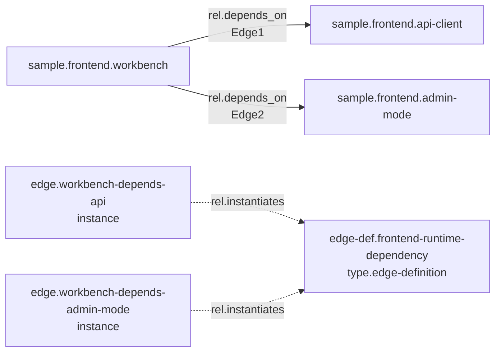

# L.W.S. Edge Definition / Instance 계획

작성일: 2026-08-02

## 1. 배경

현재 `docs/LWS_EDGE_MODEL.md`의 edge는 다음 원자 모델을 따른다.

```text
edge = source + type + target
```

edge는 단순 연결이 아니라 summary, temporal, evidence, content를 가질 수 있는 1급 relationship object이다. 따라서 최초 관계 정의는 지금처럼 하나의 edge object로 만드는 것이 자연스럽다.

다만 같은 의미의 관계가 여러 source/target 쌍에 반복되면 문제가 생긴다.

```text
A --rel.depends_on--> B
C --rel.depends_on--> D
E --rel.depends_on--> F
```

각 edge가 같은 의미 설명, evidence, content를 반복해서 가지면 semantic duplication이 생긴다. 이 계획은 최초 edge 모델은 유지하면서, 반복되는 edge 의미를 definition/group으로 승격하고 개별 edge는 instance로 최소화하는 방향을 정리한다.

## 2. 핵심 방향

```text
최초 edge는 기존 atomic edge로 만든다.
반복되는 의미가 확인되면 edge definition group으로 승격한다.
이후 같은 정의를 쓰는 edge는 source/type/target 중심의 최소 instance로 만든다.
공통 의미 설명은 edge definition group이 소유한다.
```

중요한 원칙:

- 관계 사실은 여전히 atomic edge instance가 가진다.
- 의미 설명은 edge definition group이 가진다.
- instance는 source, type, target, visibility, status, temporal, audit 같은 구조적/운영적 정보를 가진다.
- title, summary, content, evidence 같은 반복 semantic field는 definition으로 옮긴다.
- instance의 semantic field는 필요할 때만 local override로 사용한다.

## 3. 용어

### Edge Definition Group

반복되는 edge 의미를 설명하는 node-like object이다.

권장 형태:

```text
object_kind: node
type: type.edge-definition
```

소유하는 정보:

```text
title
summary
content
evidence
props.semantic_scope
props.relation_type
constraints 또는 validation hint
```

### Edge Instance

실제 source/target 사이의 관계 사실이다.

소유하는 정보:

```text
source
type
target
visibility
status
temporal
audit
props.instance_note 또는 local override
```

### Definition Link

edge instance가 어떤 definition을 쓰는지 나타내는 관계이다.

권장 relation:

```text
rel.instantiates
```

장기 목표 형태:

```text
edge.instance --rel.instantiates--> edge-definition node
```

이 방식을 쓰려면 edge endpoint가 node뿐 아니라 edge object도 참조할 수 있어야 한다. 현재 `LWS_EDGE_MODEL.md`는 source/target을 existing node id로 제한하므로, 이 계획은 backend semantic validation 확장을 필요로 한다.

## 4. 승격 전/후 예시

### 승격 전

최초 edge는 기존 방식 그대로 생성한다.

```json
{
  "object_kind": "edge",
  "id": "edge.workbench-depends-api",
  "source": "sample.frontend.workbench",
  "type": "rel.depends_on",
  "target": "sample.frontend.api-client",
  "title": "Workbench depends on API client",
  "summary": "The frontend workbench calls the LWS API client instead of touching storage directly.",
  "detail_mode": "note",
  "visibility": "public",
  "status": "active",
  "tags": [],
  "props": {},
  "temporal": {
    "occurred_at": null,
    "valid_from": null,
    "valid_to": null
  }
}
```

### Definition Group 생성

반복되는 의미가 확인되면 definition group을 만든다.

```json
{
  "object_kind": "node",
  "id": "edge-def.frontend-runtime-dependency",
  "type": "type.edge-definition",
  "title": "Frontend runtime dependency",
  "summary": "A frontend object depends on another object at runtime.",
  "detail_mode": "note",
  "visibility": "public",
  "status": "active",
  "tags": ["tag.frontend"],
  "props": {
    "relation_type": "rel.depends_on"
  }
}
```

### Definition-backed Instance

이후 같은 의미의 edge는 semantic 설명을 반복하지 않는다.

```json
{
  "object_kind": "edge",
  "id": "edge.workbench-depends-admin-mode",
  "source": "sample.frontend.workbench",
  "type": "rel.depends_on",
  "target": "sample.frontend.admin-mode",
  "title": "sample.frontend.workbench depends on sample.frontend.admin-mode",
  "detail_mode": "stub",
  "visibility": "public",
  "status": "active",
  "tags": [],
  "props": {
    "definition_id": "edge-def.frontend-runtime-dependency"
  },
  "temporal": {
    "occurred_at": null,
    "valid_from": null,
    "valid_to": null
  }
}
```

위 `props.definition_id`는 초기 호환용 표현이다. 장기적으로는 다음 relation으로 표현하는 것이 L.W.S. 철학에 더 맞다.

```text
edge.workbench-depends-admin-mode --rel.instantiates--> edge-def.frontend-runtime-dependency
```

## 5. 시각적 구조

이 계획은 구조 변환이 핵심이므로 시각적 그래프가 도움이 된다.



그래프가 필요한 이유:

- definition과 instance의 책임 경계를 한눈에 보여준다.
- relation line과 edge object 자체가 모두 다뤄진다는 점을 드러낸다.
- edge를 source로 삼는 `rel.instantiates`가 왜 endpoint model 확장을 요구하는지 보여준다.

추가적인 복잡한 시각 자료는 아직 필요하지 않다. 구현 전 단계에서는 위 구조도 하나면 충분하다.

## 6. 중복 최소화 규칙

중복을 줄이기 위한 canonical ownership:

| 정보 | 소유자 |
| --- | --- |
| source | edge instance |
| target | edge instance |
| type | edge instance, definition과 consistency 검증 |
| title | instance는 generated fallback, definition은 semantic title |
| summary | edge definition group |
| content | edge definition group |
| evidence | edge definition group |
| visibility | instance와 definition이 각각 소유 |
| temporal | edge instance |
| audit/history | 각 object가 개별 소유 |

`type`은 instance에도 유지한다. 이유는 graph traversal, graph_edges projection, permission relation, query filtering이 현재 edge.type을 강하게 사용하기 때문이다. 대신 definition의 `props.relation_type`과 instance `type`이 다르면 validation issue를 낸다.

## 7. Backend 구현 방향

### Phase 1: Definition Node와 명시적 선택

- `type.edge-definition`을 built-in 또는 materialized ontology로 추가한다.
- `rel.instantiates` relation type을 추가한다.
- create edge UI/API에서 기존 edge definition 선택을 optional로 허용한다.
- 자동 병합은 하지 않는다.
- 같은 의미 후보는 제안만 하고, 사용자가 명시적으로 선택한다.

### Phase 2: Validation 확장

- edge definition node가 존재하는지 검증한다.
- definition의 `props.relation_type`이 있으면 edge instance의 `type`과 일치하는지 검증한다.
- definition-backed edge는 `detail_mode: "stub"`와 generated title을 허용한다.
- semantic field가 instance와 definition 양쪽에 있으면 warning을 낸다.

### Phase 3: Edge Endpoint 확장

현재 edge validation은 source/target이 existing node id라고 가정한다.

장기적으로는 다음이 필요하다.

```text
source references readable object id
target references readable object id
object kind may be node or edge, depending on relation type policy
```

단, 모든 relation type이 edge endpoint를 허용하면 모델이 너무 넓어진다. `rel.instantiates`, `rel.contains`, `rel.references`, `rel.evidences`처럼 사전에 허용한 최상위 relation type부터 제한적으로 허용하는 편이 안전하다.

### Phase 3.1: Relation Type Endpoint Policy

edge endpoint 확장은 relation type 정책과 함께 설계해야 한다.

현재 `LWS_EDGE_MODEL.md`는 `type`을 relation type node id로 정의한다. 따라서 `rel.depends_on`, `rel.contains`, `rel.instantiates` 같은 relation type마다 허용 가능한 source/target object kind를 별도로 명시할 수 있어야 한다.

목표:

```text
relation type별로 source kind와 target kind를 제한한다.
edge endpoint 허용은 전역 규칙이 아니라 relation type policy로 결정한다.
validation은 edge.source, edge.target, edge.type 조합을 함께 검사한다.
```

아래 표는 확정 정책이 아니라 임시 스케치이다. 실제 구현 전에는 ontology 문서와 backend validator 기준으로 다시 확정해야 한다.

| Relation type | 임시 source policy | 임시 target policy | 비고 |
| --- | --- | --- | --- |
| `rel.depends_on` | `node` | `node` | 기본 지식 대상 간 의존성. 처음에는 edge endpoint를 열지 않는다. |
| `rel.contains` | `node` | `node \| edge` | collection/statement-set이 atomic edge를 포함할 수 있게 한다. |
| `rel.instantiates` | `edge` | `node(type.edge-definition)` | edge instance가 edge definition group을 사용한다는 뜻. |
| `rel.references` | `node \| edge` | `node \| edge` | 설명/문서/edge가 다른 object를 참조할 수 있다. |
| `rel.evidences` | `node \| edge` | `node \| edge` | 어떤 object가 다른 object의 근거가 됨을 나타낸다. |
| `rel.can_read` | `account \| group` | `node \| edge \| scope` | permission relation. source는 actor, target은 권한 대상. |
| `rel.can_update` | `account \| group` | `node \| edge \| scope` | permission relation. |
| `rel.member_of` | `account` | `group` | group membership은 edge endpoint를 허용하지 않는다. |
| `rel.owns` | `account \| group` | `node \| edge` | ownership 대상은 edge도 될 수 있다. |

정책 저장 위치 후보:

```text
1. relation type node의 props.endpoint_policy
2. backend built-in ontology registry
3. materialized core ontology node + backend fallback registry
```

예상 shape:

```json
{
  "id": "rel.instantiates",
  "type": "type.relation-type",
  "props": {
    "endpoint_policy": {
      "source": ["edge"],
      "target": ["node:type.edge-definition"]
    }
  }
}
```

검증 방향:

```text
1. edge.type으로 relation type policy를 찾는다.
2. source object kind/type이 source policy와 맞는지 확인한다.
3. target object kind/type이 target policy와 맞는지 확인한다.
4. policy가 없으면 v1 기본값인 node -> node로 fail-closed 처리한다.
5. built-in permission relation은 별도 엄격 정책을 둔다.
```

이 정책이 필요한 이유:

- edge도 1급 object이므로 edge를 설명/참조/분류할 수 있어야 한다.
- 그러나 모든 relation이 edge endpoint를 허용하면 graph 의미가 느슨해진다.
- relation type별 endpoint policy가 있어야 validation, graph query, permission projection이 같은 의미 규칙을 공유할 수 있다.

### Phase 4: Projection과 Search

- `graph_edges`는 instance edge 중심으로 유지한다.
- definition link는 별도 relation으로 projection될 수 있다.
- search에서는 instance 자체 text와 readable definition text를 합쳐 보여줄지 검토한다.
- definition이 unreadable이면 instance의 minimal source/type/target만 표시한다.

## 8. Open Questions

- `props.definition_id`를 임시 호환 경로로 허용할지, 처음부터 `rel.instantiates`만 허용할지.
- definition-backed edge에서 `title` required를 유지할지, generated title로 채울지, schema에서 optional로 완화할지.
- instance local override가 있을 때 definition summary와 UI에서 어떻게 병합할지.
- definition visibility가 private이고 instance visibility가 public일 때, public UI에서 definition 설명을 숨기고 instance만 보여줄지.
- 기존 full semantic edge를 definition으로 승격할 때 원본 edge의 summary/content/evidence를 비울지, history 보존을 위해 남겨두되 derived/legacy로 표시할지.

## 9. 권장 결론

```text
atomic edge를 기본 단위로 유지한다.
반복되는 의미는 edge-definition node로 승격한다.
개별 edge는 source/type/target 중심의 instance가 된다.
definition 연결은 장기적으로 rel.instantiates edge로 표현한다.
중복 semantic field는 definition이 소유하고, instance는 local override만 가진다.
자동 추론보다 사용자/관리자 명시 승격을 먼저 지원한다.
```
