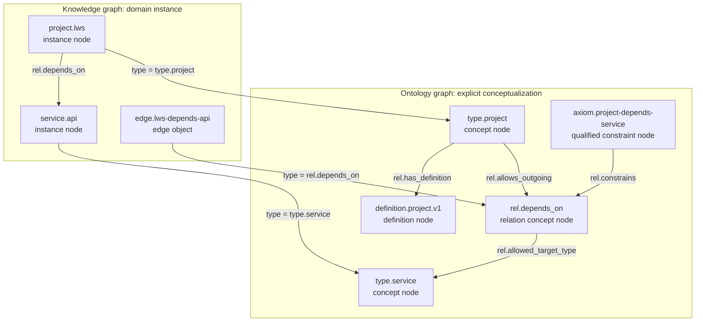

# L.W.S. Ontology System Discussion and Plan

작성일: 2026-08-04

## 1. 목적

이 문서는 L.W.S.의 ontology를 정의하고, 이후 구현을 위한 단계별 계획을 기록한다.
현재 backend 또는 frontend contract를 변경하는 문서가 아니라, 구현 확장 전에 합의해야 할 design record다.

작업 정의:

```text
L.W.S. ontology는 domain object와 그 relationship을 설명하기 위해 사용하는
conceptualization의 explicit, computer-processable specification이다.
```

Knowledge graph는 전체 지식 공간이고, ontology는 그 graph 내부에서 node와 edge에 공유된 의미를 부여하는 semantic model이다.
따라서 ontology는 별도 graph database도, knowledge graph 전체도, 단순 graph visualization도 아니다.

```text
Knowledge graph = domain instance + factual relationship + ontology concept 및 axiom
Ontology       = 나머지 graph를 해석하게 하는 concept, definition, relationship meaning, constraint
```

## 2. Visual model 필요성

이 계획에는 visual model이 필요하다.
가장 큰 설계 위험은 domain instance와 그것을 설명하는 ontology를 혼동하는 것이기 때문이다.
아래 graph는 L.W.S.의 단일 node/edge storage model을 유지하면서 두 meta-level을 보여 준다.



현재 core vocabulary 밖의 ID는 예시일 뿐이며, 구현 전에 Phase 0에서 확정해야 한다.

## 3. 현재 L.W.S.와 ontology 목표의 비교

현재 L.W.S.에도 이미 rule이 있다.
JSON schema, built-in ID, semantic reference validation은 structural schema와 controlled reference의 기반이다.
다만 domain conceptualization을 explicit하게 명세하지는 않는다.

| 관심사 | 현재 L.W.S. | ontology 목표 |
| --- | --- | --- |
| Object 형식 | JSON이 `id`, `object_kind`, `type`, `tags`, `props`, revision, audit을 제한한다. | JSON schema는 유지하고, type·property·relationship의 의미를 선언한다. |
| Type | built-in type ID 또는 임의의 existing node ID를 참조한다. | definition, lifecycle, 선택적 parent concept, usage rule을 가진 concept다. |
| Relation | built-in relation ID 또는 임의의 existing node ID를 참조한다. | definition, direction, domain/range guidance, lifecycle을 가진 predicate다. |
| Tag | `tag.*` virtual ID, scope ID 또는 existing node를 허용한다. | definition, alias, lifecycle, usage를 가진 first-class classification concept다. |
| Definition | title/content는 존재할 수 있으나 definition model을 요구하지 않는다. | 해당 term에 연결되는 citable, revisioned node다. |
| Constraint | structural/reference check와 public boundary validation이 있다. | explicit semantic assertion이 이해 가능한 warning과 선택적 error를 만든다. |
| Impact | concept usage/impact view가 없다. | usage, validation impact, deprecation, replacement guidance를 보여 준다. |

```text
JSON schema: "type은 허용된 ID를 참조해야 하는 string이다."
Ontology:   "type.project는 정의된 concept이며, 어떤 instance/property/relation이
             유의미한지와 변경 시 영향이 무엇인지 알 수 있다."
```

## 4. Node-first ontology model

tag와 definition은 node이며, type과 relation concept도 node다.
이 방식은 별도 metadata store 없이 ontology에도 일반 L.W.S. ID, revision, history, permission, evidence, graph navigation을 제공한다.

| Term kind | 예시 ID | 역할 |
| --- | --- | --- |
| Node type | `type.project` | domain instance의 class를 정의한다. |
| Relation type | `rel.depends_on` | edge predicate를 정의한다. |
| Tag | `tag.frontend` | 횡단 classification을 정의한다. |
| Definition | `definition.project.v1` | versioned, citable definition을 기술한다. |
| Axiom/constraint | `axiom.project-depends-service` | 단순 edge만으로 부족한 qualified rule을 표현한다. |

Term node는 `title`, `content`, `audit`, `visibility`, `status`, `tags`, history 같은 일반 field를 그대로 사용한다.
term 전용 metadata는 top-level schema를 무제한 확장하지 않고 versioned `props` convention으로 둔다.

L.W.S.의 "모든 것은 node이다"라는 철학은 ontology를 별도 metadata 계층으로 분리하지 않는 근거다.
더 정확히는 독립적인 의미, 재사용, definition, evidence, permission, history, 또는 graph relationship이 필요한 대상을 first-class node/edge object로 다룬다는 원칙이다.
Type, Tag, Relation, Definition, Axiom은 이 원칙을 적용할 대상이다.
반대로 단순 literal인 `title`, 날짜, boolean, 작은 값 하나하나는 독립 node로 만들지 않고 일반 property로 유지한다.
이 구분이 node-first model이 과도하게 세분화되는 것을 막는다.

단순 semantic assertion은 이미 first-class이며 revision되는 edge로 표현한다.

```text
type.project --rel.subclass_of--> type.work_item
type.project --rel.has_definition--> definition.project.v1
rel.depends_on --rel.allowed_target_type--> type.service
```

severity, cardinality, exception, rationale, evidence, validity period, migration guidance 같은 qualifier가 필요한 경우에만 axiom node를 사용한다.

```text
Type:       instance의 primary identity이며 더 강한 validation boundary다.
Tag:        many-to-many 방식의 느슨한 classification 및 navigation facet이다.
Relation:   node 사이의 directed predicate다.
Definition: term 또는 axiom을 설명하는 versioned statement다.
```

### 4.1 Semantic role의 해석

위 구분은 같은 node/edge storage model을 사용하더라도 ontology의 역할을 섞지 않기 위한 원칙이다.
아래 설명은 향후 model의 의도이며, 현재 구현이 이미 모든 rule을 강제한다는 뜻은 아니다.

#### Type — "이 instance는 무엇인가?"

Type은 instance의 주된 정체성이다.

```text
project.lws의 Type = type.project
service.api의 Type = type.service
```

`validation boundary`는 `type.project`에만 적용되는 semantic rule의 기준점이라는 뜻이다.
예를 들어 project에 expected property를 두거나, `rel.depends_on`의 source가 될 수 있는 Type을 정의할 수 있다.
Type은 하나의 instance에 적용되는 강한 semantic rule의 출발점이다.

#### Tag — "어떤 관점에서 함께 찾을 것인가?"

Tag는 여러 instance를 횡단하는 느슨한 classification이다.

```text
project.lws의 Tag = tag.frontend, tag.important
service.api의 Tag = tag.frontend
```

두 instance는 같은 `tag.frontend`를 가질 수 있지만, 하나는 project이고 다른 하나는 service다.
따라서 Tag는 instance의 본질적 종류를 정하기보다 navigation, filtering, grouping을 위한 many-to-many facet이다.
Tag도 ontology node이지만 Type과 같은 강도의 validation rule을 자동으로 뜻하지는 않는다.

#### Relation — "두 node는 어떤 관계인가?"

Relation은 edge가 사용하는 관계 concept 또는 predicate다.

```text
project.lws --rel.depends_on--> service.api
```

여기서 `edge.lws-depends-api`는 실제 관계를 기록하는 edge object이고, `rel.depends_on`은 그 edge가 참조하는 Relation이다.
Relation이 `directed`라는 것은 `A depends_on B`가 일반적으로 `B depends_on A`와 같지 않다는 뜻이다.
반대 의미가 필요하면 `rel.required_by` 같은 별도 Relation을 정의하거나, future ontology rule에서 inverse relation을 선언한다.

#### Definition — "이 term 또는 axiom은 무엇을 뜻하는가?"

Definition은 Type, Tag, Relation, Axiom의 의미를 설명하는 citable statement node다.

```text
definition.depends-on.v1
  -> "source가 target 없이는 목적을 달성하기 어려운 관계"
```

Definition이 `versioned`라는 것은 그 설명이 바뀌어도 단순 덮어쓰기가 아니라 revision/history로 보존된다는 뜻이다.
따라서 operator는 relation 또는 Type의 의미가 언제 왜 변경됐는지 추적할 수 있다.

#### Axiom — "어떤 semantic rule이 성립하는가?"

Axiom은 ontology가 주장하는 rule 또는 constraint다.

```text
rel.depends_on의 source는 type.project 또는 type.service여야 한다.
rel.depends_on의 target은 type.service 또는 type.document여야 한다.
```

단순한 axiom은 edge assertion으로 표현하고, severity, exception, rationale, evidence, cardinality, validity period 같은 qualifier가 필요하면 Axiom node로 reify한다.
초기에는 Axiom을 advisory warning으로 적용하고, migration과 impact 검토가 가능한 경우에만 blocking validation으로 승격한다.

### 4.2 기존 L.W.S. ontology materialization 원칙

Ontology 구현은 신규 term 생성뿐 아니라, 기존 L.W.S. knowledge를 ontology-aware graph로 materialize하는 작업을 포함한다.
현재 object의 `type`, `tags`, edge `type`, `props`, history를 버리거나 별도 store로 복사하지 않는다.
기존 source object와 mutation/history model을 유지한 채, ontology term과 assertion을 first-class object로 추가하고 projection을 재생성한다.

```text
기존 source object
  type.project / tag.frontend / rel.depends_on 참조
        │
        ├─ materialize → Type, Tag, Relation, Definition, Axiom node/edge
        ├─ validate    → term role, reference, advisory semantic rule 확인
        └─ reindex     → usage, assertion, graph projection 재생성
```

Materialization의 안전 원칙:

- 기존 instance node/edge를 자동으로 rename, retype, delete, 또는 mass rewrite하지 않는다.
- 기존 `materialize-core-ontology`와 같이 idempotent해야 하며, 새 node/edge mutation은 정상 event/history를 남긴다.
- string prefix만으로 domain 의미를 임의 추론하지 않는다. 불명확한 Type/Tag/Relation은 migration candidate 또는 advisory issue로 남긴다.
- `tag.*` virtual ID도 inventory에 포함한다. definition, lifecycle, usage, permission이 필요한 tag는 materialized Tag node로 승격한다.
- 실행 전후 dry-run inventory와 impact report를 제공하고, 실행 후 reindex와 validation을 수행한다.
- generated index/projection은 재생성 가능해야 하며 ontology source of truth는 durable node/edge와 history다.

권장 materialization 순서:

```text
1. Inventory: existing type/tag/relation ID, 사용 수, visibility, unresolved reference를 수집한다.
2. Core: current built-in vocabulary와 ontology meta-model term을 materialize한다.
3. Definition: core term의 definition 및 기본 assertion을 node/edge로 기록한다.
4. Domain mapping: 승인된 기존 domain term을 materialize하고 instance usage에 연결한다.
5. Validation: 새 semantic rule을 advisory mode로 실행하여 impact를 확인한다.
6. Reindex: ontology/usage/assertion projection을 재생성하고 결과를 검증한다.
7. Governance: curator가 unresolved candidate, deprecation, replacement를 결정한다.
```

## 5. Scope와 governance

Ontology는 전역적으로 탐색할 수 있지만 permission-aware해야 한다.
여기서 global은 visible L.W.S. graph 전체가 공유하는 semantic vocabulary를 뜻하며, visibility나 permission을 우회하지 않는다.

```text
Core ontology:   L.W.S. 자체에 필요한 안정적인 term이며 scope.ontology/system에서 관리한다.
Domain ontology: knowledge domain의 term이며 authorized explicit scope에서 curator가 관리한다.
Term application: 일반 author는 ontology-manage 권한 없이 visible approved term을 선택해 사용할 수 있다.
```

Term lifecycle은 `draft`, `active`, `deprecated`, `retired`를 명시적으로 가져야 한다.
deprecation은 가능한 경우 replacement term을 기록하며 existing instance를 자동으로 다시 쓰지 않는다.

## 6. 단계별 계획

### Phase 0 — ontology contract

구현 전에 다음을 결정한다.

1. ontology term, definition, qualified axiom node의 canonical ID와 node type
2. definition, hierarchy, domain/range, replacement, constraint assertion의 canonical relation
3. advisory rule과 mutation을 차단할 rule의 구분
4. 초기 domain ontology를 global-only로 둘지, scope-owned까지 허용할지
5. definition revision, deprecation, migration guidance의 표현 방식

Exit criterion: 작은 실제 domain ontology를 모호한 free-text convention 없이 작성할 수 있다.

### Phase 1 — meta-model과 core ontology

- 확정된 term/relation ID로 core ontology를 확장한다.
- 기존 materialization path를 이용해 term을 durable node/edge로 materialize한다.
- existing type/tag/relation reference를 inventory하고, virtual tag와 unresolved term을 포함한 dry-run impact report를 만든다.
- versioned `props` metadata를 정의하고 term의 ontology role을 validation한다.
- migration 중에는 현재 virtual built-in ID와의 compatibility를 보존한다.

Exit criterion: type, tag, relation term을 prefix 또는 arbitrary node existence가 아니라 semantic role로 식별한다.

### Phase 2 — projection, query, validation

- permission-aware term detail, definition, constraint, usage count, usage list를 제공한다.
- ontology assertion과 term usage를 generated projection으로 index하되 source of truth로 취급하지 않는다.
- source/target type과 expected property를 우선 warning으로 validation한다.
- 모든 semantic issue가 governing term 또는 axiom으로 연결되게 한다.
- materialization 전후의 usage, unresolved candidate, validation 결과를 비교 가능하게 한다.

Phase 0 이후 검토할 API surface:

```text
GET /api/lws/ontology
GET /api/lws/ontology/terms/:id
GET /api/lws/ontology/terms/:id/usage
GET /api/lws/ontology/terms/:id/constraints
```

Exit criterion: author가 object가 semantic하게 의심스러운 이유를 확인하고 governing term을 열 수 있으며, private usage metadata는 노출되지 않는다.

### Phase 3 — frontend exploration과 editing guidance

- broad ontology mutation 이전에 readonly `/ontology` explorer를 구현한다.
- category, definition, lifecycle, related term, constraint, usage를 보여 준다.
- static editor suggestion을 visible approved term으로 교체한다.
- type, tag, source, target, relation input에 non-blocking guidance를 제공한다.
- keyboard-accessible list/detail navigation을 제공하며 canvas는 보조 수단으로만 둔다.

Exit criterion: operator가 term을 이해하고 영향 범위를 확인하며 더 나은 editing decision을 내릴 수 있다.

### Phase 4 — governed mutation과 migration

- curator 전용 create/edit/deprecate/replace flow에 explicit save와 history를 연결한다.
- strict constraint를 활성화하기 전에 dry-run impact report를 제공한다.
- domain object를 조용히 invalid 처리하거나 mass rewrite하지 않는다.

### Phase 5 — deferred reasoning

일반적인 OWL/RDF reasoning은 defer한다.
subclass closure, inverse relation inference, rule execution의 실제 수요가 확인된 뒤 재검토한다.
초기 L.W.S.는 declared rule, transparent validation, inspectable result를 우선한다.

## 7. Frontend 관계와 검증

F3는 장차 readonly ontology usage view를 제공하지만, 이는 위 contract와 read model에 의존한다.

```text
Slice A — term read: materialized term -> definition -> usage list -> open object
Slice B — editing guidance: approved term selection과 advisory validation
Slice C — curated mutation: term change/deprecate -> impact 확인 -> history 보존
```

검증 항목:

- term-role validation이 ontology term으로 쓰인 arbitrary node를 거부한다.
- usage query가 permission-safe하다.
- materialization/reindex가 term과 assertion projection을 보존한다.
- ontology mutation이 일반 event/history record를 생성한다.
- UI가 keyboard navigation, refresh/failure survival, semantic issue link를 지원한다.

## 8. 위험, non-goal, open decision

피해야 할 위험은 arbitrary JSON `props`를 semantic definition으로 간주하는 것, any existing node를 term으로 허용하는 것, classification/migration 이전에 rule을 강제하는 것, private usage count를 노출하는 것, canvas를 유일한 UI로 만드는 것, 모든 단순 assertion을 node로 reify하는 것이다.

초기 non-goal은 general semantic-web exchange format, universal reasoning, automatic mutation/inference, automatic mass migration, public ontology management다.

Open decision:

1. definition과 axiom을 초기부터 first-class node type으로 둘지, definition content를 우선 term node에 둘지
2. 첫 reference ontology에 사용할 실제 domain은 무엇인지
3. Phase 1에서 scope-owned domain ontology를 허용할지, global core ontology만 둘지
4. v1에서 mutation을 차단할 semantic rule과 advisory로 남길 rule은 무엇인지
